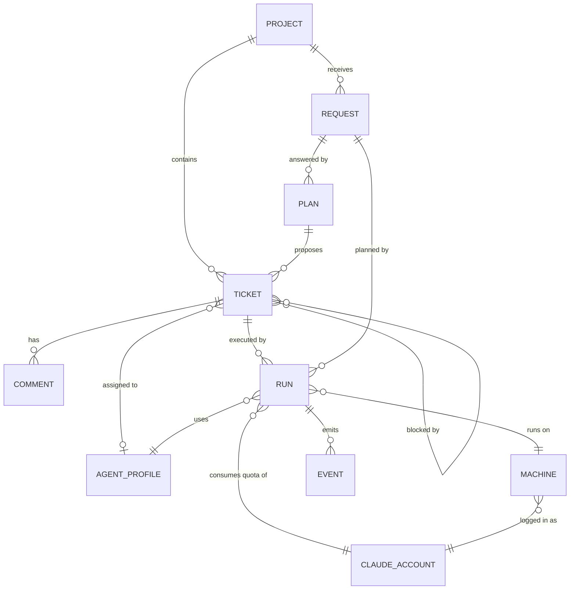

# 01 — Domain Model and Glossary

> Status: Draft v0.1
> Related: [00 — Vision and Scope](00-vision-and-scope.md), [04 — Ticket Lifecycle](04-ticket-lifecycle.md)

This document defines the concepts of the system, their fields and their relationships. It is the reference for the database schema, the API and the MCP tools. Field lists describe meaning, not final column types.

## 1. Glossary

| Term | Definition |
|---|---|
| **Owner** | The single human user of the system in v1. |
| **Project** | A piece of software being built, linked to exactly one GitHub repository. |
| **Request** | A message from the owner to the Project Manager agent describing what they want. |
| **Plan** | A proposal from the Project Manager in answer to a request: a set of tickets (and possibly a new project) waiting for the owner's approval. |
| **Ticket** | A unit of work small enough for one agent to complete in one run, delivered as one pull request. |
| **Agent profile** | The definition of an agent: role, instructions, model, allowed tools and MCP permissions. |
| **Run** | One execution of one agent profile on one ticket (or one request, for planning), on one machine, under one Claude account. |
| **Machine** | A computer running the daemon and Claude Code. |
| **Claude account** | A Claude subscription used by one or more machines. Quota belongs to the account, not the machine. |
| **Capability** | A tag declared by a machine describing what it can do (for example `android-sdk`). |
| **Harness** | The documentation, tests, CI and technical decision records that every project must have. |
| **Definition of Done (DoD)** | The checks a ticket must pass before moving to review and to done. |
| **ADR** | Architecture Decision Record: a short document in the repository recording a technical decision. |

## 2. Entity overview

## 3. Entities

### 3.1 Project

| Field | Description |
|---|---|
| id | Identifier. |
| key | 2 to 6 uppercase letters (`WEB`), chosen by the owner at creation. Unique among all projects, archived ones included. Immutable. Prefix of ticket numbers (`WEB-12`). |
| name, slug | Display name and URL-safe name. For a new repository, the slug is the repository name. |
| description | Short description. |
| kind | `web_app`, `website`, `android_app`. Drives the default stack and the default agents involved. |
| repo_owner, repo_name | GitHub repository, on the owner's personal account. |
| repo_origin | `created`: the Orchestrator created the repository and applied the skeleton (08, section 3.1). `linked`: an existing repository of the owner's account; the skeleton is not applied (08, section 3.4). |
| repo_private | Whether the repository is private. A new repository is private unless the owner chooses public at creation. For a linked repository, as read from GitHub. |
| default_branch | Read from GitHub; usually `main`. |
| setup_status | `in_progress`, `ready`, `failed` (with the reason). Only `ready` projects accept tickets. See 08, section 3. |
| branch_protection | `applied`, `not_available` (GitHub plan does not allow it), `failed`, `not_applied` (linked repositories). |
| missing_harness | For a linked repository: the harness elements not found at the last check (08, section 3.4), with the check time. |
| status | `active`, `archived`. |
| required_capabilities | Capabilities every run on this project needs (for example `android-sdk` for Android projects). |
| created_at, updated_at | Timestamps. |

A project is always linked to a repository. A project cannot exist without one.

Projects are never deleted. Archiving a project hides it from the default lists and stops new work on it (no new tickets, no runs); its tickets and history are kept. Archiving never changes the GitHub repository.

### 3.2 Request

| Field | Description |
|---|---|
| id | Identifier. |
| project_id | Optional. Empty when the request asks for a new project. |
| body | The owner's text. |
| status | `open`, `planning`, `plan_proposed`, `closed`. |
| created_at | Timestamp. |

The owner and the Project Manager can exchange messages on a request before a plan is produced (clarifying questions). These messages are stored as comments on the request.

### 3.3 Plan

| Field | Description |
|---|---|
| id | Identifier. |
| request_id | The request it answers. |
| summary | What the Project Manager proposes, in prose. |
| new_project | Optional project definition when the plan creates a project. |
| status | `proposed`, `approved`, `rejected`, `superseded`. |
| owner_feedback | Text given by the owner when rejecting. |
| decided_at | Timestamp of approval or rejection. |

Tickets proposed by a plan exist in the `proposed` state. Tickets an agent creates with `ticket.create` outside a plan are also `proposed`, with no plan: the owner accepts or rejects each one (04, section 2; owner's decision, lot 2 step A). Approving the plan creates the project (if any) and moves its tickets to `todo`. Rejecting it with feedback sends the request back to the Project Manager, who produces a new plan; the old one becomes `superseded`.

Limit: a plan contains at most 15 tickets by default (configurable, see 04 section 8). Larger work is split into several plans.

### 3.4 Ticket

| Field | Description |
|---|---|
| id, number | Identifier and human number per project: the project key and a sequence starting at 1 (`WEB-12`). Numbers are never reused. |
| project_id | Owning project. |
| plan_id | Plan that created it, if any. Empty for a ticket created by the owner or by an agent with `ticket.create`. |
| parent_id | Optional parent ticket, used to group work (epic). A parent ticket has no run of its own. |
| type | `feature`, `bug`, `chore`, `docs`, `spike`. See 04 for DoD per type. |
| title | Short title. |
| description | What must be done and why. |
| acceptance_criteria | Ordered list of verifiable statements. |
| assignee_profile_id | Agent profile expected to do the work. Optional; set by the owner or by the agent that created the ticket. Any existing profile can be assigned until the assignment rules of 03, section 4 arrive (lot 6). |
| status | See 04. |
| priority | `low`, `normal`, `high`. |
| blocked_by | List of tickets that must be `done` before this one can start. |
| branch_name | Set at first run: `t/<number>-<slug>`. Until pushing exists (lot 3), the branch lives only in the machine's bare clone; the daemon reports its head and the commits ahead of the base branch (hash and subject) at the end of each run, and the ticket page shows them with the machine's name. |
| pr_number | Pull request on GitHub, once opened. |
| attempt_count | Number of failed runs, used by the retry policy. A run stopped by the owner, a run failed with `machine_offline` and a run cancelled because the machine did not acknowledge it are never counted (owner's decision, lot 2 step A). |
| dod_report | Latest Definition of Done report submitted by the agent (see 04). |
| created_by | `owner`, or the agent profile and the run that created it (shown as "created by agent"). |
| created_at, updated_at | Timestamps. |

**Derived states** (computed, not stored):

- **Blocked**: at least one ticket in `blocked_by` is not `done`. It matters, and the UI shows it, only while the ticket is `proposed` or `todo`: work has not started and its dependencies can still change (owner's decision, lot 1 step F; 04, section 1).
- **Eligible**: status is `todo`, an assignee is set, not blocked, and a compatible machine exists.

`blocked_by` only names tickets of the same project, never the ticket itself, and never forms a cycle. Tickets are never deleted: a ticket created by mistake is cancelled (04, section 2).

### 3.5 Comment

| Field | Description |
|---|---|
| id | Identifier. |
| target | Ticket or request. |
| author | `owner`, `system`, or an agent profile (with the run id). |
| kind | `note`, `question`, `answer`, `review`, `status_change`. |
| body | Markdown text (see below). |
| answers_comment_id | For `answer`, the question it answers. |
| created_at | Timestamp. |

A `question` from an agent puts the ticket in `waiting_human` until the owner posts an `answer`.

**Markdown from the owner or agents** (ticket descriptions and acceptance criteria, comments, requests, plans) is untrusted: it is rendered sanitized. Raw HTML is not rendered, links can only use `http`, `https` and `mailto`, and nothing in it can run a script (09, section 5).

### 3.6 Agent profile

| Field | Description |
|---|---|
| id, key | Identifier and stable key (`pm`, `architect`, `web_dev`, `android_dev`, `quality`, `writer`, or custom). |
| name, description | Display information. |
| role | `planner`, `builder`, `reviewer`, `writer`. Drives the default MCP permissions. |
| instructions | Role instructions injected into Claude Code at the start of a run. Default profiles are shipped as files in `agents/` (03, section 6). |
| model | Claude model to use. Default: Sonnet. |
| allowed_tools | Claude Code tool allowlist applied to the run. |
| mcp_permissions | Set of MCP tools this agent may call (see 06). |
| required_capabilities | Capabilities needed on the machine. |
| is_default | True for the six built-in profiles. Defaults can be edited and reset. |
| version | Incremented on each change. Each run records the version it used. Until profiles can be edited (lot 6), the version of a default profile goes up when the server starts with a changed shipped file. |

### 3.7 Run

| Field | Description |
|---|---|
| id | Identifier. |
| ticket_id | Ticket being worked on. Empty for planning runs. |
| request_id | Request being planned (planning runs only). |
| profile_id, profile_version | Agent used and its version. |
| purpose | `implement`, `review`, `plan`, `document`, `fix_review`. |
| machine_id | Machine executing it. |
| account_id | Claude account whose quota it consumes. |
| status | `queued`, `dispatched`, `starting`, `running`, `waiting_human`, `paused_quota`, `succeeded`, `failed`, `cancelled`. How the daemon's states map to these is in 05, section 4.7. |
| pause_reason | For `paused_quota`: `usage_limit` (a limit detected with certainty, the account becomes `limited`) or `suspected_usage_limit` (an API error the daemon cannot identify; the account is not changed and the run can be resumed at once). See 05, section 4.10. |
| tmux_session | Name of the tmux session on the machine. |
| claude_session_id | Claude Code session, used to resume after a pause. |
| worktree_path | Git worktree used by the run. |
| started_at, ended_at | Timestamps. |
| outcome | Summary written by the agent at the end. |
| branch_head, commits | Reported by the daemon at the end of the run: the ticket branch's head and the commits ahead of the base branch (hash, subject). |
| estimated_usage | Equivalent cost of the run in US dollars, as estimated by Claude Code (05, section 4.5). Informational. |
| failure_reason | `timeout`, `crash`, `agent_gave_up`, `dod_failed`, `machine_offline`, `cancelled`. A usage limit is never a failure (`paused_quota`). `cancelled` covers a run stopped by the owner, a cancelled ticket and a dispatch not acknowledged in time; like `machine_offline`, it never counts as a failed attempt. |

A run in `paused_quota` keeps its session and worktree. It resumes on the same machine when the account becomes available again.

### 3.8 Machine

| Field | Description |
|---|---|
| id, name | Identifier and display name. |
| os | `linux` or `wsl`. |
| account_id | Claude account the machine's Claude Code is logged into. |
| capabilities | Tags (`node`, `android-sdk`, `docker`, …). The daemon reports those it detects (`git`, `node`, `docker`); the owner can add or remove tags. |
| daemon_version, claude_code_version | Reported at connection. A Claude Code version below the supported minimum makes the machine unusable; a version above the highest validated one is accepted with a warning (05, section 2). |
| status | `online`, `offline`, `disabled`. |
| last_heartbeat_at | Timestamp. |
| enrollment_token_hash | Hash of the token used by the daemon. Revocable. |

### 3.9 Claude account

| Field | Description |
|---|---|
| id, label | Identifier and display name. |
| plan | `pro`, `max_5x`, `max_20x`. Informational in v1. |
| max_concurrent_runs | Default 1. |
| schedule | Time windows during which runs may start (for example weekdays 00:00–08:00). Empty means always. |
| state | `available`, `paused_manual`, `limited`. Only a usage limit detected with certainty makes an account `limited`, never a suspected one (05, section 4.10). `paused_manual` comes with lot 4. |
| limited_until | When `limited`, the expected reset time, if known. |

### 3.10 Event

Append-only log of everything that happens: status changes, MCP calls, run lifecycle, scheduler decisions. Used for the activity feed, debugging and audit. Fields: id, timestamp, actor, entity type and id, project, event type, payload. The project is the one the event concerns (the project itself, one of its tickets, one of its setting overrides), so the event log can be filtered by project; events about no project (owner, sessions, GitHub connection, global settings) have none (lot 1 step H). A payload holds facts, never a secret.

### 3.11 Owner

The single human user (v1). Created by the setup wizard (02, section 3); at most one exists.

| Field | Description |
|---|---|
| username | Used to log in. |
| password_hash | Argon2 hash (09, section 5). The password has at least 12 characters. |
| created_at | Timestamp. |
| sessions | Active login sessions: id, token hash, created_at, expires_at. Revocable from Settings (02, section 10). |

There is no email address. A forgotten password is reset with a command run inside the server container (09, section 7.4).

## 4. Where things live

| Information | Location |
|---|---|
| Owner, projects, tickets, plans, comments, runs, machines, accounts, profiles, events, setting values | PostgreSQL (web application). |
| Code, tests, ADRs, project documentation | The project's GitHub repository. |
| Run transcripts | On the machine; streamed to the web application and kept there in summarised form. |
| Claude credentials | On the machine only. Never sent to the web application. |
| GitHub token | Web application. For one Git command (fetch, and from lot 3 push), the daemon receives it, keeps it in memory only for that command and passes it through a credential helper given on that command's line; it is never written to disk, to a Git configuration or to a remote URL, and never reaches the agent (05, section 7). A fine-grained token cannot be limited to one repository per run. |

## 5. Invariants

1. A project always has a repository, on the owner's personal GitHub account.
2. A ticket has at most one active run (`queued` to `waiting_human`) at any time.
3. A Claude account never has more active runs than `max_concurrent_runs`.
4. A run's machine must have every capability required by the project and by the agent profile.
5. Ticket status changes happen only through the transitions defined in 04.
6. Every change of state is recorded as an event.
7. Projects and tickets are never deleted: projects are archived, tickets cancelled.
