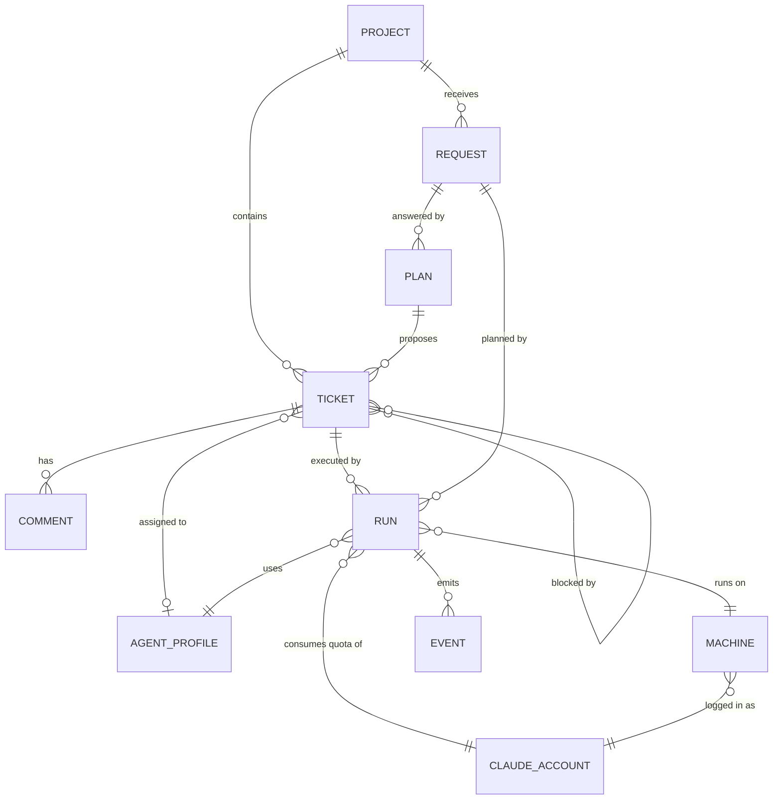

# 01 — Domain Model and Glossary

> Status: Draft v0.1
> Related: [00 — Vision and Scope](00-vision-and-scope.md), [04 — Ticket Lifecycle](04-ticket-lifecycle.md)

This document defines the concepts of the system, their fields and their relationships. It is the reference for the database schema, the API and the MCP tools. Field lists describe meaning, not final column types.

## 1. Glossary

| Term | Definition |
|---|---|
| **Owner** | The single human user of the system in v1. |
| **Project** | A piece of software being built, linked to exactly one GitHub repository. |
| **Request** | A message from the owner to the Project Manager agent describing what they want. |
| **Plan** | A proposal from the Project Manager in answer to a request: a set of tickets (and possibly a new project) waiting for the owner's approval. |
| **Ticket** | A unit of work small enough for one agent to complete in one run, delivered as one pull request. |
| **Agent profile** | The definition of an agent: role, instructions, model, allowed tools and MCP permissions. |
| **Run** | One execution of one agent profile on one ticket (or one request, for planning), on one machine, under one Claude account. |
| **Machine** | A computer running the daemon and Claude Code. |
| **Claude account** | A Claude subscription used by one or more machines. Quota belongs to the account, not the machine. |
| **Capability** | A tag declared by a machine describing what it can do (for example `android-sdk`). |
| **Harness** | The documentation, tests, CI and technical decision records that every project must have. |
| **Definition of Done (DoD)** | The checks a ticket must pass before moving to review and to done. |
| **ADR** | Architecture Decision Record: a short document in the repository recording a technical decision. |

## 2. Entity overview

## 3. Entities

### 3.1 Project

| Field | Description |
|---|---|
| id | Identifier. |
| key | 2 to 6 uppercase letters (`WEB`), chosen by the owner at creation. Unique among all projects, archived ones included. Immutable. Prefix of ticket numbers (`WEB-12`). |
| name, slug | Display name and URL-safe name. For a new repository, the slug is the repository name. |
| description | Short description. |
| kind | `web_app`, `website`, `android_app`. Drives the default stack and the default agents involved. |
| repo_owner, repo_name | GitHub repository, on the owner's personal account. |
| repo_origin | `created`: the Orchestrator created the repository and applied the skeleton (08, section 3.1). `linked`: an existing repository of the owner's account; the skeleton is not applied (08, section 3.4). |
| repo_private | Whether the repository is private. A new repository is private unless the owner chooses public at creation. For a linked repository, as read from GitHub. |
| default_branch | Read from GitHub; usually `main`. |
| setup_status | `in_progress`, `ready`, `failed` (with the reason). Only `ready` projects accept tickets. See 08, section 3. |
| branch_protection | `applied`, `not_available` (GitHub plan does not allow it), `failed`, `not_applied` (linked repositories). |
| missing_harness | For a linked repository: the harness elements not found at the last check (08, section 3.4), with the check time. |
| status | `active`, `archived`. |
| required_capabilities | Capabilities every run on this project needs (for example `android-sdk` for Android projects). From lot 5 (owner's answer 5, lot 5 step A), a `website` or `web_app` project created from version 0.6.0, from the Projects screen or a plan's approval, requires `browser-tests` by default, so its end-to-end tests run on the machine; the owner can remove it in project settings. Projects created before are unchanged. A planning run needs none of the project's capabilities (07, section 4). |
| reviews_automatic | **Start reviews by themselves** (lot 4; owner's answer 1, lot 4 step A): when on (the default), the scheduler starts a `review` run when a ticket enters `in_review` with a pull request; when off, only the owner's **Start review** does (07, section 1). Each change writes an event. |
| merges_automatic | **Merge automatically** (lot 5 step 5bis B): off by default, also for projects created before. When on, a ticket's pull request is merged by the server once Quality approved it and CI passed on the approved commit (04, section 4, "Automatic merge"). A project field like `reviews_automatic`, not a setting: settings are whole-number limits with a global value (04, section 8). Each change writes `project.merges_automatic_changed` (before and after). |
| created_at, updated_at | Timestamps. |

A project is always linked to a repository. A project cannot exist without one.

Projects are never deleted. Archiving a project hides it from the default lists and stops new work on it (no new tickets, no runs); its tickets and history are kept. Archiving never changes the GitHub repository.

### 3.2 Request

| Field | Description |
|---|---|
| id, number | Identifier, and a human number: one sequence for every request from 1, "Request 7" (owner's answer 6, lot 5 step D). |
| project_id | Optional. Empty when the request asks for a new project. Any project not archived, whatever its setup state (owner's answer 9, lot 5 step D). |
| body | The owner's text, at most **Longest ticket description** (owner's answer 7, lot 5 step D); screens show its first line, cut at 120 characters, as its title (answer 8). It is not edited once submitted: the owner adds comments. |
| status | `open`, `planning`, `plan_proposed`, `closed`. |
| attempt_count, stopped | From lot 5: the request's failed planning runs, and its stop at **Failed attempts before asking you** (below). |
| created_at | Timestamp. |

The owner and the Project Manager can exchange messages on a request before a plan is produced (clarifying questions). These messages are stored as comments on the request.

**As decided for lot 5** (owner's answers 10 and 11, lot 5 step A):

- A question (`request.ask`) works as a ticket's question (04, section 6): a "Needs you" item and the same answer box, the answer delivered live or by resume within **Waiting run lifetime**. The request stays `planning` and shows its open question.
- **A planning run and its request** (owner's answers, lot 5 step D2a): a run of purpose `plan` has its request (`runs.request_id`), no ticket and no branch (`branch_name` empty), any other run a ticket and a branch, a database check; at most one active planning run per request. The request is `planning` while it runs; every end of it without a plan (a crash, a timeout, **Stop run**, an answer that could not reach it) puts the request back to `open`. Until step E2 that end is not counted: E2 adds `attempt_count`, the stop and "Planning stopped".
- A planning run that fails (a crash, a timeout, `ticket_give_up`, its reminders used up without a plan) counts as a failed attempt of its request (`attempt_count`); a run stopped by the owner or failed because of its machine does not, as for tickets (section 3.4). At **Failed attempts before asking you** the request is **stopped** (with its cause and when): no planning run starts for it until the owner's **Try again**, which clears it and resets the count ("Planning stopped" in "Needs you").

### 3.3 Plan

| Field | Description |
|---|---|
| id | Identifier. |
| request_id | The request it answers. |
| summary | What the Project Manager proposes, in prose. |
| new_project | Optional project definition when the plan creates a project. |
| tickets | From lot 5: the plan's tickets as `plan.propose` gave them once checked (06, section 4.4), each with its local key, until approval creates them (below). |
| status | `proposed`, `approved`, `rejected`, `superseded`. |
| owner_feedback | Text given by the owner when rejecting. |
| decided_at | Timestamp of approval or rejection. |

A plan's tickets are kept on the plan, not as tickets of the project, until the owner approves it (owner's answer 9, lot 5 step E1). Tickets an agent creates with `ticket.create` outside a plan are also `proposed`, with no plan: the owner accepts or rejects each one (04, section 2; owner's decision, lot 2 step A). Approving the plan creates the project (if any) and then its tickets, in `todo`. Rejecting it with feedback sends the request back to the Project Manager, who produces a new plan; the old one becomes `superseded`.

Limit: a plan contains at most 15 tickets by default (configurable, see 04 section 8). Larger work is split into several plans.

**As decided for lot 5** (owner's answers 8, 9 and 12, lot 5 step A):

- **new_project** holds the Project Manager's name, kind and description. At approval the owner confirms or changes the name, the key (suggested from the name), the repository name (the name's slug, checked free on the owner's account) and the visibility (private by default); **Approve** then creates the project with a new repository and the skeleton (08, section 3.1). Linking an existing repository stays on the Projects screen. The kind `android_app` is refused until lot 7 (Agent management, with the Android Developer).
- A plan for a new project has exactly one **bootstrap ticket** (`chore`, assigned to the Architect, blocked by nothing), to which the server adds the fixed criteria of 08 section 3.2 it lacks; every other ticket of the plan is blocked by it.
- Before approving, the owner can edit a plan ticket's title, description, acceptance criteria, type, priority, assignee and dependencies, and remove a ticket (it leaves the plan); a ticket cannot be added. Each edit writes an event. **Approve** checks the plan again as `plan.propose` does (06, section 4.4).
- The plan's tickets become tickets of the project at approval, in `todo`, numbered then in the plan's order, each with `plan_id`; for a new project they wait for its setup to be `ready`, as any ticket of a project not ready. Before approval they are not tickets: they take no number, never show on the board, and a rejected or superseded plan leaves nothing in the project (owner's answer 9, lot 5 step E1: one form for every plan, new project or existing one, so step F edits them in one way, and no cancelled tickets or numbers used up by each rejection).

### 3.4 Ticket

| Field | Description |
|---|---|
| id, number | Identifier and human number per project: the project key and a sequence starting at 1 (`WEB-12`). Numbers are never reused. |
| project_id | Owning project. |
| plan_id | Plan whose approval created it, if any. Empty for a ticket created by the owner or by an agent with `ticket.create`. |
| parent_id | Optional parent ticket, used to group work (epic). A parent ticket has no run of its own. Not built yet: left out of lot 5, for later, in no lot (owner's answer 13, lot 5 step A). |
| type | `feature`, `bug`, `chore`, `docs`, `spike`. See 04 for DoD per type. |
| title | Short title. |
| description | What must be done and why. |
| acceptance_criteria | Ordered list of verifiable statements. |
| assignee_profile_id | Agent profile expected to do the work. Optional; set by the owner or by the agent that created the ticket. Any existing profile can be assigned until the assignment rules of 03, section 4 arrive (lot 7, Agent management). |
| status | See 04. |
| priority | `low`, `normal`, `high`. |
| blocked_by | List of tickets that must be `done` before this one can start. |
| branch_name | Set at first run: `t/<number>-<slug>`. Until pushing exists (lot 3), the branch lives only in the machine's bare clone; the daemon reports its head and the commits ahead of the base branch (hash and subject) at the end of each run, and the ticket page shows them with the machine's name. |
| pr_number | Pull request on GitHub, once opened by the server at the first accepted submission (04, section 3.1), with its link, its state as last read (open, closed, merged) and its head, whether it conflicts with the base branch, and whether the branch changes `.github/workflows/` (lot 3). From lot 3 step F3: "pull request wanted" since an accepted submission, until the pull request is opened or updated with it or the ticket is done or cancelled, and the latest failed attempt (reason, permission, the fields of an unreadable answer, when). From lot 3 step G2c: when the server last opened or reopened it, or first found it open (for **Check CI again**, 04 section 3.1). From lot 3 step J1: its state and head are read again at every **GitHub check interval** while it is watched (open, or closed without merging on a ticket neither `done` nor `cancelled`), and at every read of the CI wait; once found merged, the merge as GitHub gave it (GitHub's time, the pull request's head then, never the merge commit, and the base it went into), which the clean-up after a merge reads (04, section 2). From lot 3 step J3a: once closed without merging, GitHub's time of the close and who closed it (`github`, or `orchestrator` at **Cancel**); **Cancel**'s close not done yet (since when, its latest failure); the latest failed reopen (with whether its branch is gone from GitHub). On the project: the watch's latest check that could not read GitHub (reason, GitHub's words, since when and the latest, the pull requests left unread), until a check reads every watched pull request again. From lot 3 step J3b: GitHub's conflict fact (the head GitHub said conflicts with which base, since when), and the one comparison of the approved or skipped commit with a head that moved after it (the two commits, when, and its result: the newest titles and how many more, no longer part of the pull request, or failed) (04, section 2). An owner's request for changes keeps the base it was marked in conflict with. |
| branch clean-up | From lot 3 step J2: "clean-up wanted" after a merge into the default branch, one per recorded merge, with its own copy of the merge's facts (pull request number, merged head, branch, base, the default branch then), stored apart from the ticket so a restart neither loses it nor runs it twice, and so a later pull request's reset of the ticket's merge facts leaves it alone: one row for GitHub (J2a) and one per machine where a run of the ticket that works on its branch started (J2b; the run stopped by the merge reports the branch only at its end), the database refusing a second row for the same merge and place. A machine's row also keeps its `branch.delete` message id (the same each time it is sent again), when it was last sent (05, section 3.3), and the machine's latest answer that it is busy with the branch (a worktree, or a run of the repository working), asked again with a new message. Its state: wanted, deleted, already gone or kept with its reason; the latest try that could not end; a push recorded after the deletion (04, section 4). |
| github_branch_head | The ticket branch's last push the daemon reported as done (lot 3 step D3), at a submission or at a run's end: the head pushed, when, from which machine, and the commits ahead of the base branch that head held (from the branch report read with it). A reported commit is "not on GitHub yet", on the machine that reported it, when that machine said it is on no branch it fetched from GitHub (the run's `not_on_github`) and no push held it; a machine that said nothing (protocol 1, runs of 0.3.0) counts every commit no push held. Commits that came from GitHub (an **Update branch** taken at preparation) are therefore never counted. A review run's report is never used: it reports GitHub's head, and never changes where the work is. The push record what was pushed, not what GitHub holds now: a change made on GitHub (**Update branch**, a push by hand, a deleted branch) is not seen by it; screens word it "Last pushed to GitHub on <date> from machine <name>". One exception from lot 3 step J1 (owner's answer 3): when the ticket's pull request, as last read on GitHub, has exactly the head a run reported, every commit of that report counts as on GitHub, for the screens and **Run now**'s machine rule (a push the daemon made but could not report). The pull request's head is never used otherwise. |
| branch_push_failure | The latest failed push since the last one done (reason `diverged`, `refused` or `unreachable`, the message masked, when, the machine); cleared by the next push done (lot 3 step D3). `diverged` is the only way the server learns that GitHub's branch has commits a machine lacks. |
| ci | The CI result of the latest accepted submission: waiting, passed, failed, no CI found, or did not finish (04, section 3.1; lot 3). |
| automatic_merge | From lot 5 step 5bis B, on a project with `merges_automatic` on: the latest automatic merge, wanted by Quality's approval in its transaction, with the approved commit, then its outcome: tried (the merge request sent, with when), merged (with the merge commit and the method) or failed (the reason, masked, in the owner's words). Replaced by the next approval; never tried twice for the same approval (04, section 4). |
| review_rounds | Number of Quality's requests for changes applied on the ticket, for **Most review rounds per ticket** (lot 3). The owner's **Request changes** and a decision thrown away never count; **Try again** and **Reopen** reset it to 0 (owner's answer 2, lot 3 step I). |
| change_request | The latest request for changes (lot 3 step I): Quality's (the reviewed commit, the review run whose `review` comments hold the points, the round) or the owner's **Request changes** (the ticket's latest accepted commit, the comment, and on `awaiting_merge` whether it came after Quality's approval or a skipped review), with when the next accepted submission answered it. While not answered it stands: **Run now** starts a `fix_review` run, and handing in the same commit is refused (04, section 3.1); once answered, the next review's first message gives it (03, section 3.1). |
| held | Set by the owner's **Stop run** (lot 4; owner's answer 4, lot 4 step A), with when and the run, or by the owner's **Request changes** with its box "Hold <ticket> so I can edit its acceptance criteria first" checked (owner's new answer 2, lot 4 step A), with when and the request: the scheduler does not start the ticket until the owner's **Run now** (**Start review** for a review run), which clears it (04, section 2; 07, section 1); **Request changes** without the box, **Skip review**, **Cancel** and **Mark as done manually** clear it too. A hold after a review's stop applies only to a review of the same commit. Each change writes an event (`ticket.held`, `ticket.released`; lot 4 step D2b). |
| machine_failures | Per machine, the failures in a row its machine caused (07, section 4; lot 4 step D2b): each with its cause, time and run, and when the item "<ticket> could not start on <machine>" was given, with the setting's value then. Cleared by any other end of a run of the ticket and by the owner's **Run now** or **Start review**. |
| machine_start_failures | From lot 4: the latest failures its machine caused for the ticket (07, section 4), per machine, cleared by any other ending of a run of the ticket; one leaves that machine out for the ticket until it connects again or the owner's **Run now**, a second leaves a blocking "Needs you" item. |
| stopped | Set when the ticket reached **Failed attempts before asking you** or **Most review rounds per ticket**, with its cause (`review_rounds` from lot 3 step I, `failed_attempts` from step K) and when: **Run now** refuses it until the owner's **Try again**, which clears it and resets `attempt_count` and `review_rounds` (04, section 5; owner's answer 2, lot 3 step I). **Reopen** clears it too. |
| attempt_count | Number of failed runs, used by the retry policy. A run stopped by the owner, a run failed with `machine_offline`, `machine_revoked`, `claude_code_unsupported`, `machine_problem`, `ci_timeout`, `ci_cancelled`, `push_failed` or `download_failed`, any failed `review` run, and a run cancelled because the machine did not acknowledge it are never counted (owner's decisions, lot 2 steps A, C, J and M2, lot 3 steps A and K2). A run failed with `ci_failed` whose commit **Check CI again** later accepts no longer counts: the acceptance takes one off, never below 0 (owner's answer 3d, lot 3 step G2c). The attempt number a run's first message states is different: it counts every earlier run a machine acknowledged, review runs left out (07, section 3). |
| dod_report | Latest Definition of Done report submitted by the agent (see 04). |
| dod_checks, workflow_changes, workflow_reason | The checks of that report, each with its result, and whether the branch changes `.github/workflows/` (or its changed files were cut or not sent), from lot 3 step F2; null for a report accepted before 0.4.0. Why the flag is raised, `changed` (a workflow file among the changed files received, also from a cut list) or `not_listed` (the list cut or not sent), from lot 3 step F4; null when not raised, and for rows flagged before F4, whose reason cannot be found again (the ticket page then gives a sentence covering both). |
| created_by | `owner`, or the agent profile and the run that created it (shown as "created by agent"). A ticket an agent created starts `proposed`, and the owner **Accepts** or **Rejects** it (04, section 2). |
| created_at, updated_at | Timestamps. |

**Derived states** (computed, not stored):

- **Blocked**: at least one ticket in `blocked_by` is not `done`. It matters, and the UI shows it, only while the ticket is `proposed` or `todo`: work has not started and its dependencies can still change (owner's decision, lot 1 step F; 04, section 1).
- **Eligible**: status is `todo`, an assignee is set, not blocked, and a compatible machine exists.

`blocked_by` only names tickets of the same project, never the ticket itself, and never forms a cycle. Tickets are never deleted: a ticket created by mistake is cancelled (04, section 2).

### 3.5 Comment

| Field | Description |
|---|---|
| id | Identifier. |
| target | Ticket or request. |
| author | `owner`, `system`, or an agent profile (with the run id). |
| kind | `note`, `question`, `answer`, `review`, `status_change`. |
| body | Markdown text (see below). |
| answers_comment_id | For `answer`, the question it answers. |
| created_at | Timestamp. |

A `question` from an agent puts the ticket in `waiting_human` until the owner posts an `answer`.

**Markdown from the owner or agents** (ticket descriptions and acceptance criteria, comments, requests, plans) is untrusted: it is rendered sanitized. Raw HTML is not rendered, links can only use `http`, `https` and `mailto`, and nothing in it can run a script (09, section 5).

### 3.6 Agent profile

| Field | Description |
|---|---|
| id, key | Identifier and stable key (`pm`, `architect`, `web_dev`, `android_dev`, `quality`, `writer`, or custom). |
| name, description | Display information. |
| role | `planner`, `builder`, `reviewer`, `writer`. Drives the default MCP permissions. |
| instructions | Role instructions injected into Claude Code at the start of a run. Default profiles are shipped as files in `agents/` (03, section 6). |
| model | Claude model to use. Default: Sonnet, as Claude Code's alias `sonnet` (03, section 3). |
| allowed_tools | Claude Code tool allowlist applied to the run. |
| mcp_permissions | Set of MCP tools this agent may call (see 06). |
| required_capabilities | Capabilities needed on the machine. |
| is_default | True for the six built-in profiles. Defaults can be edited and reset. |
| version | Incremented on each change. Each run records the version it used. Until profiles can be edited (lot 7, Agent management), the version of a default profile goes up when the server starts with a changed shipped file: its own file, the shared rules or the rules its role's runs receive (03, section 3; owner's decision, lot 2 step I; lot 3 step H5). Lot 7 keeps the owner's edits when the rules change (03, section 5). |

### 3.7 Run

| Field | Description |
|---|---|
| id | Identifier. |
| ticket_id | Ticket being worked on. Empty for planning runs. |
| request_id | Request being planned (planning runs only). |
| profile_id, profile_version | Agent used and its version. |
| purpose | `implement`, `review`, `plan`, `document`, `fix_review`. |
| machine_id | Machine executing it. |
| account_id | Claude account whose quota it consumes. |
| status | `queued`, `dispatched`, `starting`, `running`, `waiting_human`, `paused_quota`, `succeeded`, `failed`, `cancelled`. How the daemon's states map to these is in 05, section 4.7. A run waiting for CI is `running`, shown "waiting for CI"; its time waiting counts as waiting time, not working time (lot 3). |
| pause_reason | For `paused_quota`: `usage_limit` (a limit detected with certainty, the account becomes `limited`) or `suspected_usage_limit` (an API error the daemon cannot identify; the account is not changed and the run can be resumed at once). See 05, section 4.10. |
| quota_wait_minutes, quota_resume_at | From lot 4 step E, a suspected limit: the wait of the run's latest pause (doubled at each pause until a turn ends without a limit, up to **Longest quota wait**) and when the scheduler resumes it (07, section 5.2). |
| resume_left_out | From lot 4 step E: the scheduler's latest resume not confirmed or refused by the run's machine, and when; the machine is left out of the run's resumes until it connects again or the owner's **Resume** (07, section 5.2). |
| daemon_state | From lot 4 step E: the daemon's latest `run.state` short of `ended`, to tell a turn that ended without a usage limit (07, section 5.2). |
| tmux_session | Name of the tmux session on the machine. |
| claude_session_id | Claude Code session, used to resume after a pause. |
| worktree_path | Git worktree used by the run. |
| started_at, ended_at | Timestamps. |
| stop_sent_at, end_reported_at | When the server sent `run.stop`, and when the daemon reported the run's end: between them, and at most MCP call timeout plus Longest push after `run.stop`, a run the server ended is **ending** and may still get a push credential for its end push (05, section 7; lot 3 step D2). |
| end_missing_at | When the run's machine reconnected without it in its `hello` while its end was not reported: the daemon no longer has the run and never pushes for it again, so the clean-up after a merge stops waiting for it (04, section 4; lot 3 step J2a). |
| working_time, waiting_time | Totals kept by the server at each status change (owner's decision, lot 2 step L): working counts the time in `starting` and `running`, waiting the time in `waiting_human` and `paused_quota`; `queued` and `dispatched` count in neither. With `status_since` (when the current status began), a screen adds the current period of an active run when it shows it. |
| waiting_owner_ms, waiting_ci_ms, waiting_quota_ms | From lot 4 step H: waiting_time split by what the run waited for (07, section 7), their sum being waiting_time: the owner (`waiting_human`), CI (`running` with its session idle waiting for CI) and the quota (`paused_quota`), added at each status change and at each change of the CI wait. A run of an earlier version gets them at the migration from its `run.status_changed` events: its completed periods in `waiting_human` and `paused_quota`, the rest of waiting_time as CI. |
| outcome | Summary written by the agent at the end. |
| branch_head, commits | Reported by the daemon at the end of the run: the ticket branch's head and the commits ahead of the base branch (hash, subject), at most the 500 newest (`BRANCH_REPORT_MAX_COMMITS`, 05 section 4.9). |
| not_on_github | With that report (protocol 2, lot 3 step D3): the listed commits the machine found on no branch fetched from GitHub, and how many there are in all, listed or not. Commits beyond the ceiling are only counted, and count as not on GitHub, since the server is never told which they are. Null for protocol 1 and runs of 0.3.0. |
| push | The run's latest push of the ticket branch (at a submission or at its end) as the daemon reported it, `pushed` with the head or `failed` with the reason, and when (lot 3 step D3). Each push also writes `run.branch_pushed` or `run.branch_push_failed`. A push made before a `ticket_submit` is recorded first, in its own transaction, whatever the answer to the call. |
| submission, refused_submission | The run's accepted submission and its latest refused one, each with the report, each check's result (`passed`, `failed`, `incomplete` when the server could not fully do it, `skipped` when an earlier check made it pointless) and the workflow flag (04, section 3.1). Each failed or incomplete check also keeps its reasons as facts (the criterion, the listed path and its list, the counts of a cut list; `CheckReason`), one per message the agent received, from lot 3 step F4: the screens word them for the owner when they show them, so a wording fix applies to every submission kept. A refusal replaces the previous one, kept beside the accepted one, so the run page can show an agent looping on refused submissions (owner's addition, lot 3 step F2). Each refusal also writes `ticket.submission_refused`. |
| ci_commit, ci_start_wait_minutes, ci_wait_timeout_minutes, ci_wait_started_at, ci_waiting_since, ci_result, ci_checked_at, ci_check_failure | The wait for CI of the accepted submission (04, section 3.1; lot 3 step G1a): the commit pushed at the submission, whose workflow runs and statuses are the CI result; **Wait for CI to start** and **CI wait at submission** as resolved when the run started; when the wait began (the pull request open) and when the session went idle (its time then counts as waiting); the latest result read and when; the latest check that failed (reason, GitHub's masked words, the unreadable fields, since when, and GitHub's reset time at its request limit). Events `run.ci_waiting`, `run.ci_result` (a result that decides, or a conflict), `run.ci_check_failed` (when checking starts failing or its reason changes) and `run.ci_check_recovered`. |
| max_ci_failures, ci_rounds, ci_round_message_id, ci_round_refusal | The run's CI rounds (04, section 3.1; lot 3 step G2b): **Most CI failures per run** as resolved when the run started; each failed result or conflict sent back to the agent (`CiRound`: its number, kind, commit, message id, `run.input` or `run.resume`, when it was decided, sent and confirmed by the machine, and the result the agent received with its excerpts), the last one possibly still unanswered, matched by its message id; the machine's latest refusal of a round (its kind, masked words and time), until a round is confirmed or the agent hands in again. A confirmed round removes the run's wait (`ci_commit` and the fields after it) and its decision. Events `run.ci_round_sent` (confirmed: counted) and `run.ci_round_not_taken` (refused: not counted, when it starts or its words change). |
| estimated_usage | Equivalent cost of the run in US dollars, as estimated by Claude Code (05, section 4.5). Informational. |
| failure_reason | `timeout`, `crash`, `agent_gave_up`, `dod_failed`, `machine_offline`, `machine_revoked`, `claude_code_unsupported`, `machine_problem`, `cancelled`, and from lot 3 `ci_failed` (one CI failure more than **Most CI failures per run**; a failed attempt), `ci_timeout` (**CI wait at submission** reached; not counted), `push_failed` (GitHub refused the push at a submission or could not be reached; not counted), `download_failed` (the project could not be downloaded from GitHub at the run's start: GitHub unreachable, the credential refused, or **Longest push** reached; not counted; lot 3 step K2; its reason and words kept in `download_failure`), `ci_cancelled` (every failed check of the submitted commit a workflow run GitHub cancelled while the pull request's head is another commit: the branch moved on GitHub; not counted; lot 3 step G2b) and `review_branch_moved` (the branch head moved during a review run; not counted, like every failure of a review run) (04, section 5; owner's decisions, lot 3 step A). A usage limit is never a failure (`paused_quota`). `cancelled` covers a run stopped by the owner, a cancelled ticket, a dispatch not acknowledged in time, and from lot 3 step J1 a run stopped because its ticket's pull request was found merged (end cause "pull request merged", `pull_request_merged`; 04, section 2). `machine_revoked` is a run still active when the owner revokes its machine (owner's decision, lot 2 step C). `claude_code_unsupported` is a start refused because the machine's Claude Code was missing or below the minimum (05, section 4.3; owner's decision, lot 2 step J). `machine_problem` is a run whose process scope systemd-run refused, so Claude Code never started (end reason `process_scope_failed`, 05 section 2; owner's decision, lot 2 step M2). Like `machine_offline`, `machine_revoked`, `claude_code_unsupported`, `machine_problem` and `cancelled` never count as a failed attempt. |

A run in `paused_quota` keeps its session and worktree. It resumes on the same machine when the account becomes available again: from lot 4 the scheduler resumes it (07, section 5.2), after a suspected limit once its own wait is over.

### 3.8 Machine

| Field | Description |
|---|---|
| id, name | Identifier and display name. The name is 1 to 80 characters, unique among machines without regard to case (a revoked machine keeps its name, so it can be enrolled again). |
| os | `linux` or `wsl`, reported at connection. |
| account_id | Claude account the machine's Claude Code is logged into. |
| capabilities | Tags (`node`, `android-sdk`, `docker`, …), from three lists: **detected** (reported by the daemon at each connection: `git`, `node`, `docker`, and from lot 5 `browser-tests` when `doctor`'s **Browser tests** check passes, 05 section 8; replaced each time), **added** and **removed** by the owner. The machine's capabilities are the detected and added tags, minus the removed ones: a tag the owner removed stays removed even when detected again, and a detected tag the owner never touched follows the machine (owner's decision, lot 2 step C). |
| daemon_version, daemon_build, claude_code_version | Reported at connection. The build identifier (05, section 2; lot 3) tells two packages of one version apart; a build other than the one the server serves gives a warning (02, section 4). |
| doctor | The daemon's `doctor` results, reported at connection (05, section 8). |
| unusable | Why the machine cannot receive runs, from its last connection: its Claude Code is missing or below the supported minimum, or a `doctor` check reports an **error** (for example `git` or `tmux` missing or too old). Warnings (a Claude Code version above the highest validated one, managed Claude Code settings found, the WSL idle timeout to check yourself) are shown on the machine page and never make it unusable. Cleared by the next connection whose checks pass (owner's decision, lot 2 step C; 05, section 3.2). |
| status | `online` or `offline`: whether the daemon is connected (05, section 3.2). |
| connected_at | The server's time of the daemon's latest accepted `hello` (lot 4 step D2b), on the application's clock: it releases a machine left out for a ticket (07, section 4). Empty until the first connection after version 0.5.0. |
| last_heartbeat_at | Timestamp of the last message received from the daemon. |
| enrolled_at | When the daemon last enrolled; empty while the machine is **waiting for enrollment**. |
| disabled_at | Set by **Disable**: the machine stays connected and reporting but receives no new runs; runs already on it finish. **Enable** clears it. |
| revoked_at | Set by **Revoke**: the token is invalid, the daemon is disconnected and refused. Runs still active on the machine fail with `machine_revoked` (section 3.7). |
| token_hash | Hash of the machine token (05, section 3.1). A token is never valid again once replaced or revoked. |
| enrollment code | Hash of the one-time code and its expiry. At most one code per machine: a new one replaces the earlier one. |

A machine is created by the owner, with its account, and is waiting for enrollment until a daemon uses its code. When the code expires unused, the machine stays waiting and the owner generates a new code. **New enrollment code** is also offered on a revoked machine: it puts the machine back to waiting for enrollment (`revoked_at` cleared, the revocation kept in the event log), and only the token issued by the new enrollment works. Machines are never deleted (owner's decision, lot 2 step C).

### 3.9 Claude account

| Field | Description |
|---|---|
| id | Identifier. |
| label | 1 to 80 characters, unique among accounts without regard to case. |
| plan | `pro`, `max_5x`, `max_20x`. Informational in v1. |
| max_concurrent_runs | Default 1, from 1 to 10. A field of the account, not a global setting (owner's decision, lot 2 step C). |
| schedule | Weekly time windows during which runs may start (for example weekdays 00:00–08:00): days, a start and an end, a window crossing midnight allowed, read in the Orchestrator's time zone (07, section 5.3). Empty means always. From lot 4. |
| daily_budget | None (the default), working time in minutes, or estimated usage in US dollars, per day in the Orchestrator's time zone (07, section 5.4). From lot 4. The time zone is one row of its own (`time_zone`), written by the owner's first save on Settings, with the event `setting.time_zone_saved`; UTC until then (lot 4 step C). |
| window_end | Behaviour at window end: finish the current run, the only one in lot 4 (07, section 5.3). |
| state | `available`, `paused_manual`, `limited`. Only a usage limit detected with certainty makes an account `limited`, never a suspected one (05, section 4.10). `paused_manual` comes with lot 4: the owner's **Stop new runs**, until **Resume** (07, section 5.5). The history of limits reached is read from the `account.limited` events. A detected limit reached while `paused_manual` keeps the account paused and records `limited_until`; **Resume** then makes it `limited` until that time, or `available` once it has passed (lot 4 step C). Events `account.paused` (with the active runs, which finish) and `account.resumed` (with the limit still holding, if any). |
| limited_until | When `limited`, the expected reset time, if known. Once it has passed, the account is treated as `available` everywhere, even before the change and its event are written (07, section 3; owner's decision, lot 2 step J). |
| quota_wait_minutes | From lot 4 step E: the wait of the account's latest limit with no reset time; the next one doubles it, up to **Longest quota wait**, until a run of the account ends a turn without a limit (`account.quota_wait_restarted`; 07, section 5.2). |

### 3.10 Event

Append-only log of everything that happens: status changes, MCP calls, run lifecycle, scheduler decisions. Used for the activity feed, debugging and audit. Fields: id, timestamp, actor, entity type and id, project, event type, payload. The project is the one the event concerns (the project itself, one of its tickets, one of its setting overrides), so the event log can be filtered by project; events about no project (owner, sessions, GitHub connection, global settings) have none (lot 1 step H). A payload holds facts, never a secret.

The automatic merge (04, section 4; lot 5 step 5bis B) writes `ticket.merged_automatically` (the pull request, the approved commit, the method, the merge commit) or `ticket.automatic_merge_failed` (the pull request, the commit, the reason, masked), each once per approval; the merge itself then writes the usual `ticket.pull_request_merged`, once. The option's change writes `project.merges_automatic_changed`.

A request (lot 5 step D1) writes `request.created` (its number, its project's key or none, its first line) and `request.commented` for each comment on it (the comment and its kind, and for the planning agent's question its profile and run), with the entity `request` and its project when it has one. From step D2a, `request.status_changed` (from, to, the cause `run_started` or `run_ended`, the run, and the failure reason of a run that failed) records each change of status by its planning run.

An import of tickets by the owner (02, section 6.3; lot 5bis step A) writes each ticket's `ticket.created`, then one `tickets.imported` on the project, with the count and the numbers in the file's order.

The ticket's pull request (lot 3 step J3a) writes `ticket.pull_request_closed` with who closed it (`github`, or `orchestrator` at **Cancel**), `ticket.pull_request_reopened` with `owner` for **Reopen pull request**, `ticket.pull_request_not_closed` (**Cancel**'s close failed: when it starts failing or its reason changes, never at each try) and `ticket.pull_request_not_reopened` (with `branchGone`); GitHub's conflict fact (lot 3 step J3b) writes `ticket.pull_request_conflict` (once per head) and `ticket.pull_request_conflict_gone` (mergeable again, or `headMoved`); the watch of a project's pull requests writes `project.pull_request_watch_failed` when a check cannot read GitHub (when it starts failing or its reason changes) and `project.pull_request_watch_recovered` when one reads every watched pull request again.

The clean-up after a merge (04, section 4; lot 3 step J2a) writes `ticket.branch_deleted` (with `alreadyGone` when GitHub had no such branch any more), `ticket.branch_kept` (with its reason, never tried again) and `ticket.branch_pushed_again` (a push of the branch recorded after its deletion), each naming the real branch, the pull request and the merged head. A try that could not end (GitHub unreachable, the request limit, the token or a permission) writes no event: it is kept on the clean-up and tried again at the next check. On the machines (lot 3 step J2b): `ticket.machine_branch_deleted` (with `notFound`, `repository` or `branch`, when the machine had nothing to delete) and `ticket.machine_branch_kept` (with its reason: the local head, the bare clone's current branch, not a ticket branch, the machine revoked, the ticket reopened or another pull request; a machine busy with the branch writes no event, it is asked again), each naming the machine, the real branch, the pull request and the merged head; sending the message writes no event.

### 3.11 Owner

The single human user (v1). Created by the setup wizard (02, section 3); at most one exists.

| Field | Description |
|---|---|
| username | Used to log in. |
| password_hash | Argon2 hash (09, section 5). The password has at least 12 characters. |
| created_at | Timestamp. |
| sessions | Active login sessions: id, token hash, created_at, expires_at. Revocable from Settings (02, section 10). |

There is no email address. A forgotten password is reset with a command run inside the server container (09, section 7.4).

## 4. Where things live

| Information | Location |
|---|---|
| Owner, projects, tickets, plans, comments, runs, machines, accounts, profiles, events, setting values | PostgreSQL (web application). |
| Code, tests, ADRs, project documentation | The project's GitHub repository. |
| Run transcripts | On the machine; streamed to the web application and kept there in summarised form. |
| Claude credentials | On the machine only. Never sent to the web application. |
| GitHub token | Web application. For one Git command (fetch, and from lot 3 push), the daemon receives it, keeps it in memory only for that command and passes it through a credential helper given on that command's line; it is never written to disk, to a Git configuration or to a remote URL, and never reaches the agent (05, section 7). A fine-grained token cannot be limited to one repository per run. |

## 5. Invariants

1. A project always has a repository, on the owner's personal GitHub account.
2. A ticket has at most one active run (`queued` to `waiting_human`) at any time.
3. A Claude account never has more active runs than `max_concurrent_runs`, with one exception: the owner's answer resumes a waiting run at once, whatever the account's state, so the account can be one run above its maximum until a run ends (04, section 6; owner's decision, lot 2 step K). New runs and **Resume** still respect the maximum.
4. A run's machine must have every capability required by the project and by the agent profile.
5. Ticket status changes happen only through the transitions defined in 04.
6. Every change of state is recorded as an event.
7. Projects and tickets are never deleted: projects are archived, tickets cancelled.
