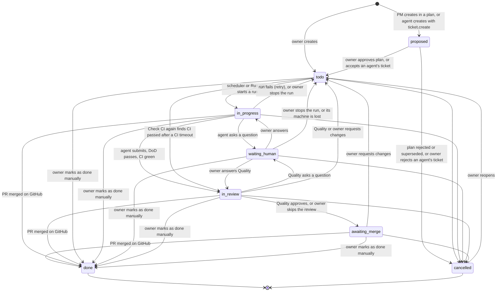

# 04 — Ticket Lifecycle and Definition of Done

> Status: Draft v0.1
> Related: [01 — Domain Model](01-domain-model.md), [05 — Daemon](05-daemon.md), [06 — MCP](06-mcp.md), [07 — Scheduler](07-scheduler.md)

This document defines the ticket states, who may move a ticket between them, and the checks that guard each transition. The rules are enforced by the web application: an MCP call or UI action that breaks them is rejected with an explanation.

## 1. States

| State | Meaning |
|---|---|
| `proposed` | Part of a plan not yet approved, or created by an agent with `ticket.create` and not yet accepted by the owner. Plan tickets are not visible on the board by default; tickets proposed by agents are (02, section 6.3). |
| `todo` | Approved and waiting for work. May be blocked or not assigned yet. |
| `in_progress` | A run is working on it. |
| `waiting_human` | An agent asked the owner a question. Work is paused until it is answered. |
| `in_review` | A pull request is open, CI is green, and the work waits for the Quality agent's review, which the owner starts with **Start review** or skips with **Skip review** until the scheduler starts reviews (lot 4; owner's decision, lot 3 step A). **In lot 2**, before pull requests and Quality exist, it means "work finished, the owner checks it": the agent submitted its report, no Quality run exists, and the ticket waits for the owner to mark it as done manually, send it back with **Request changes**, cancel it, or leave it (owner's decisions, lot 2 steps A and L2). Tickets left in `in_review` by 0.3.0 have no pull request and keep that meaning: **Request changes** and **Mark as done manually** (lot 3 step A). |
| `awaiting_merge` | Review approved, or skipped by the owner. The owner must merge the pull request on GitHub. |
| `done` | Pull request merged, or marked as done manually by the owner. Terminal. |
| `cancelled` | Abandoned. Terminal, except that the owner can reopen it. |

Blocked and eligible are derived conditions of `todo` (see 01, section 3.4). They are shown in the UI but are not states. The UI shows "Blocked" for `proposed` and `todo` tickets only, the states in which dependencies can still change; the API's `blocked` flag is computed for every ticket (owner's decision, lot 1 step F).

## 2. Transitions and who may perform them

| From → To | Performed by | Guard |
|---|---|---|
| (new) → `proposed` | Project Manager | Created inside a plan. |
| (new) → `proposed` | Any agent with `ticket.create` permission | Outside a plan. Limited per run (see section 8), flagged "created by agent", listed in "Needs you". The project is `ready` and not archived. |
| (new) → `todo` | Owner | — |
| `proposed` → `todo` | System, when the owner approves the plan | — |
| `proposed` → `todo` | Owner, with **Accept** | The ticket was created by an agent (no plan). |
| `proposed` → `cancelled` | System, when the plan is rejected or superseded | — |
| `proposed` → `cancelled` | Owner, with **Reject** | The ticket was created by an agent (no plan). An optional comment is posted as a `status_change` comment. |
| `todo` → `in_progress` | Scheduler, or the owner with **Run now** | Ticket is eligible (01, section 3.4) and its account can start a run (07, section 2, step 1, without the schedule windows); a run is created. Until the scheduler exists (lot 4), Run now is the only way a run starts (owner's decision, lot 2 step A). |
| `in_progress` → `waiting_human` | Assigned agent, by posting a `question` | Question body is not empty. |
| `in_review` → `waiting_human` | Quality agent, by posting a `question` during a review run | Question body is not empty. The answer returns the ticket to `in_review` in the same run (owner's decision, lot 3 step A). |
| `waiting_human` → `in_progress` (or `in_review` for a review run's question) | System, when the owner posts an `answer` | The waiting run continues: its live session receives the answer, or, after the waiting run lifetime, the same run is resumed on the same machine at once (section 6). |
| `in_progress` or `waiting_human` → `todo` | Owner, with **Stop run** | The run is stopped and `cancelled`; the attempt is not counted; the branch is kept; a `status_change` comment records it. The server cancels the run at once, in one transaction with the ticket's status, the comment, the events and the revocation of the run's token (so any later MCP call from that session is refused), then sends `run.stop`; the daemon's later end report only adds the branch and its commits. A session whose end the daemon never reports is stopped by the reconciliation at its next `hello` (05, section 6) (owner's decision, lot 2 step J). |
| `waiting_human` → `todo` | System | The waiting run's machine is offline when the answer arrives, or the owner stops a run whose machine is offline: the run fails with `machine_offline`, which is not counted as an attempt. The same applies when the machine does not confirm the answer's `run.resume` within the dispatch acknowledgement timeout, or refuses it: the answer stays in the comments, and the next run's first message holds it (owner's decision, lot 2 step K). Formally the ticket passes through `in_progress` (the answer), then returns to `todo` with the run's end. |
| `proposed` → `todo` or `cancelled` | Owner, with **Accept** or **Reject** (lot 2 step K) | Only a ticket an agent created (`created_by` agent); a ticket the owner created in `proposed` is refused. **Reject** posts its optional comment as a `status_change` comment. |
| `in_progress` → `in_review` | Assigned agent, by calling `ticket.submit` | Submission checks pass and CI passed (section 3.1; the reduced checks of lot 2 until lot 3). |
| `todo` → `in_review` | System, on the owner's **Check CI again** | The ticket's last run ended with `ci_timeout` and CI has passed since for the stored submission (section 3.1); no session starts (owner's decision, lot 3 step A). |
| `in_progress` → `todo` | System | Run failed; retry policy applies (section 5). A dispatch the machine did not acknowledge in time (07, section 8) returns the ticket to `todo` too, without counting an attempt. |
| `in_review` → `awaiting_merge` | Quality agent, by approving | Review checks pass (section 3.2). |
| `in_review` → `awaiting_merge` | Owner, with **Skip review** | No review run active. A `status_change` comment says the owner skipped the review; "Needs you" and the pull request show "review skipped" (owner's decision, lot 3 step A). |
| `in_review` → `todo` | Quality agent, by requesting changes | At least one `review` comment explaining what to change. Next run has purpose `fix_review`. Never a failed attempt. One request more than **Most review rounds per ticket** stops the ticket instead (section 5). |
| `in_review` → `todo` | Owner, with **Request changes** | From lot 3 (owner's decision, lot 3 step A): offered while no review run is active, never during one; the next run has purpose `fix_review`, with the owner's comment as its point; it is also kept for tickets left in `in_review` by 0.3.0 without a pull request. Lot 4 decides again when reviews start by themselves. Lot 2: a comment explaining what to change is mandatory, posted as a `status_change` comment. `attempt_count` is unchanged (the run succeeded, it is not a failed attempt) and the branch is kept. Nothing starts by itself: the owner starts the next run with **Run now**, which the confirmation offers directly with its usual refusals; it runs on the machine holding the ticket's commits (07, section 3), with purpose `implement`, and its first message holds the comment and says to continue the earlier commits (03, section 3.2). Whether it stays once Quality reviews `in_review` tickets is decided in lot 3 (owner's decision, lot 2 step L2). |
| `awaiting_merge` → `done` | System | GitHub reports the pull request merged into the default branch. A merge found while the ticket is in another state with an open pull request (`todo`, `in_progress`, `waiting_human`, `in_review`) also moves it to `done`, stopping an active run, with a `system` comment saying the pull request was merged before the review finished (owner's decision, lot 3 step A). |
| `awaiting_merge` → `todo` | Owner, with **Request changes** | Owner comment explaining the requested change, posted as a `status_change` comment; the next run has purpose `fix_review`, with the comment as its point. When the pull request conflicts with the base branch, the comment is filled in, asking to merge the base branch and resolve the conflicts (owner's decision, lot 3 step A). |
| any non-terminal → `cancelled` | Owner; Project Manager with owner approval | Active run is stopped; the branch and pull request are closed but kept. A pull request closed without merging on GitHub changes nothing by itself: "Needs you" shows it with **Reopen pull request** and **Cancel ticket**. A ticket reopened after a cancellation keeps its pull request closed until its next accepted submission reopens it (owner's decision, lot 3 step A). |
| `todo`, `in_progress`, `waiting_human`, `in_review` or `awaiting_merge` → `done` | Owner, with **Mark as done manually** | A comment explaining why is mandatory (posted as a `status_change` comment). Active run is stopped; the branch and pull request are left as they are. Tickets it blocked are unblocked. Allowed even while the ticket waits for tickets not `done`; the confirmation then warns and names them (02, section 6.4). |
| `cancelled` → `todo` | Owner, with **Reopen** | None. The ticket keeps its number, history and dependencies; `attempt_count` is reset to 0. |

Every transition writes an event (01, section 3.10) naming who performed it. Tickets are never deleted: a ticket created by mistake is cancelled.

A ticket's fields can be edited only in `proposed` and `todo` (02, section 6.4). The same applies to its dependencies: they can be added or removed only while the waiting ticket is `proposed` or `todo`, whatever the state of the blocking ticket (owner's decision, lot 1 step E).

Agents can never set `done` or `awaiting_merge` on their own work, and the Quality agent can never review a ticket it implemented. Only the owner can mark a ticket as done manually or reopen it.

## 3. Definition of Done

The DoD is checked at two points. The first check is mechanical and done by the system. The second is a judgement made by the Quality agent.

### 3.1 Submission checks (`in_progress` → `in_review`)

When the assigned agent calls `ticket.submit`, it sends a **DoD report**:

- for each acceptance criterion: `met` or `not_met`, with a one-line justification. A criterion is something the agent can show in its own work; CI is the system's check (below), never a criterion, since a criterion such as "CI passes" could not be reported `met` at the first submission (owner's decision, lot 3 step A; Help > Tickets);
- tests added or changed (file paths), or a justification when none are needed;
- documentation updated (file paths), or a justification when not needed;
- ADRs added, if a technical decision was made;
- a short summary of the change for the pull request description.

The system then checks mechanically:

1. every acceptance criterion is reported as `met`;
2. the worktree is clean, and the daemon pushed the branch to GitHub with commits ahead of the default branch (the push result comes with the worktree facts, 05 section 4.9);
3. the rules for the ticket type are satisfied (section 3.3), as a check of the report's form: where the table says "Required", the report lists paths or gives a justification; and every path listed is changed on the branch (the daemon sends the files changed against the base branch);
4. a pull request is open from that branch: the **server** opens it, or updates its description, only when checks 1 to 3 pass, never for a push at a run's end;
5. CI on the pull request has completed and passed.

Checks 1 to 3 answer the call at once: a failure rejects it with the list of failures (`DOD_FAILED`), the agent continues working in the same run, and no pull request is opened or updated. When they pass, the report is stored, the pull request is opened or updated, and the call answers `pending_ci`: the agent ends its turn and the run waits for CI with its session open, counting no working time and no idle time, and still counting against its account's maximum concurrent runs (owner's decisions, lot 3 step A).

**The pull request** (owner's decisions, lot 3 step A): title `<number>: <title>`; a normal pull request, not a draft; its description is filled in from the template `agents/templates/pull-request.md` with the report (summary, criteria as a checklist, tests, documentation, ADRs) and a link to the ticket page. When the branch changes anything under `.github/workflows/`, the description, the review run's first message and "Needs you" say so: an agent could weaken the checks that judge its own work, and a changed workflow runs on GitHub before anyone reads it.

**The CI result** is every GitHub Actions workflow run for the pull request's head commit, plus that commit's statuses (02, section 3.1: fine-grained tokens cannot read the Checks API). It has **passed** when all are completed and successful (skipped or neutral count as passed), and **failed** when all are completed and one failed, was cancelled or timed out. The server polls it at the **GitHub check interval** (section 8).

- **No CI found**: when no workflow run or status appears within **Wait for CI to start**, check 5 reads "No CI found", the submission passes, and the review run is told.
- **CI failed**: the server sends the agent, with `run.input`, the template `agents/templates/ci-failed.md` filled in with each failed job and, for each failed step, the step's own part of the job's log, cut to **Longest CI log excerpt** (keeping its end) after reading at most **Longest CI log read** of the log; the agent fixes its work and calls `ticket.submit` again. One failure more than **Most CI failures per run** ends the run as failed with `ci_failed`, a failed attempt.
  A failed step's part of the log runs from its first `##[group]` line at or after its start time to its last `##[error]` line before its end time plus one second, since GitHub gives step times in whole seconds and runs the post steps' clean-up in the same second as the failure (the owner's run of 2026-10-06: the end of a failed job's log is that clean-up, not the failure). Timestamps and colour codes are removed and secrets masked. When the part cannot be cut (no step times, no timestamp, no line or no `##[error]` line within the step's times, or the log larger than **Longest CI log read**), the excerpt is the end of the job's log, and the agent is told it is not the step's part and why. The message keeps its whole text within the `run.input` ceiling by cutting the excerpts further, across all failed steps, the longest first, with a marker.
- **CI passed**: the run ends `succeeded` and the ticket moves to `in_review`.
- **CI wait at submission** reached: the run fails with `ci_timeout`, which is not a failed attempt; the ticket returns to `todo` with its branch, pull request and stored report, and "Needs you" shows "CI did not finish" with **Check CI again**. That action starts no session: it reads the CI result once, and when CI has passed since, the stored submission is accepted and the ticket moves to `in_review`.

**Lot 2 (reduced submission).** Until pushing, pull requests and CI exist (lot 3), `ticket.submit` takes the same input, but only checks that every acceptance criterion is reported `met`, that the worktree has no uncommitted changes, and that the ticket branch has commits ahead of the base branch. When they pass, the report is stored, the run ends `succeeded` and the ticket moves to `in_review` with the lot 2 meaning (section 1); nothing is pushed. When they fail, the call is rejected with the failures, as above (owner's decision, lot 2 step A).

### 3.2 Review checks (`in_review` → `awaiting_merge`)

The Quality agent reviews the pull request and the DoD report. It verifies that:

- the change does what the acceptance criteria say, and nothing unrelated;
- the tests actually test the change, rather than existing only to satisfy the check;
- justifications for missing tests or documentation are acceptable;
- user documentation describes the change from the user's point of view;
- the code follows the project's CLAUDE.md conventions and existing ADRs.

It either approves, posting a `review` comment summarising the verdict, or requests changes with actionable comments. Both are also posted on the pull request as one GitHub review of the "comment" kind: GitHub refuses an approval or a request for changes on your own pull request, and every pull request is the owner's. When GitHub refuses the post, the decision stands in the Orchestrator, with an event and a note on the ticket page (owner's decision, lot 3 step A).

CI already ran, so the Quality agent does not run the test suite again unless the diff or the CI result gives a reason. It never changes the branch: a review run never pushes, and when the branch head moved during the review, the run fails with `review_branch_moved`. It may ask the owner with `ticket.ask` (section 2). A review run that fails, gives up or ends otherwise is never a failed attempt of the ticket: the ticket stays `in_review` and "Needs you" shows "Review did not finish" with **Start review** (owner's decisions, lot 3 step A).

### 3.3 Rules per ticket type

| Type | Tests | User documentation | ADR | Notes |
|---|---|---|---|---|
| `feature` | Required | Required if user-facing | If a technical decision was made | — |
| `bug` | A regression test that fails before the fix is required | Required if behaviour visible to users changed | Rarely | — |
| `chore` | Existing tests must pass | Not required | If a dependency or tool was added or replaced | Refactoring, tooling, dependencies. |
| `docs` | Not required | Is the deliverable | No | May be assigned to the Technical Writer. |
| `spike` | Not required | Not required | Required: the spike's findings are recorded as an ADR or a document in `docs/` | Research only; no production code. |

"Required" can be waived only by a justification in the DoD report, which the Quality agent must accept.

## 4. Git conventions

- One branch per ticket: `t/<number>-<slug>`, created from the default branch at the first run.
- One Git worktree per run, managed by the daemon.
- One pull request per ticket. Later runs (`fix_review`) push to the same branch.
- Pull request title: `<number>: <title>`. The description is built from the DoD report summary and links back to the ticket.
- After a merge, the server deletes the ticket's branch on GitHub unless another open pull request uses it, and a branch GitHub already deleted counts as deleted; the daemon deletes its local copy (05, section 4.11). After a cancellation nothing is deleted, so **Reopen** finds the work (owner's decision, lot 3 step A).
- The daemon pushes only the ticket's branch, by an explicit refspec, never a tag or another branch, and never forces a push. If the default branch moved, the agent brings it in with `git merge origin/<base>` (the daemon fetches before each run), never with a rebase, so the history Quality reviewed is kept. Unresolvable conflicts are raised as a `question`. When the branch on GitHub contains the machine's branch (for example after GitHub's **Update branch**), the daemon fast-forwards the machine's branch when it prepares a run; a branch that diverged fails the push with a clear reason and a "Needs you" item (owner's decisions, lot 3 step A).
- Merge is done by the owner on GitHub. The web application detects merges by polling GitHub.
- Agent commits are authored as "<profile name> (Orchestrator)" with the owner's GitHub noreply address (`<id>+<login>@users.noreply.github.com`, from the id and login stored with the token, 02 section 3.2), so pushes pass GitHub's "block pushes that expose my email" option and GitHub links the commits to the owner's account. The daemon sets them per worktree.

## 5. Failures and retries

A run fails when it crashes, times out, the machine goes offline, or the agent declares it cannot finish.

- A run stopped because the Claude account reached its usage limit, or because the daemon suspects it did, is **not** a failure. The run goes to `paused_quota` and resumes later (see 07 and 05, section 4.10).
- A run stopped by the owner, a run failed with `machine_offline`, a run failed with `machine_revoked` (its machine was revoked while the run was active), a run failed with `claude_code_unsupported` (its machine's Claude Code was missing or too old at the start, 05 section 4.3; owner's decision, lot 2 step J), a run failed with `machine_problem` (systemd-run refused its process scope, 05 section 2; owner's decision, lot 2 step M2) and a dispatch not acknowledged in time are not failed attempts: the ticket returns to `todo` without changing `attempt_count` (owner's decisions, lot 2 steps A and C).
- Lot 3 adds (owner's decisions, lot 3 step A): `ci_timeout` (section 3.1) and `push_failed` (GitHub refused the push or could not be reached; a "Needs you" GitHub item) are not failed attempts; neither is any failure of a `review` run (`review_branch_moved` included), whose ticket stays `in_review`. `ci_failed` is a failed attempt. A `fix_review` run that fails by itself (gives up, times out, `ci_failed`) counts like an `implement` run; Quality asking for changes never counts.
- Otherwise, the ticket returns to `todo`, `attempt_count` is incremented and the failure reason is posted as a `system` comment.
- After **2 failed attempts** (**Failed attempts before asking you**), the ticket stays `todo` and is marked "stopped after N failed attempts": **Run now** refuses it, naming the setting and its value, and "Needs you" lists it ("Tickets stopped after repeated failures") with **Try again** (resets `attempt_count`, with a `status_change` comment), **Cancel** and **Mark as done manually**. The same stop applies when Quality asks for changes once more than **Most review rounds per ticket** (owner's decision, lot 3 step A; the system question of earlier drafts had no run to answer it).

## 6. Questions to the owner

- Agents ask questions with the `ticket.ask` MCP tool. The question is posted as a `question` comment and the ticket moves to `waiting_human`.
- The run stays alive for the waiting run lifetime (a setting, default 30 minutes, section 8) so an answer can resume it without losing context. After that, the tmux session is closed but the run stays `waiting_human`, with its worktree and Claude session id kept on its machine; the answer then resumes **the same run** on that machine at once (`run.resume`, 05 section 3.3), without waiting for the scheduler. If the machine is offline, the run fails with `machine_offline` and the ticket returns to `todo` (owner's decision, lot 2 step A).
- The owner answers the latest question of a `waiting_human` ticket (`POST /api/projects/<key>/tickets/<number>/answer`): the `answer` comment names the question it answers, and the ticket moves back to `in_progress`. A live session receives it with `run.input`; if the daemon refuses it because the session closed meanwhile (05, section 4.4), the server sends `run.resume` instead. A run paused on a usage limit keeps the answer in the comments: **Resume** sends the "please continue" message, which points to `ticket_comments` (lot 2 step K).
- The answer is delivered **at once, whatever the Claude account's state** (owner's decision, lot 2 step K): a session still open already receives it that way, and a waiting run held its session. From then on the run counts against the account again, so the account can be one run above its maximum concurrent runs until a run ends (01, invariant 3); on a limited account, the usage limit is detected as usual and pauses the run.
- If the machine does not confirm the `run.resume` of an answer within the dispatch acknowledgement timeout, or refuses it, the run fails with `machine_offline`, as when the machine is offline: not counted, the ticket back to `todo`, the answer kept in the comments for the next run (owner's decision, lot 2 step K).
- A waiting run does not count as active for the Claude account, so other tickets can run meanwhile.
- The UI shows pending questions prominently. They are the owner's main task list.

## 7. What the owner sees

- A board per project with one column per state (`proposed` hidden by default).
- On each ticket: description, acceptance criteria, assignee, dependencies, DoD report, comments, run history with logs, links to branch and pull request.
- A global "Needs you" view listing plans to approve, questions to answer and pull requests awaiting merge.

## 8. Configurable limits

Every limit and timeout of the Orchestrator is a setting, editable from the UI (Settings > Limits, 02 section 10) without touching the code. A setting is a value that changes what the Orchestrator does or accepts (refuse, wait, stop, retry). A value that only changes how much the screens show at once (for example the events per page of the event log, or the length of a quote in it) is not a setting but a named display constant in `packages/protocol` (owner's decision, lot 1 step H). Each setting is a whole number with a default and an allowed range; a value outside the range is refused. Some can also be overridden per project (project settings, 02 section 6.5). The value used is the project's override, then the global value, then the default. The user documentation lists every setting with its effect.

This table lists the settings of this document and the settings added in lots 0, 1, 2 and 3. The daemon's timeouts (05, section 5) and the global scheduler settings (07, section 8) follow the same rules and are shown on the same screen. Settings of a Claude account (schedule windows, daily budget, behaviour at window end, maximum concurrent runs) are set on the account (02, section 9.1), not here.

| Setting (key) | Default | Allowed range | Override per project | Used in |
|---|---|---|---|---|
| Most tickets per plan (`maxTicketsPerPlan`) | 15 | 1 to 100 | Yes | 01, section 3.3 |
| Most tickets an agent creates per run (`maxAgentTicketsPerRun`; outside a plan) | 3 | 0 to 20 | Yes | Section 2 |
| Failed attempts before asking you (`maxFailedAttempts`) | 2 | 1 to 10 | Yes | Section 5 |
| CI wait at submission (`ciWaitTimeoutMinutes`) | 20 minutes | 1 to 240 minutes | Yes | Section 3.1 |
| Wait for CI to start (`ciStartWaitMinutes`; lot 3) | 5 minutes | 1 to 60 minutes | Yes | Section 3.1 |
| Most CI failures per run (`maxCiFailuresPerRun`; lot 3) | 2 | 1 to 10 | Yes | Section 3.1 |
| Longest CI log excerpt (`ciLogExcerptMaxLength`; lot 3; per failed step, in the CI result message and `ci.status`) | 4,000 characters | 500 to 20,000 characters | No | Section 3.1; 06, section 4.1 |
| Longest CI log read (`ciLogReadMaxMegabytes`; lot 3; how much of a failed job's log is read to find each failed step's part; beyond it the excerpt is the end of what was read, and says so) | 20 MB | 1 to 500 MB | No | Section 3.1; 06, section 4.1 |
| GitHub check interval (`githubPollSeconds`; lot 3; how often tickets waiting on GitHub are checked: CI, open pull requests) | 60 seconds | 15 to 600 seconds | No | Section 3.1; 09, section 4 |
| Most review rounds per ticket (`maxReviewRounds`; lot 3) | 2 | 1 to 10 | Yes | Sections 2 and 5 |
| Waiting run lifetime (`waitingRunLifetimeMinutes`): how long a waiting run stays alive after a question | 30 minutes | 1 to 1,440 minutes | No | Section 6; 05, section 5 |
| Session lifetime (`sessionLifetimeDays`) | 30 days | 1 to 365 days | No | 09, section 5 (ADR 0015) |
| Failed logins before a delay (`loginFailuresBeforeDelay`) | 5 | 1 to 100 | No | 09, section 5 (ADR 0015) |
| First login delay (`loginFirstDelaySeconds`; doubles with each further failure) | 10 seconds | 1 to 3,600 seconds | No | 09, section 5 (ADR 0015) |
| Longest login delay (`loginMaxDelaySeconds`) | 900 seconds (15 minutes) | 1 to 86,400 seconds (24 hours) | No | 09, section 5 (ADR 0015) |
| Failed login memory (`loginFailureMemoryMinutes`) | 60 minutes | 1 to 10,080 minutes (7 days) | No | 09, section 5 (ADR 0015) |
| GitHub token expiry warning (`githubTokenExpiryWarningDays`) | 14 days | 1 to 90 days | No | 02, section 4 |
| GitHub request timeout (`githubRequestTimeoutSeconds`) | 15 seconds | 1 to 300 seconds | No | 09, section 4 |
| GitHub clock tolerance (`githubClockToleranceSeconds`) | 120 seconds (2 minutes) | 0 to 3,600 seconds | No | 08, section 3.1 |
| Longest ticket title (`ticketTitleMaxLength`) | 200 characters | 1 to 1,000 characters | No | 01, section 3.4 |
| Longest ticket description (`ticketDescriptionMaxLength`) | 20,000 characters | 1 to 100,000 characters | No | 01, section 3.4 |
| Most acceptance criteria (`ticketMaxAcceptanceCriteria`) | 20 | 1 to 100 | No | 01, section 3.4 |
| Longest acceptance criterion (`acceptanceCriterionMaxLength`) | 500 characters | 1 to 5,000 characters | No | 01, section 3.4 |
| Longest comment (`commentMaxLength`) | 20,000 characters | 1 to 100,000 characters | No | 01, section 3.5 |
| Enrollment code lifetime (`enrollmentCodeLifetimeMinutes`) | 15 minutes | 1 to 1,440 minutes | No | 05, section 3.1 |
| Heartbeat interval (`heartbeatIntervalSeconds`; sent to the daemon when it connects) | 15 seconds | 5 to 120 seconds | No | 05, section 3.2 |
| Machine offline after (`machineOfflineAfterSeconds`; no heartbeat for this long) | 60 seconds | 15 to 600 seconds | No | 05, section 3.2 |
| Session start timeout (`sessionStartTimeoutSeconds`; no `SessionStart` hook after the launch) | 30 seconds | 5 to 600 seconds | No | 05, section 4.2.1 |
| Progress update interval (`progressUpdateIntervalSeconds`; shortest time between two publications of a run's progress line; the agent's calls are never refused, the latest line is kept) | 60 seconds | 0 to 3,600 seconds | No | 06, section 4.2 |
| MCP call timeout (`mcpCallTimeoutSeconds`; how long the daemon waits for the server's answer to a tool call) | 30 seconds | 5 to 300 seconds | No | 05, section 3.3 |
| Claude Code MCP tool timeout (`claudeCodeMcpToolTimeoutSeconds`; written by the daemon into each run's `mcp.json`) | 120 seconds | 10 to 1,800 seconds | No | 05, section 4.2 |
| Longest push (`pushTimeoutSeconds`; lot 3; every push of a ticket branch by the daemon, and every download of the project from GitHub at a run's start, the first one on a new machine the longest) | 60 seconds | 10 to 600 seconds | No | 05, sections 4.9 and 7.1 |
| Longest stored log entry (`logEntryMaxLength`) | 2,000 characters | 100 to 100,000 characters | No | 02, section 7 |

**Names** (owner's decision, lot 3 step A): a setting is named in the specs as on the Settings screen (`SETTINGS` in `packages/protocol/src/api/settings.ts`), with its key in the tables. Earlier names still found in the specs' prose mean the same settings: "max tickets per plan", "max failed attempts", "CI wait timeout", "maximum run duration" (**Longest run**), "maximum nudges" (**Most reminders per run**), "dispatch acknowledgement timeout" (**Machine answer timeout**), "fallback delay" (**Quota wait when the reset time is unknown**), "longest fallback delay" (**Longest quota wait**) and "scheduler tick" (**Scheduler check interval**). The five settings marked "lot 3" are used from version 0.4.0, like **Failed attempts before asking you** and **CI wait at submission**; the description of **CI wait at submission** says that the run then fails without counting as a failed attempt (section 3.1).

The maximum concurrent runs of a Claude account (1 by default) is set on the account (01, section 3.9). Three kinds of values are code constants, not settings: the daemon's reconnection backoff (1 to 60 seconds), because the daemon needs it before it is connected and can read any setting (05, section 3.2); the Claude Code minimum and highest validated versions (05, section 2, declared once in `packages/protocol`), because they describe what the code was validated against, not a choice of the owner (owner's decision, lot 2 step D); and the largest message on the daemon connection (1 MiB, `DAEMON_MESSAGE_MAX_BYTES` in `packages/protocol`), a transport limit both sides must agree on before any setting can be exchanged, not an owner preference: longer reports, such as a batch of log entries, are split below it (owner's decision, review of lot 2 step F). Lot 2 step K adds two more (owner's decisions): the grace period of the daemon's sweep of a run's leftover processes (5 seconds between `SIGTERM` and `SIGKILL`, `SWEEP_GRACE_MS`, also the run scopes' `TimeoutStopSec` and, from lot 2 step L2b, the longest the sweep keeps sending `SIGKILL` before it logs a process that will not die, 05 section 4.11), because it only gives a well-behaved program time to exit, like the reconnection backoff, and the largest output of a reading MCP tool (40,000 characters, `MCP_OUTPUT_MAX_CHARACTERS`, 06 section 4.1), because it follows from Claude Code's own output limit, as the first message's byte budget follows from Linux's. Lot 2 step L adds two more (owner's decisions): the realtime stream's keep-alive (every 20 seconds) and the reconnection delay it gives the browser (3 seconds), because they are transport details, like the daemon's reconnection backoff, not a choice of the owner (02, section 1). The project setup polling interval added in lot 1 (`projectSetupPollSeconds`) is removed in lot 2, when the realtime stream replaces the polling (02, section 1); a stored value is dropped with it.

The idle timeout (05, section 5) is described on the screen as: "A run whose agent shows no activity for this long is stopped. Time waiting for you, for CI or for the quota, and time running a command, does not count." It ends the run without a reminder, since reminders are sent at once when a turn ends (owner's decision, lot 2 step F).

The first login delay is never above the longest login delay: a change or a **Reset to default** that would make it so is refused, naming both settings (the same rule as the quota fallback delays, 07 section 8). Two more pairs follow the same rule with a clear message naming both settings (owner's decision, lot 2 step A): "Machine offline after" is at least twice the heartbeat interval, so one lost heartbeat never marks a machine offline; and the MCP call timeout is below the Claude Code MCP tool timeout, so the daemon always answers Claude Code (with `UNAVAILABLE`) before Claude Code gives up on the call. The daemon waits the MCP call timeout for the server; `mcp.json` receives only the Claude Code MCP tool timeout (owner's decision, lot 2 step G). Both are in the Runs group of Settings > Limits. A third rule adds two settings (owner's decision, lot 3 step D1): the MCP call timeout plus **Longest push** stays strictly below the Claude Code MCP tool timeout, because the push at submission happens inside the agent's `ticket_submit` call, before the daemon waits for the server's answer; a change or a **Reset to default** breaking it is refused with `setting_sum_invalid`, naming the three settings and their values (for example "MCP call timeout (30 seconds) plus Longest push (90 seconds) must be less than Claude Code MCP tool timeout (120 seconds)"). The defaults (30 + 60 < 120) fit. One more rule ties two settings to a constant (owner's decision, review of lot 2 step I): the maximum number of acceptance criteria times the longest acceptance criterion is at most 20,000 characters (`FIRST_MESSAGE_CRITERIA_MAX_CHARACTERS`), so the criteria of any valid ticket fit in the byte budget of a run's first message (`FIRST_MESSAGE_MAX_BYTES`, 03 section 3.2). A change or a **Reset to default** breaking it is refused with a message naming both settings, their values and the budget (for example "Maximum acceptance criteria (40) times Longest acceptance criterion (1,000 characters) is 40,000 characters, above the 20,000 characters a run's first message has room for"). The defaults (20 criteria of 500 characters) fit. The ranges keep the owner from locking themselves out: a login wait is at most 24 hours, and `orchestrator reset-password` (09, section 7.4) also lifts an active wait. Settings added in lots 0 and 1 are global only (owner's decision, lot 1 step G), and so are those added in lot 2. Lot 2 (version 0.3.0) starts using: max tickets an agent may create per run, the waiting run lifetime, the daemon timeouts of 05 section 5 (maximum run duration, idle timeout, maximum nudges), the dispatch acknowledgement timeout and the quota fallback delay (07, section 8), and every setting added by lot 2 above. Every value is read through the one settings resolver (project override, then global value, then default). A setting used only from a later version is shown with "Used from version ..." and can be set before it has any effect.

Changing a limit applies to future actions only; runs and plans already in progress keep the values they started with, and an open login session keeps its expiry date. Every change of a global value or a project override, and every **Reset to default**, writes an event.
