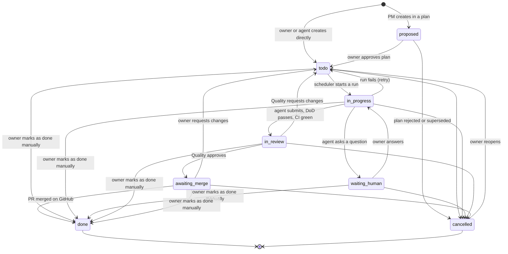

# 04 — Ticket Lifecycle and Definition of Done

> Status: Draft v0.1
> Related: [01 — Domain Model](01-domain-model.md), [05 — Daemon](05-daemon.md), [06 — MCP](06-mcp.md), [07 — Scheduler](07-scheduler.md)

This document defines the ticket states, who may move a ticket between them, and the checks that guard each transition. The rules are enforced by the web application: an MCP call or UI action that breaks them is rejected with an explanation.

## 1. States

| State | Meaning |
|---|---|
| `proposed` | Part of a plan not yet approved. Not visible on the board by default. |
| `todo` | Approved and waiting for work. May be blocked or not assigned yet. |
| `in_progress` | A run is working on it. |
| `waiting_human` | An agent asked the owner a question. Work is paused until it is answered. |
| `in_review` | A pull request is open, CI is green, and the Quality agent is reviewing it. |
| `awaiting_merge` | Review approved. The owner must merge the pull request on GitHub. |
| `done` | Pull request merged, or marked as done manually by the owner. Terminal. |
| `cancelled` | Abandoned. Terminal, except that the owner can reopen it. |

Blocked and eligible are derived conditions of `todo` (see 01, section 3.4). They are shown in the UI but are not states. The UI shows "Blocked" for `proposed` and `todo` tickets only, the states in which dependencies can still change; the API's `blocked` flag is computed for every ticket (owner's decision, lot 1 step F).

## 2. Transitions and who may perform them

| From → To | Performed by | Guard |
|---|---|---|
| (new) → `proposed` | Project Manager | Created inside a plan. |
| (new) → `todo` | Owner; any agent with `ticket.create` permission | Agent-created tickets outside a plan are limited per run (see section 8) and are flagged "created by agent" for the owner. |
| `proposed` → `todo` | System, when the owner approves the plan | — |
| `proposed` → `cancelled` | System, when the plan is rejected or superseded | — |
| `todo` → `in_progress` | Scheduler only | Ticket is eligible; a run is created. |
| `in_progress` → `waiting_human` | Assigned agent, by posting a `question` | Question body is not empty. |
| `waiting_human` → `in_progress` | System, when the owner posts an `answer` | The paused run resumes; if it no longer exists, the ticket returns to `todo` and a new run resumes the work. |
| `in_progress` → `in_review` | Assigned agent, by calling `ticket.submit` | Submission checks pass (section 3.1). |
| `in_progress` → `todo` | System | Run failed; retry policy applies (section 5). |
| `in_review` → `awaiting_merge` | Quality agent, by approving | Review checks pass (section 3.2). |
| `in_review` → `todo` | Quality agent, by requesting changes | At least one `review` comment explaining what to change. Next run has purpose `fix_review`. |
| `awaiting_merge` → `done` | System | GitHub reports the pull request merged into the default branch. |
| `awaiting_merge` → `todo` | Owner | Owner comment explaining the requested change. |
| any non-terminal → `cancelled` | Owner; Project Manager with owner approval | Active run is stopped; the branch and pull request are closed but kept. |
| `todo`, `in_progress`, `waiting_human`, `in_review` or `awaiting_merge` → `done` | Owner, with **Mark as done manually** | A comment explaining why is mandatory (posted as a `status_change` comment). Active run is stopped; the branch and pull request are left as they are. Tickets it blocked are unblocked. |
| `cancelled` → `todo` | Owner, with **Reopen** | None. The ticket keeps its number, history and dependencies; `attempt_count` is reset to 0. |

Every transition writes an event (01, section 3.10) naming who performed it. Tickets are never deleted: a ticket created by mistake is cancelled.

A ticket's fields can be edited only in `proposed` and `todo` (02, section 6.4). The same applies to its dependencies: they can be added or removed only while the waiting ticket is `proposed` or `todo`, whatever the state of the blocking ticket (owner's decision, lot 1 step E).

Agents can never set `done` or `awaiting_merge` on their own work, and the Quality agent can never review a ticket it implemented. Only the owner can mark a ticket as done manually or reopen it.

## 3. Definition of Done

The DoD is checked at two points. The first check is mechanical and done by the system. The second is a judgement made by the Quality agent.

### 3.1 Submission checks (`in_progress` → `in_review`)

When the assigned agent calls `ticket.submit`, it sends a **DoD report**:

- for each acceptance criterion: `met` or `not_met`, with a one-line justification;
- tests added or changed (file paths), or a justification when none are needed;
- documentation updated (file paths), or a justification when not needed;
- ADRs added, if a technical decision was made;
- a short summary of the change for the pull request description.

The system then checks mechanically:

1. every acceptance criterion is reported as `met`;
2. the branch exists on GitHub and has commits ahead of the default branch;
3. a pull request is open from that branch (the daemon opens it if the agent has not);
4. CI on the pull request has completed and passed;
5. the rules for the ticket type are satisfied (section 3.3).

If CI is still running, the ticket stays `in_progress` and the run waits, up to a configurable timeout. If a check fails, the call is rejected with the list of failures and the agent continues working in the same run.

### 3.2 Review checks (`in_review` → `awaiting_merge`)

The Quality agent reviews the pull request and the DoD report. It verifies that:

- the change does what the acceptance criteria say, and nothing unrelated;
- the tests actually test the change, rather than existing only to satisfy the check;
- justifications for missing tests or documentation are acceptable;
- user documentation describes the change from the user's point of view;
- the code follows the project's CLAUDE.md conventions and existing ADRs.

It either approves, posting a `review` comment summarising the verdict, or requests changes with actionable comments.

### 3.3 Rules per ticket type

| Type | Tests | User documentation | ADR | Notes |
|---|---|---|---|---|
| `feature` | Required | Required if user-facing | If a technical decision was made | — |
| `bug` | A regression test that fails before the fix is required | Required if behaviour visible to users changed | Rarely | — |
| `chore` | Existing tests must pass | Not required | If a dependency or tool was added or replaced | Refactoring, tooling, dependencies. |
| `docs` | Not required | Is the deliverable | No | May be assigned to the Technical Writer. |
| `spike` | Not required | Not required | Required: the spike's findings are recorded as an ADR or a document in `docs/` | Research only; no production code. |

"Required" can be waived only by a justification in the DoD report, which the Quality agent must accept.

## 4. Git conventions

- One branch per ticket: `t/<number>-<slug>`, created from the default branch at the first run.
- One Git worktree per run, managed by the daemon.
- One pull request per ticket. Later runs (`fix_review`) push to the same branch.
- Pull request title: `<number>: <title>`. The description is built from the DoD report summary and links back to the ticket.
- If the default branch moved and the branch conflicts, the next run starts by rebasing. Unresolvable conflicts are raised as a `question`.
- Merge is done by the owner on GitHub. The web application detects merges by polling GitHub.

## 5. Failures and retries

A run fails when it crashes, times out, the machine goes offline, or the agent declares it cannot finish.

- A run stopped because the Claude account reached its usage limit is **not** a failure. The run goes to `paused_quota` and resumes later (see 07).
- Otherwise, the ticket returns to `todo`, `attempt_count` is incremented and the failure reason is posted as a `system` comment.
- After **2 failed attempts** (configurable), the ticket is not scheduled again. The system posts a `question` asking the owner how to proceed and moves the ticket to `waiting_human`.

## 6. Questions to the owner

- Agents ask questions with the `ticket.ask` MCP tool. The question is posted as a `question` comment and the ticket moves to `waiting_human`.
- The run stays alive for the waiting run lifetime (a setting, default 30 minutes, section 8) so an answer can resume it without losing context. After that, the tmux session is closed but the Claude session id is kept; the answer then starts a run that resumes the session.
- A waiting run does not count as active for the Claude account, so other tickets can run meanwhile.
- The UI shows pending questions prominently. They are the owner's main task list.

## 7. What the owner sees

- A board per project with one column per state (`proposed` hidden by default).
- On each ticket: description, acceptance criteria, assignee, dependencies, DoD report, comments, run history with logs, links to branch and pull request.
- A global "Needs you" view listing plans to approve, questions to answer and pull requests awaiting merge.

## 8. Configurable limits

Every limit and timeout of the Orchestrator is a setting, editable from the UI (Settings > Limits, 02 section 10) without touching the code. Each setting is a whole number with a default and an allowed range. Some can also be overridden per project (project settings, 02 section 6.5). The value used is the project's override, then the global value, then the default. The user documentation lists every setting with its effect.

This table lists the settings of this document and the settings added in lots 0 and 1. The daemon's timeouts (05, section 5) and the global scheduler settings (07, section 8) follow the same rules and are shown on the same screen. Settings of a Claude account (schedule windows, daily budget, behaviour at window end, maximum concurrent runs) are set on the account (02, section 9.1), not here.

| Setting | Default | Override per project | Used in |
|---|---|---|---|
| Max tickets per plan | 15 | Yes | 01, section 3.3 |
| Max tickets an agent may create per run (outside a plan) | 3 | Yes | Section 2 |
| Max failed attempts before asking the owner | 2 | Yes | Section 5 |
| CI wait timeout at submission | 20 minutes | Yes | Section 3.1 |
| Waiting run lifetime: how long a waiting run stays alive after a question | 30 minutes | No | Section 6; 05, section 5 |
| Session lifetime | 30 days | No | 09, section 5 (ADR 0015) |
| Failed logins before a delay | 5 | No | 09, section 5 (ADR 0015) |
| First login delay (doubles with each further failure) | 10 seconds | No | 09, section 5 (ADR 0015) |
| Longest login delay | 15 minutes | No | 09, section 5 (ADR 0015) |
| Failed login memory | 60 minutes | No | 09, section 5 (ADR 0015) |
| GitHub token expiry warning | 14 days | No | 02, section 4 |
| GitHub request timeout | 15 seconds | No | 09, section 4 |
| GitHub clock tolerance | 2 minutes | No | 08, section 3.1 |
| Project setup polling interval | 2 seconds | No | 02, section 1 |
| Longest ticket title | 200 characters | No | 01, section 3.4 |
| Longest ticket description | 20,000 characters | No | 01, section 3.4 |
| Max acceptance criteria per ticket | 20 | No | 01, section 3.4 |
| Longest acceptance criterion | 500 characters | No | 01, section 3.4 |
| Longest comment | 20,000 characters | No | 01, section 3.5 |

The maximum concurrent runs of a Claude account (1 by default) is set on the account (01, section 3.9).

Settings added in lots 0 and 1 are global only (owner's decision, lot 1 step G). A setting used only from a later version is shown with "Used from version ..." and can be set before it has any effect.

Changing a limit applies to future actions only; runs and plans already in progress keep the values they started with, and an open login session keeps its expiry date. Every change of a global value or a project override, and every **Reset to default**, writes an event.
