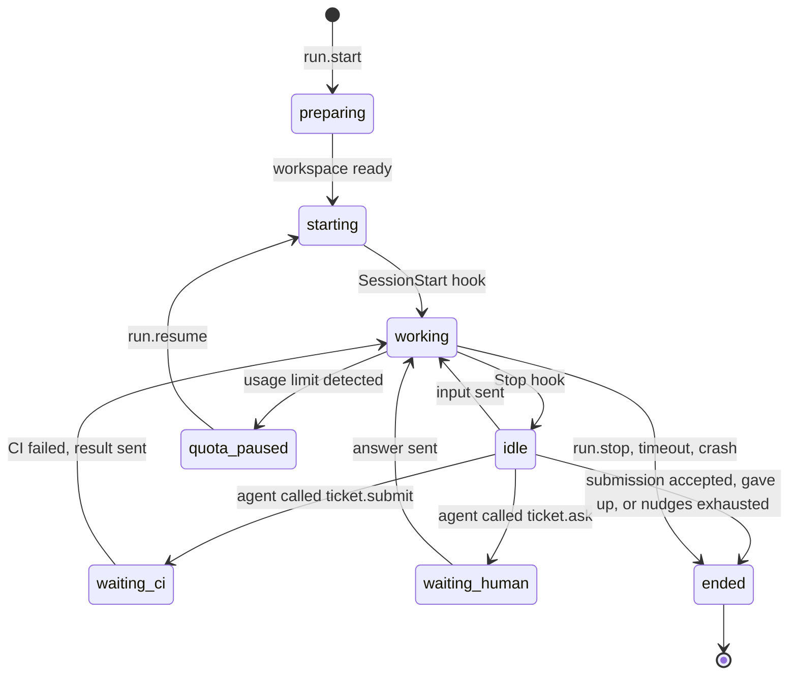

# 05 — Daemon

> Status: Draft v0.1
> Related: [01 — Domain Model](01-domain-model.md), [04 — Ticket Lifecycle](04-ticket-lifecycle.md), [06 — MCP](06-mcp.md), [07 — Scheduler](07-scheduler.md)

The daemon is the execution plane. It runs on every machine that executes agents, starts Claude Code sessions for runs, and reports what happens back to the web application. It holds no business rules about tickets: it executes what the server asks and reports facts.

## 1. Responsibilities

- Keep a single authenticated outbound connection to the web application.
- Report the machine's identity, versions and capabilities.
- Prepare a Git workspace for each run.
- Start, drive, resume and stop Claude Code sessions in **interactive mode** inside tmux.
- Enforce the agent profile's tool allowlist through Claude Code hooks.
- Collect state from hooks and session transcripts, and stream it to the server.
- Serve the MCP tools to Claude Code and relay the calls to the server.
- Push branches to GitHub on behalf of agents. Agents never hold GitHub credentials.
- Detect when the Claude account reaches its usage limit.

Non-responsibilities: deciding what runs next (scheduler), validating ticket transitions (server), storing business data (server).

## 2. Platform and packaging

| Item | Decision |
|---|---|
| Supported OS | Linux, and Windows through WSL 2 (Linux distribution). No native Windows. |
| Runtime | Node.js LTS, TypeScript. Node is already required by Claude Code. |
| Distribution | npm package exposing an `orchestrator-daemon` command. |
| Service | systemd user service, installed by `orchestrator-daemon install-service`. On WSL, systemd must be enabled; the user documentation explains how, and how to keep WSL running. |
| Dependencies checked at start | `git`, `tmux`, `claude` (version within the supported range). Missing or unsupported dependencies are reported to the server and the machine is marked unusable. |
| Recommended setup | A dedicated Linux user for the daemon, so agents cannot read the owner's personal files. |
| Claude configuration | Agents run with a **dedicated Claude Code configuration folder** (`CLAUDE_CONFIG_DIR=~/.orchestrator/claude-config`), separate from the owner's personal one. It holds its own login (same subscription), trust entries and transcripts. See ADR 0002. |

The daemon runs as a normal process on the host, **not in Docker**, because it needs the machine's Claude Code login, tmux and toolchains (for example the Android SDK).

## 3. Enrollment and connection

### 3.1 Enrollment

1. In the UI, the owner creates a machine and selects the Claude account it uses. The server shows a one-time enrollment command containing the server URL and an enrollment code valid for 15 minutes.
2. On the machine, the owner runs `orchestrator-daemon enroll <server-url> <code>`.
3. The owner runs `orchestrator-daemon login`, which opens Claude Code once with the dedicated configuration folder so they can log in to their Claude account. This is the only interactive step, done once per machine.
4. The daemon exchanges the code for a long-lived **machine token**, stored in `~/.orchestrator/config.json` with permissions `600`.
5. The machine appears online in the UI. The owner can revoke the token at any time, which disconnects the daemon.

### 3.2 Connection

- A single WebSocket from the daemon to the server (`wss://` when the server is remote, `ws://` accepted for `localhost` only).
- The daemon authenticates with the machine token on connection.
- Heartbeat every 15 seconds. The server marks the machine `offline` after 60 seconds without one.
- Reconnection with exponential backoff (1 s to 60 s).
- When the server is not on the same network (VPS), the recommended setup is a private network such as a VPN; the web application is not exposed publicly in v1.

### 3.3 Messages

All messages are JSON: `{ "type": "...", "id": "...", "payload": { ... } }`. Messages that need an answer are acknowledged with the same `id`.

| Direction | Type | Purpose |
|---|---|---|
| D → S | `hello` | Daemon version, Claude Code version, OS, capabilities, runs currently alive on the machine. |
| D → S | `heartbeat` | Liveness and resource summary. |
| S → D | `run.start` | Start a run (payload in section 4.1). |
| S → D | `run.input` | Send text to a live session (owner answer, CI result, nudge). |
| S → D | `run.resume` | Resume a session that was closed (after a quota pause or a long wait). |
| S → D | `run.stop` | Stop a run (cancel, timeout). |
| D → S | `run.state` | Run state change (`starting`, `running`, `idle`, `ended`, …) with details. |
| D → S | `run.events` | Batch of transcript events for live logs. |
| D → S | `run.quota_limited` | The account reached its usage limit, with reset time when known. |
| D → S | `mcp.call` | An MCP tool call from an agent, with the run token. |
| S → D | `mcp.result` | Result or error of the call. |
| D → S | `git.push_request` | Ask for credentials to push a branch. |
| S → D | `git.push_credentials` | Short-lived use of the push credential for one repository. |

## 4. Run execution

### 4.1 `run.start` payload

- run id, purpose, and ticket id or request id;
- repository (owner/name), base branch, ticket branch;
- agent profile snapshot: instructions, model, tool allowlist, profile version;
- run token for MCP calls (scoped to this run);
- initial prompt, built by the server from the ticket, its comments and the purpose;
- limits: maximum run duration, idle timeout, maximum nudges;
- optional Claude session id to resume.

### 4.2 Workspace

Everything the daemon manages lives under `~/.orchestrator/`:

```
~/.orchestrator/
  config.json              machine token, server URL
  claude-config/           dedicated CLAUDE_CONFIG_DIR: login, trust entries, transcripts
  repos/<owner>/<name>.git bare clone, one per repository, reused across runs
  worktrees/<run-id>/      Git worktree for a run
  runs/<run-id>/           run files (never inside the worktree)
    system-prompt.md       agent instructions and run context
    settings.json          hooks and permissions for this run
    mcp.json               MCP server declaration for this run
    daemon.sock            local socket used by hooks and the MCP server
```

Preparation steps:

1. Fetch the bare clone. If it is missing, clone it and **register workspace trust** for the bare clone's path in the dedicated configuration (section 4.2.1).
2. Create the worktree: on the ticket branch if it exists on the remote, otherwise a new branch from the base branch.
3. For `review` runs, the worktree is checked out on the ticket branch, read-only by convention and by allowlist (no write tools).
4. For planning runs on a new project (no repository yet), the worktree is an empty scratch directory.

Run files are written outside the worktree so they never end up in a commit.

#### 4.2.1 Workspace trust

Claude Code asks the user to trust a folder the first time it starts there, and does not load hooks or project settings before that. The spike (ADR 0002) showed that:

- trust is recorded per exact path, never inherited from a parent folder;
- for a Git worktree, trust is recorded on the **main repository** path, which here is the bare clone;
- a trust entry written in advance in the configuration file is honoured: the session starts with no dialog.

So the daemon registers trust **once per repository**, when it first clones it, by writing `projects["<bare clone path>"].hasTrustDialogAccepted = true` in the dedicated configuration file. The write is atomic (temporary file then rename) and done while no session of the dedicated configuration is starting. Every worktree of that repository then starts without a dialog. The owner's personal configuration is never modified.

If a session does not report `SessionStart` within 30 seconds, the run fails with reason `crash` and the event says "workspace trust or startup dialog suspected", so a change in Claude Code's behaviour is visible immediately.

### 4.3 Starting Claude Code

The daemon creates a detached tmux session named `orch-<run-id>`, with the worktree as working directory and `CLAUDE_CONFIG_DIR` set to the dedicated configuration, and starts Claude Code in interactive mode. The command is built as an argument list, never as a shell string, in this order:

| Argument | Purpose |
|---|---|
| `--mcp-config <run mcp.json>` | MCP relay for the run. First, because this option accepts several values. |
| `--settings <run settings.json>` | Hooks and allowlist for the run. |
| `--permission-mode dontAsk` | Refuse anything not allowed instead of prompting (section 4.6). |
| `--model <profile model>` | Model from the agent profile. |
| `--append-system-prompt <text>` | Common rules and role instructions, added to Claude Code's own system prompt. There is no file variant; the text is passed directly. |
| `--resume <session id>` | Only for `run.resume`. The session keeps its id. |
| `--` then the first message | Always after `--`, so the message can never be read as an option value. |

These arguments were validated on Claude Code 2.1.280 (ADR 0002). The daemon declares the supported version range and refuses unsupported versions (section 2).

### 4.4 Sending input

Later messages (owner answers, CI results, nudges) are sent to the session by loading the text into a tmux buffer and pasting it, then pressing Enter. This avoids problems with special characters and multi-line text. Input is only sent when the session is idle (last hook received is `Stop`); otherwise it is queued.

### 4.5 Observing the session

The daemon never reads the terminal display. It uses three sources.

| Source | What it gives | Use |
|---|---|---|
| **Hooks** | `SessionStart` (session id, transcript path, `startup` or `resume`), `PreToolUse` and `PostToolUse`, `Notification` (including "waiting for your input" when idle), `Stop` at the end of **each turn** with the agent's last message (`last_assistant_message`), `SessionEnd`. | Run state machine, permission enforcement, idle detection, turn outcome without reading the transcript. |
| **Transcript file** | The session's JSONL transcript, under the dedicated configuration folder. Includes `cost-state` entries with an equivalent cost and token usage per model. | Live logs in the UI, usage estimate per run (07), quota-limit detection. |
| **MCP calls** | Explicit declarations by the agent: progress, question, submission, giving up. | Ticket state, run outcome. |

Hooks are small commands declared in the run's `settings.json`. Each hook sends its input to the daemon through `daemon.sock` and returns the daemon's answer to Claude Code.

### 4.6 Permission enforcement

Interactive permission prompts would block unattended runs. They are avoided as follows:

Two layers, validated by the spike (ADR 0002):

1. **`dontAsk` permission mode with the profile's allowlist.** Allowed tools run without prompts. Anything else is refused automatically with a message telling the agent to stop and explain; the common rules tell the agent to use `ticket.ask` in that case (06, section 6).
2. **`PreToolUse` hook for rules an allowlist cannot express.** It denies, with a reason the agent reads:
   - `git push` and any command reaching GitHub (pushing is done by the daemon);
   - any change to the repository's `.claude/` folder, because a trusted workspace loads its project settings, and an agent could otherwise grant itself permissions for the next run;
   - any access outside the worktree and the run folder.

Allowlist rules are strict: a prefix rule such as `Bash(echo:*)` does not cover the same command with a redirection. Every default profile's allowlist is therefore checked by a smoke test (03, section 6). The `ToolSearch` tool must always be allowed, because Claude Code uses it to load MCP tools.

`--dangerously-skip-permissions` and the `bypassPermissions` mode are never used.

### 4.7 Run state machine on the daemon



### 4.8 End of turn without a decision

When a turn ends (`Stop` hook) and the agent has not called `ticket.submit`, `ticket.ask` or `ticket.give_up` during it, the daemon sends a **nudge**: a short message reminding the agent that it must continue working or use one of these three tools. After the maximum number of nudges (default 2, configurable), the run ends with reason `agent_gave_up`.

Nudges are expensive: every turn reloads the whole session context (about 70,000 tokens from cache in the spike, even for a one-line answer). The instructions are designed so that agents rarely need one.

### 4.9 Submission and pushing

When the agent calls `ticket.submit` (see 06):

1. The daemon checks that the worktree has no uncommitted changes. If it has, the call is rejected and the agent is asked to commit.
2. The daemon requests push credentials, pushes the branch, and discards the credentials.
3. The server opens or updates the pull request and starts its checks (see 04, section 3.1).
4. The run moves to `waiting_ci`. The Claude session is idle and consumes no quota.
5. If a check fails, the server sends the result with the relevant CI log excerpt through `run.input`, and the agent continues. If all checks pass, the ticket moves to `in_review` and the run ends.

### 4.10 Quota limit detection

When the Claude account reaches its usage limit, Claude Code reports it in the session. The daemon detects it from the transcript (and from hooks when available), then:

1. sends `run.quota_limited` with the reset time when it can be read;
2. closes the tmux session but keeps the worktree and the Claude session id;
3. waits for `run.resume` from the scheduler (see 07).

The exact signal is not known yet (section 9). Until it is, the daemon also treats as a possible quota limit a turn that ends with an API error and no tool use; the scheduler then applies the fallback delay (07, section 5.2).

### 4.11 Ending and cleanup

- The tmux session is closed when the run ends.
- The worktree is removed when the run ends, except for runs that are `waiting_human` or `quota_paused`.
- Unpushed commits are pushed before removal when the run ends with a failure, so work is not lost (the branch keeps the history; the next attempt starts from it).
- Bare clones are kept and pruned periodically.

## 5. Timeouts

| Setting | Default | Allowed range | Effect |
|---|---|---|---|
| Maximum run duration | 90 minutes of working time | 1 to 1,440 minutes | Run stopped with reason `timeout`. Time spent waiting for CI, the owner or the quota does not count. |
| Idle timeout | 10 minutes | 1 to 120 minutes | A session that is neither working nor waiting for something receives a nudge, then is stopped. |
| Maximum nudges per run | 2 | 0 to 10 | See section 4.8. |

All are configurable, following the rules in 04, section 8. The waiting run lifetime is also a daemon timeout; it is defined once, in 04, section 8.

## 6. Disconnection and reconciliation

- If the connection drops, live sessions keep running. Events are buffered on disk and sent when the connection returns. MCP calls fail with a retryable error while disconnected.
- On reconnection, `hello` lists the runs still alive. The server reconciles: the **daemon is the source of truth for processes**, the **server is the source of truth for tickets**.
- A run unknown to the server is stopped. A run the server thinks is active but the daemon does not report is marked failed with reason `machine_offline`.
- If a machine stays offline for more than 10 minutes with an active run, the server marks the run failed and the ticket follows the retry policy.

## 7. Security

| Asset | Protection |
|---|---|
| Claude login | Stays on the machine, in the dedicated configuration folder. Never read or sent by the daemon. Separate from the owner's personal Claude Code login. |
| Machine token | File with permissions `600`, revocable from the UI. |
| GitHub credential | Held by the server. Sent to the daemon only for a push, used in memory through a Git credential helper, never written to disk and never visible to the agent. |
| Run token | Scoped to one run: one project, one ticket or request, the profile's MCP permissions. Expires when the run ends. |
| Machine files | Dedicated user recommended; tool allowlist; no network tools beyond what the profile allows. |
| Transcripts | Scanned for secret patterns before being streamed; matches are masked. |

In v1 the GitHub credential is the owner's fine-grained personal token. A GitHub App with per-installation short-lived tokens is planned later.

## 8. Commands

| Command | Purpose |
|---|---|
| `orchestrator-daemon enroll <url> <code>` | Register the machine. |
| `orchestrator-daemon login` | Open Claude Code once with the dedicated configuration folder to log in. |
| `orchestrator-daemon start` | Run in the foreground. |
| `orchestrator-daemon install-service` | Install and enable the systemd user service. |
| `orchestrator-daemon status` | Connection state, versions, capabilities, live runs. |
| `orchestrator-daemon attach <run-id>` | Attach to a run's tmux session to watch it live (read-only by default). |
| `orchestrator-daemon doctor` | Check dependencies, Claude Code login, WSL configuration. |
| `orchestrator-daemon mcp --run <id>` | MCP server started by Claude Code for a run (internal). |

## 9. Spike results

The Claude Code behaviour this document relies on was verified on version 2.1.280 by the scripts in `tools/spike/`. Results and decisions are recorded in [ADR 0002](../adr/0002-claude-code-interactive-runner.md).

| Point | Status |
|---|---|
| Launch arguments, appended instructions, settings, MCP config, resume | Validated |
| Hook payloads, `Stop` per turn, `PreToolUse` deny with reason | Validated |
| Multi-line input through tmux | Validated |
| Usage-limit signal | **Open**: to capture with `claude-code-spike.sh --scan-limit` the next time the limit is reached |
| Transcript structure | Recorded; to compare when upgrading Claude Code |
| Idle session for 30 minutes | Validated |
| Remote Control | Not suitable to replace the daemon; possible later for taking over a session from a phone |
| Workspace trust | Solved by a dedicated configuration folder and trust registered per repository |
| `dontAsk` permission mode | Validated |

The spike scripts are kept as a compatibility check: they are run again before raising the supported Claude Code version.
