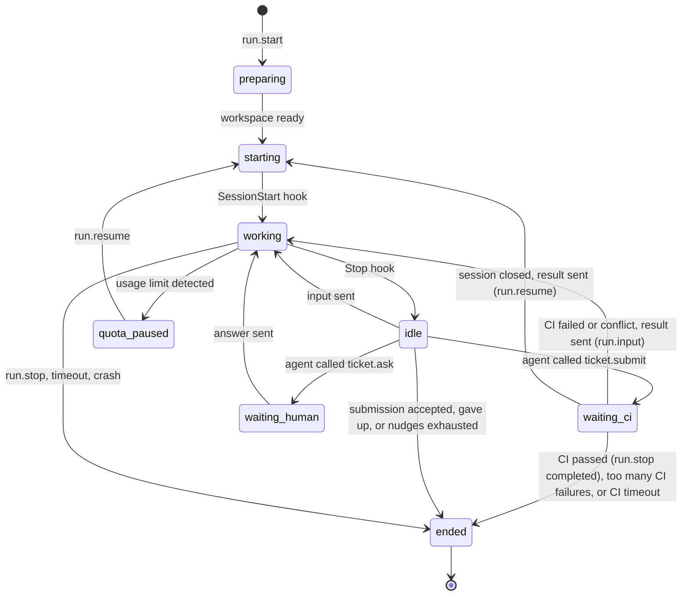

# 05 — Daemon

> Status: Draft v0.1
> Related: [01 — Domain Model](01-domain-model.md), [04 — Ticket Lifecycle](04-ticket-lifecycle.md), [06 — MCP](06-mcp.md), [07 — Scheduler](07-scheduler.md)

The daemon is the execution plane. It runs on every machine that executes agents, starts Claude Code sessions for runs, and reports what happens back to the web application. It holds no business rules about tickets: it executes what the server asks and reports facts.

## 1. Responsibilities

- Keep a single authenticated outbound connection to the web application.
- Report the machine's identity, versions and capabilities.
- Prepare a Git workspace for each run.
- Start, drive, resume and stop Claude Code sessions in **interactive mode** inside tmux.
- Enforce the agent profile's tool allowlist through Claude Code hooks.
- Collect state from hooks and session transcripts, and stream it to the server.
- Serve the MCP tools to Claude Code and relay the calls to the server.
- Fetch repositories and, from lot 3, push branches to GitHub on behalf of agents. Agents never hold GitHub credentials.
- Detect when the Claude account reaches its usage limit.

Non-responsibilities: deciding what runs next (scheduler), validating ticket transitions (server), storing business data (server).

## 2. Platform and packaging

| Item | Decision |
|---|---|
| Supported OS | Linux, and Windows through WSL 2 (Linux distribution). No native Windows. |
| Runtime | Node.js 24 LTS, TypeScript. Claude Code's native installer does not need Node.js, so Node.js is a prerequisite of the daemon itself. |
| Distribution | npm package exposing an `orchestrator-daemon` command, bundled into a single file and served by the server of the same version at `/downloads/orchestrator-daemon-<version>.tgz`. The owner installs it with `npm install -g <server URL>/downloads/orchestrator-daemon-<version>.tgz`; nothing is published to the npm registry (owner's decision, lot 2 step A). Each package carries a **build identifier**, a hash of the daemon's bundled sources computed when the package is built, so two packages of the same version number are told apart (16 hexadecimal digits of the SHA-256 of the bundled script, with a placeholder where the identifier is then written, and of the package's `package.json`: it changes with any change of the bundled code, the daemon's, the protocol package's or a library's, and with the package's name or version, never with the time, the machine or the folder; `apps/daemon/scripts/bundle.ts`, lot 3 step B; a daemon run from its sources has none; the server reads the build of the package it serves from the file `pack.ts` writes next to it, and `/version` returns it): the daemon sends it in `hello`, and `orchestrator-daemon --version`, `status` and the machine page show it (owner's decision, lot 3 step A; on 2026-10-03 the daemon before and after lot 2's fixes was "0.3.0" both times). Updating a daemon: `systemctl --user stop orchestrator-daemon`, `npm uninstall -g orchestrator-daemon`, `npm install -g --prefer-online <server URL>/downloads/orchestrator-daemon-<version>.tgz`, `orchestrator-daemon install-service`, then `orchestrator-daemon doctor` (Help > Machines > "Update the daemon"; the commands that worked on 2026-10-03). The installed package is named `orchestrator-daemon`, which a test checks against the documented commands (owner's decision, lot 3 step A). |
| Service | systemd user service named `orchestrator-daemon`, installed by `orchestrator-daemon install-service`, with lingering enabled (`loginctl enable-linger <user>`, with the user's name from the account, since without it loginctl looks for the terminal's login session, which a WSL terminal does not have: "No such device or address", owner's check, lot 2 step N) so it runs without an open login. When loginctl refuses, `install-service` prints loginctl's own message and the command to type. The unit starts the daemon with the absolute paths of the `node` executable and of the daemon's script found at install time, so it never depends on a login shell's `PATH` (nvm). The unit also sets `PATH` to the `PATH` of the terminal where `install-service` is typed, so the service finds the same tools as the owner (`claude` in `~/.local/bin`, `node` and `npm` from nvm) and agents' commands find them too; `install-service` drops empty and relative entries (including `.`) and, on WSL, every entry under `/mnt/` (Windows folders added by WSL interop), and prints the `PATH` it wrote. After installing a tool or changing the Node.js version, the owner installs the daemon again if needed and runs `install-service` again (owner's decision, lot 2 step E). The checks of section 3.2 run at each `hello`: after updating the daemon or Claude Code, or fixing a `doctor` error, the owner restarts the daemon with `systemctl --user restart orchestrator-daemon` (or stops and starts `orchestrator-daemon start` when it runs in the foreground) (owner's decision, lot 2 step D). On WSL, systemd must be enabled (`[boot] systemd=true` in `/etc/wsl.conf`), and systemd services do not keep WSL running: the user documentation explains how to keep it running (`instanceIdleTimeout=-1` in the `[general]` section of `%UserProfile%\.wslconfig`, or an open WSL window). The daemon cannot read the Windows `.wslconfig`: the Add machine help page explains the setting, and `doctor` prints it as "check this yourself" with the documentation link (owner's decision, lot 2 step A). |
| Dependencies checked at start | `git` (2.40 or later), `tmux` (3.2 or later, for `paste-buffer -p`), `claude` (2.1.280 or later). Missing dependencies or versions below these are reported to the server and the machine is marked unusable. A Claude Code version above the highest one validated with the spike scripts is accepted with a warning in `doctor` and on the machine page, because Claude Code updates itself often; the session start timeout (section 4.2.1) catches a real incompatibility (owner's decision, lot 2 step A). |
| Recommended setup | A dedicated Linux user for the daemon, so agents cannot read the owner's personal files. In lot 2 the daemon runs under the owner's own user, and the user documentation says plainly that an agent is then less isolated and that the path checks on Bash commands are best effort (section 4.6); the guide for a dedicated user comes with lot 7 (owner's decision, lot 2 step A). Under the same user, an agent could also write to its run's socket (`runs/<run-id>/daemon.sock`, section 4.2) to send fake hook events or MCP calls: the barrier is on the server, where a run's token only allows actions on that run's own ticket or request (06, section 2; enforced from plan steps J and K). The Help section "Agents on your own user" says so in plain words (owner's decision, lot 2 step F). The first message of a run is passed to Claude Code as a command-line argument (section 4.3), so the owner's other processes can read it (`ps`) while the session launches; it holds the ticket and its comments, never a secret (owner's decision, lot 2 step I). |
| Claude configuration | Agents run with a **dedicated Claude Code configuration folder** (`CLAUDE_CONFIG_DIR=~/.orchestrator/claude-config`), separate from the owner's personal one. It holds its own login (same subscription), trust entries and transcripts. See ADR 0002. |

**Sessions survive a restart of the service** (owner's decision, review of lot 2 step J; lot 2 step K). The unit sets no `KillMode`, so systemd's default `control-group` applies: stopping or restarting the service kills every process of its cgroup. The daemon therefore starts its tmux server (`tmux -L orchestrator`) outside that cgroup, in a transient scope of its own, `systemd-run --user --scope --unit orchestrator-tmux --collect`, wrapping the `tmux new-session` that starts the server: the service's cgroup then holds only the daemon and its short-lived commands, and a `systemctl --user restart orchestrator-daemon` leaves every agent session running, found again by the restarted daemon (section 6). `KillMode=process` is not chosen: it would leave every other child of the daemon (a `git` command, for example) behind on a stop, and systemd warns about such processes. At start, the daemon creates one throw-away scope (`systemd-run --user --scope --collect --unit <prefix>orchestrator-scope-check-<random> -- true`); scopes are used only when it succeeds, the service's normal case (owner's decision, lot 2 step M2). **The service without scopes** (`start --service`, the check failed: `systemd-run` or `systemctl` not in its `PATH`, or `systemd-run` refused, with its own error) still starts and connects, but reports the blocking `doctor` error "Process scopes" with the precise reason and the fix (section 8), shown as **Problem on …** in "Needs you", and refuses `run.start` and `run.resume` with that message, so no session starts where the next restart of the service would kill it. A daemon in a terminal without scopes keeps the fallback: no scope, no check row, sessions start as before. **A run's scope failing later** (the check at start passed) is classified on systemd-run's own failure, never on a missing file alone (owner's decision, review of lot 2 step M2): a session can also end during its launch because of **Stop run**, a daemon stopped or restarted, or tmux killed. The run's session command is a wrapper outside the scope, `sh -c '<wrapper>' orchestrator-scope <started> <error> <exit> systemd-run … -- sh -c ': > "$0" && exec "$@" 2>/dev/tty' <started> claude …` (files in the run's folder, section 4.3): it runs systemd-run with its error output in `scope-error`, and when systemd-run ends without the scope having written `scope-started`, it records systemd-run's exit status in `scope-exit`; inside the scope, Claude Code gets the terminal back as its error output. A session that ends with a recorded exit status from 1 to 127 (systemd-run's own failure, not a signal) and no `scope-started` is a scope failure, with systemd-run's message from `scope-error` (or the exit status) as its reason. A session that ends without the marker but with no recorded failure (a hang-up from **Stop run** or a killed tmux ends the wrapper too) ends as before (`crashed`), and the machine is not blocked. The tmux server's scope is told the same way: its `tmux new-session` runs through the marking shell inside the scope (`<home>/tmux-scope-started`), and a failure with an exit status from 1 to 127 and no marker is the scope's. A scope failure ends the run with `process_scope_failed`, which the server records as failed with `machine_problem`, never a failed attempt, the ticket back in `todo` (owner's decision, lot 2 step M2); the daemon switches to the same blocking error and sends its checks at once (`machine.doctor`, section 3.3), refusing `run.start` and `run.resume` until it is restarted. This applies to a daemon in a terminal whose check at start passed as well: it then shows its "Process scopes" error row in `hello`, `status` and `doctor` until it is restarted (owner's decision, review of lot 2 step M2). New sessions are started one at a time, so two runs never both start the server. A daemon whose `ORCHESTRATOR_HOME` is not `~/.orchestrator` (the tests' throw-away homes) prefixes its unit names with `od-test-` and a hash of that folder, so it never meets the owner's units.

The daemon runs as a normal process on the host, **not in Docker**, because it needs the machine's Claude Code login, tmux and toolchains (for example the Android SDK).

## 3. Enrollment and connection

### 3.1 Enrollment

1. In the UI, the owner creates a machine and selects the Claude account it uses. The server shows a one-time enrollment command containing the server URL and an enrollment code valid for the enrollment code lifetime (a setting, 15 minutes by default, 04 section 8).
2. On the machine, the owner runs `orchestrator-daemon enroll <server-url> <code>`.
3. The owner runs `orchestrator-daemon login`, which opens Claude Code once with the dedicated configuration folder so they can log in to their Claude account. Claude Code starts in `~/.orchestrator/login/`, an empty folder the daemon marks as trusted in the dedicated configuration beforehand (as for a run's bare clone, section 4.2.1), whatever folder the command is typed in: Claude Code asks no trust question and loads no `CLAUDE.md` (owner's check, lot 2 step N: from the terminal's folder it asked to trust that folder, and from a repository it would have loaded its `CLAUDE.md`). This is the only interactive step, done once per machine.
4. The daemon exchanges the code for a long-lived **machine token**, stored in `~/.orchestrator/config.json` with permissions `600`.
5. The machine appears online in the UI. The owner can revoke the token at any time, which disconnects the daemon.

The exchange (owner's decision, lot 2 step C):

- The daemon sends `POST /daemon/enroll` with `{ code }`, without authentication; the answer is `{ machineId, machineName, machineToken }`. Both are Zod schemas in `packages/protocol`.
- The **code** is 24 characters from Crockford's Base32 alphabet (`0-9`, `A-Z` without `I`, `L`, `O`, `U`; 120 random bits), so guessing one within its lifetime is impractical. The daemon accepts it in any case and ignores `-` and spaces. It is stored hashed, with its expiry.
- The code is **single use**: it is marked used in the same transaction that sets the machine's token, so two requests with the same code cannot both succeed.
- A refused code says why: unknown, already used, or expired (stating the current "Enrollment code lifetime"). Failed attempts are throttled per client address with the login throttling of ADR 0015 and its settings, under their own key so they never delay the owner's login; the address is resolved as for a login. A throttled attempt is refused with the time to wait.
- The **machine token** is `omt_` followed by 43 characters (256 random bits, Base64 URL). It is returned once, stored as a hash, and never logged; the request body is never logged either. The event log masks it like other credentials.
- Enrolling again (after **New enrollment code**, 01 section 3.8) issues a new token; earlier tokens are never valid again.

### 3.2 Connection

- A single WebSocket from the daemon to the server (`wss://` when the server is remote, `ws://` accepted for `localhost` only). The rule is checked by `enroll` and at every connection (owner's decision, lot 2 step E):
  - an `http://` server address is accepted only when its host is `localhost`, an address in `127.0.0.0/8` or `::1`; any other is refused, and the refusal says why: the machine token and, for Git commands, the GitHub token travel on this connection. A server on another computer is reached through `https://` (a reverse proxy, 09 section 7.2);
  - `enroll` accepts `--ca-file <path>`, a PEM certificate authority for a reverse proxy with an internal or self-signed certificate. Its content is stored in `config.json` and used for the enrollment request and the WebSocket. Certificate checks are never disabled, and there is no "insecure" option;
  - `doctor` reports the server address scheme and, for `https://`, whether the certificate is valid, with a warning when it expires within 14 days.
- The daemon authenticates with the machine token on connection (`Authorization: Bearer <token>` on the WebSocket request to `/daemon`). An unknown token is refused before the WebSocket opens (HTTP 401). A revoked token gets a `welcome` refused with `token_revoked`, then the connection is closed.
- The first message is `hello`. The server accepts the current protocol version and the previous one (09, section 6); any other version gets a `welcome` refused with `protocol_incompatible` and the update instruction, the connection is closed, and the machine shows "daemon incompatible" in "Needs you" until a compatible `hello`. A connection that sends no `hello` within the "machine offline after" delay is closed.
- A machine whose Claude Code is missing or below the minimum (section 2), or whose `doctor` reports an error, is still accepted: it shows online, is marked **unusable** with the reasons, and receives no runs. Warnings never block it. The next `hello` whose checks pass clears it (01 section 3.8, 02 section 4; owner's decision, lot 2 step C).
- Heartbeat at the heartbeat interval (15 seconds by default). The server marks the machine `offline` after the "machine offline after" delay without a message of any kind (60 seconds by default, at least twice the interval), and closes the connection. Both are settings (04, section 8); the server sends the interval to the daemon in its answer to `hello`. Each connection keeps the interval it was given, and its silence limit is never below twice that interval, so changing the settings never marks a connected daemon offline by mistake (owner's decision, lot 2 step C).
- The machine is also `offline` as soon as its connection closes. When the server starts, machines still recorded `online` become `offline`, each with its event.
- If a machine opens a new connection while an older one is still open, the newer one replaces it: the server closes the older one without marking the machine offline in between.
- Going offline only changes the machine's status and writes an event. In lot 2 it never ends or fails a run by itself: tmux sessions keep running on the host, and the daemon resends its unacknowledged reports when it reconnects. Only the owner's **Stop run** fails a run with `machine_offline`; lot 4 adds the automatic failure of section 6 (owner's decision, lot 2 step C).
- Revoking a machine closes its connection at once.
- Every connection the server closes has a WebSocket close code from `packages/protocol`, so the daemon can tell the reason (revoked, incompatible, replaced, silent).
- Reconnection with exponential backoff (1 s to 60 s). These two values are constants of the daemon, not settings: the daemon needs them before it is connected and can read any setting (owner's decision, lot 2 step A). The daemon also sends a WebSocket ping with each heartbeat; a connection with no answer for two heartbeat intervals is abandoned and a new one opened, so a connection lost without a close (a sleeping computer, a network change) is noticed.
- **Refusals that retrying cannot fix stop the daemon** (owner's decision, lot 2 step E): an unknown token (HTTP 401), a revoked token (`token_revoked` or the `revoked` close code), an incompatible protocol (`protocol_incompatible` or the `incompatible` close code), and the `replaced` close code (another daemon connected with this machine's token). The daemon writes a message naming the cause and the fix (for example "This machine was revoked in the Orchestrator: enroll it again with a new enrollment code, then restart the daemon"), records it as the **last stop reason** in `~/.orchestrator/last-stop.json`, which `doctor` and `status` show, and exits with code 78; the systemd unit does not restart it for that code (`RestartPreventExitStatus=78`). The daemon acts on a close only when it arrives on its current connection: a `replaced` close on a connection it has already abandoned for a newer one is ignored. Every other close (network error, server restart, `silent`, `shutdown`) reconnects with the backoff. Stopping the daemon (`systemctl --user stop`, Ctrl+C) is recorded as the last stop reason too; an accepted `welcome` clears it.
- When the server is not on the same network (VPS), the recommended setup is a private network such as a VPN; the web application is not exposed publicly in v1.

### 3.3 Messages

All messages are JSON: `{ "type": "...", "id": "...", "payload": { ... } }`, defined once as Zod schemas in `packages/protocol` (`src/daemon/`). Messages that need an answer are acknowledged with the same `id` (owner's decision, lot 2 step B):

- three pairs answer each other: `hello` and `welcome`, `mcp.call` and `mcp.result`, `git.credential_request` and `git.credential`;
- the server's commands (`run.start`, `run.input`, `run.resume`, `run.stop`) and the daemon's reports (`run.state`, `run.events`, `run.quota_limited`, `machine.doctor`) are each answered by an `ack` (`ok`, or not with the reason); `run.events` are acknowledged per batch, not per line; heartbeats get no answer;
- the daemon keeps every unacknowledged report in its run files, so it survives a daemon restart, and resends them in order after reconnection;
- the server handles every report and command idempotently by message id: a duplicate is acknowledged again and changes nothing.

Sizes (owner's decision, lot 2 step B): every text of a message has a ceiling derived in code from the settings' declared ranges in `packages/protocol`, never copied as a number. A text tied to a setting is capped at the highest value that setting allows (a ticket title at the top of "Longest ticket title"'s range); any other text at the largest such ceiling. The server still checks the setting's current value. The same rule applies to MCP tool inputs (06, section 3).

| Direction | Type | Purpose |
|---|---|---|
| D → S | `hello` | Protocol version, daemon version and build identifier (section 2; from protocol 2), Claude Code version, OS, detected capabilities, `doctor` results, runs currently alive on the machine. |
| S → D | `welcome` | Answer to `hello`: accepted or refused (incompatible protocol, revoked token), and the heartbeat interval. The run timeouts come with each `run.start`. |
| D → S | `machine.doctor` | The `doctor` results again, sent at once when they change while connected (a run's process scope could not be created, section 2). The server stores them as at `hello` (an error makes the machine unusable) and writes the event `machine.doctor_changed` when they differ; a duplicate changes nothing. Not kept for resending: the next `hello` carries the same checks (lot 2 step M2). |
| D → S | `heartbeat` | Liveness. In lot 2 it carries nothing else; lot 4 adds the resource summary as an optional field, so protocol version 1 stays compatible (owner's decision, lot 2 step B). |
| both | `ack` | Acknowledges a command or a report (above). |
| S → D | `run.start` | Start a run (payload in section 4.1). |
| S → D | `run.input` | Send text to a live session (owner answer, CI result). Nudges are not sent this way: the daemon sends the nudge it received in `run.start` (section 4.8). The server builds the text from a run message template in `agents/` (03, section 3.2), such as the wrapping of the owner's answer. With `fetchBase` (protocol 2, lot 3 step G2a), the daemon first downloads the base branch (section 4.9) and acknowledges only afterwards. |
| S → D | `run.resume` | Resume a session that was closed (after a quota pause or a long wait), with the first message to send: the owner's answer, the "please continue" message after a usage-limit pause, detected or suspected, or a CI result for a run waiting for CI whose session closed (lot 3 step G2a). They come from run message templates in `agents/` (03, section 3.2), filled in by the server. It takes `fetchBase` as `run.input` does. |
| S → D | `run.stop` | Stop a run (cancel, timeout), or, with the reason `completed` (protocol 2), end a run waiting for CI whose CI passed: the run ends with `submitted` (section 4.9). |
| D → S | `run.state` | Run state change (section 4.7) with the Claude session id and whether the tmux session is alive (false once a waiting or paused run's session is closed); with `starting`, the version of the `claude` about to be launched (section 4.3); at the end of a run, the reason as a fact (`submitted`, `gave_up`, `nudges_exhausted`, `stopped`, `max_duration`, `idle_timeout`, `session_start_timeout`, `claude_code_unsupported`, `process_scope_failed`, `crashed`, and from protocol 2 `ci_failed`, `ci_timeout`, `review_branch_moved` and, from lot 3 step F, `push_failed`), from which the server derives the run's status and failure reason, and the ticket branch's head and the commits ahead of the base branch; from protocol 2 also `waiting_ci`, the head pushed to GitHub at the end (or the push's error), for a review run whether the head moved, and what the daemon found changed and restored in the bare clone's Git configuration and hooks, in plain words naming settings and hook files, never their values (section 7.1); the server writes it as the event `run.git_config_restored`, information only (lot 3 step D2). The end is reported once the end push is over (section 4.11), and the daemon acknowledges `run.stop` once the run has ended. |
| D → S | `run.events` | Batch of transcript events for live logs. |
| D → S | `run.quota_limited` | The account reached its usage limit (`detected`, with the reset time when known) or may have (`suspected`), with the evidence (section 4.10). |
| D → S | `mcp.call` | An MCP tool call from an agent, with the run token; for `ticket_submit`, also the worktree facts of section 4.9 (from protocol 2 with the push result and the files changed against the base branch). A push result is `pushed` with the head now on GitHub, or `failed` with the reason (`diverged`, `refused`, `unreachable`) and Git's or the server's message; null when no push was tried (lot 3 step B). The decision tools are `ticket_submit`, `ticket_ask`, `ticket_give_up` and, from protocol 2, `review_approve` and `review_request_changes`. |
| S → D | `mcp.result` | Result or error of the call. |
| D → S | `git.credential_request` | Ask for the credential for one Git command on one repository of an active or ending run: `fetch`, or from protocol 2 `push` (never for a `review` run). |
| S → D | `git.credential` | The credential for that one command (section 7). |

## 4. Run execution

**Protocol 2** (lot 3; owner's decision, lot 3 step A). Every change above marked "protocol 2" is one a 0.3.0 daemon cannot understand (working rule 13), so `PROTOCOL_VERSION` is 2. A protocol 1 daemon is still accepted as the previous version (09, section 6) but is **unusable**: "Daemon 0.3.0 is older than this Orchestrator (0.4.0): update it", with the update commands (section 2), shown as "Update the daemon on X" in "Needs you". A protocol 2 daemon whose build differs from the bundle the server serves stays usable, with a warning on the machine page and a non-blocking "Needs you" item, "The daemon on X is not the one this Orchestrator provides" (a different build is not always a newer one). A daemon run from its sources (no build) differs from a served package too; a server that serves no package compares nothing. The protocol 2 fields of the daemon's messages (the build, push results, changed files, "head moved") read as null when a protocol 1 daemon leaves them out, so its reports are still understood (lot 3 step B).

### 4.1 `run.start` payload

- run id, purpose, and ticket id or request id;
- repository (owner/name), its clone URL (built by the server from a base URL that tests point to a local `file://` remote), base branch, ticket branch;
- commit author name and address (04, section 4);
- agent profile snapshot: instructions, model, tool allowlist, profile version;
- run token for MCP calls (scoped to this run);
- initial prompt, built by the server from the ticket, its comments and the purpose;
- nudge message, filled in by the server from its run message template (03, section 3.2; section 4.8);
- limits: maximum run duration, idle timeout, maximum nudges, waiting run lifetime, session start timeout, MCP call timeout, Claude Code MCP tool timeout (values resolved by the server when the run starts, 04 section 8);
- optional Claude session id to resume.
- from protocol 2 (lot 3 step H; protocol 2 not released yet, so no version change): the MCP tools the run may call (`mcpTools`, 06 section 5), which the relay alone lists to Claude Code; and for a `review` run the commit under review (`reviewCommit`, 04 section 3.2).

### 4.2 Workspace

Everything the daemon manages lives under `~/.orchestrator/`:

```
~/.orchestrator/
  config.json              machine token, server URL, optional certificate authority (mode 600)
  daemon.sock              control socket of the running daemon, read-only (section 8)
  last-stop.json           why the daemon last stopped (section 3.2)
  claude-config/           dedicated CLAUDE_CONFIG_DIR: login, trust entries, transcripts
  login/                   empty folder where `login` opens Claude Code (section 3.1)
  repos/<owner>/<name>.git bare clone, one per repository, reused across runs
  worktrees/<run-id>/      Git worktree for a run
  runs/<run-id>/           run files (never inside the worktree)
    system-prompt.md       agent instructions and run context
    settings.json          hooks, status line command and permissions for this run
    mcp.json               MCP server declaration for this run, with its tool timeout
    state.json             the run's daemon state, so a restarted daemon finds its sessions again
    daemon.sock            local socket used by hooks and the MCP server
```

Preparation steps:

1. Fetch the bare clone. If it is missing, clone it and **register workspace trust** for the bare clone's path in the dedicated configuration (section 4.2.1). The credential is used as described in section 7: it never ends up in the bare clone's configuration. The bare clone receives the remote's branches in `refs/remotes/origin/*`, never on its local branches, so a fetch never overwrites a ticket branch holding commits not pushed yet (owner's decision, lot 2 step F). From lot 3 the fetch runs in an **isolated repository** (section 7.1), never in the bare clone: the commits the bare clone has are written into the isolated repository as refs first, so only new commits are downloaded; the fetched pack is then moved into the bare clone's `objects/pack` (the `.pack` first, then its `.rev` when Git wrote one, then the `.idx`, so Git never sees an index without its pack), and the daemon sets `refs/remotes/origin/*` to the fetched refs with one `git update-ref --stdin` transaction, deleting the refs of branches no longer on GitHub. Those local commands never carry the credential's variables (owner's decision, lot 3 step D1).
2. Create the worktree: on the ticket branch of the bare clone if it exists (lot 2 keeps it there, section 4.11), else on the remote's ticket branch, otherwise a new branch from the remote's base branch (`origin/<base>`). Set the commit author for that worktree with Git's per-worktree configuration (`extensions.worktreeConfig`), which holds nothing else (owner's decision, lot 2 step F).
3. For `review` runs, the worktree is **detached at GitHub's head of the ticket branch**, as fetched in step 1 (`refs/remotes/origin/<branch>`), which must be `run.start`'s `reviewCommit`: a GitHub head that is another commit fails the preparation with `review_branch_moved` ("The ticket branch on GitHub moved since the review was started: it is now def5678, not abc1234."), not counted (owner's answer 2b, lot 3 step H); the local ticket branch is neither created nor moved, so commits only the machine has (for example one made after an accepted submission, in the same turn) are never reviewed in place of the pull request, and a local branch ahead of GitHub is left alone. A ticket branch not on GitHub fails the preparation ("The ticket branch … is not on GitHub: there is nothing to review."). The worktree is read-only by convention and by allowlist (no write tools). A review run never pushes. The daemon keeps the worktree's head and the local ticket branch's head (or its absence) in `state.json`; at the run's end, the head **moved** when either differs (a head it cannot read counts as moved), and a moved head ends the run with `review_branch_moved`, whatever its reason was, and `headMoved` true; the branch reported is the worktree's head (owner's decisions, lot 3 steps A and D2).

From lot 3, for `implement` and `fix_review` runs, when the ticket branch exists both in the bare clone and on GitHub, the worktree uses the bare clone's branch after fast-forwarding it to GitHub's when GitHub's contains it (for example after GitHub's **Update branch**), with `git update-ref` given the old head, so a branch that moved meanwhile is not changed; when they diverged, the run goes on from the bare clone's branch and its push fails with `diverged` (section 4.9; owner's decision, lot 3 step A). A branch another worktree has checked out (a waiting or paused run of the same ticket, which the server's one active run per ticket allows only after a **Stop run** while the machine was offline) is never moved: the preparation fails with "The ticket branch … is checked out by another run on this machine …", and the old run is stopped at the machine's next `hello` (section 6) (lot 3 step D2).
4. For planning runs on a new project (no repository yet), the worktree is an empty scratch directory.

Run files are written outside the worktree so they never end up in a commit.

#### 4.2.1 Workspace trust

Claude Code asks the user to trust a folder the first time it starts there, and does not load hooks or project settings before that. The spike (ADR 0002) showed that:

- trust is recorded per exact path, never inherited from a parent folder;
- for a Git worktree, trust is recorded on the **main repository** path, which here is the bare clone;
- a trust entry written in advance in the configuration file is honoured: the session starts with no dialog.

So the daemon registers trust **once per repository**, when it first clones it, by writing `projects["<bare clone path>"].hasTrustDialogAccepted = true` in the dedicated configuration file. The write is atomic (temporary file then rename) and done while no session of the dedicated configuration is starting: the daemon's trust writes are serialised, each waits until no run is `starting`, and a launch waits for a trust write in progress. Claude Code rewrites the same file on its own, so one of its writes could drop an entry: the daemon checks the entry before each launch and writes it again when missing. The test runs several registrations at once while another process keeps rewriting the file, and checks that every entry is kept (restored by that check when the other process dropped it) and that a reader never sees a partial file (owner's decision, lot 2 step F). Every worktree of that repository then starts without a dialog. The owner's personal configuration is never modified.

If a session does not report `SessionStart` within the session start timeout (a setting, 30 seconds by default, 04 section 8), the run fails with reason `crash` and the event says "workspace trust or startup dialog suspected", so a change in Claude Code's behaviour is visible immediately.

### 4.3 Starting Claude Code

The daemon creates a detached tmux session named `orch-<run-id>` on its own tmux server (`tmux -L orchestrator`), separate from the owner's tmux sessions, with the worktree as working directory and `CLAUDE_CONFIG_DIR` set to the dedicated configuration, and starts Claude Code in interactive mode. `TMUX` and `TMUX_PANE` are unset in each session's environment, so nothing in a session finds the tmux server through them (owner's decision, lot 2 step E). The command is built as an argument list, never as a shell string, in this order:

| Argument | Purpose |
|---|---|
| `--mcp-config <run mcp.json>` | MCP relay for the run. First, because this option accepts several values. |
| `--strict-mcp-config` | Use only the MCP relay: MCP servers declared by the repository (`.mcp.json`) or elsewhere are ignored. |
| `--setting-sources user` | Load only the dedicated configuration's user settings (written by the daemon), never the repository's `.claude/settings.json` or `settings.local.json`: Claude Code merges `permissions.allow` lists and hooks across sources, so a repository could otherwise widen the allowlist or add hooks. This also stops Claude Code from loading the repository's `CLAUDE.md` on its own; the common rules tell the agent to read it (03, section 3). |
| `--settings <run settings.json>` | Hooks, status line command, allowlist, deny rules and `autoContinueAtUsageLimit: false` for the run. |
| `--permission-mode dontAsk` | Refuse anything not allowed instead of prompting (section 4.6). |
| `--model <profile model>` | Model from the agent profile. |
| `--append-system-prompt <text>` | Common rules and role instructions, added to Claude Code's own system prompt. The text is passed directly: the spike found no file variant, and although the documentation now lists `--append-system-prompt-file`, the validated text form is kept (owner's decision, lot 2 step A). |
| `--resume <session id>` | Only for `run.resume`. The session keeps its id. |
| `--` then the first message | Always after `--`, so the message can never be read as an option value. |

With `--setting-sources user`, the only settings file Claude Code reads besides `--settings` is the **user** settings file of the configuration folder in `CLAUDE_CONFIG_DIR`: `~/.orchestrator/claude-config/settings.json`, written and owned only by the daemon (Claude Code's documentation: user settings are `$CLAUDE_CONFIG_DIR/settings.json` when the variable is set). Before each launch the daemon sets `autoContinueAtUsageLimit: false` in that file, keeping any other key found there (section 4.10; owner's decision, lot 2 step H). The owner's own `~/.claude/` settings never reach a run, and the agent cannot change the daemon's file: it is inside the Claude configuration folders covered by the deny rules (section 4.6). Managed settings (`/etc/claude-code/`, and on WSL possibly the Windows policy) always apply, as they do for any Claude Code session; the owner's machine normally has none, and `doctor` reports any it finds (owner's decision, lot 2 step A).

These arguments were validated on Claude Code 2.1.280 (ADR 0002), except `--strict-mcp-config` and `--setting-sources`, taken from the documentation check of lot 2 step A and checked by the owner on Claude Code 2.1.283 with `tools/smoke/claude-code-probe.sh` (lot 2 plan step H): the repository's allow rules, hooks and `.mcp.json` servers are ignored. The daemon declares its supported minimum version and refuses older ones (section 2). Claude Code updates itself while the daemon runs, so the version reported at `hello` can go stale: at each run start the daemon reports the version of the `claude` it launches, and the server checks it again as at `hello`, marking the machine unusable (and failing that start) when it is missing or below the minimum (owner's decision, lot 2 step D; implemented in plan steps F and J). The daemon runs `claude --version` before each launch and sends the version with the `starting` state (`run.state`). When it is missing or below the minimum (the constant shared through `packages/protocol`), the daemon does not launch and ends the run with the reason `claude_code_unsupported`, so the server marks the machine unusable without counting an attempt (owner's decision, lot 2 step F); the run fails with the failure reason `claude_code_unsupported` and the ticket returns to `todo` (owner's decision, lot 2 step J). Environment: `CLAUDE_CONFIG_DIR` as above; `GIT_TERMINAL_PROMPT=0` and `GCM_INTERACTIVE=never`, so no Git command of the agent waits for a password or opens Git Credential Manager's window (owner's decision, lot 2 step G; section 7); `ORCHESTRATOR_RUN_ID=<run id>`, the marker every process of the run inherits, even through `nohup`, `setsid` and double forks (section 4.11); the automatic updater of Claude Code is left on. tmux gives a new session the `PATH` of the tmux client, which is the daemon's own (the service's `PATH`, section 2).

Where the daemon uses scopes (section 2), Claude Code is started inside a transient scope of its own, `systemd-run --user --scope --unit orch-run-<run id> --collect --property=TimeoutStopSec=5s -- sh -c ': > "$0" && exec "$@" 2>/dev/tty' <run folder>/scope-started claude …`, run by the wrapper that records systemd-run's failure (section 2) as the session's command: the shell inside the scope writes the marker that proves the scope was created, then replaces itself with Claude Code (lot 2 step M2): the scope then holds every process the session starts, whatever it does to its session or process group (lot 2 plan step K).

### 4.4 Sending input

Later messages (owner answers, CI results, nudges) are sent to the session by loading the text into a tmux buffer and pasting it, then pressing Enter. This avoids problems with special characters and multi-line text. Input is only sent when the session is idle (last hook received is `Stop`) or waiting for the owner; otherwise it is queued. A `run.input` for a run whose session was closed (after the waiting run lifetime, a usage limit, or Claude Code ending while the run waits for CI) is refused with "session closed: use run.resume" (owner's decision, lot 2 step G; lot 3 step G2a). A run waiting for CI with its session open takes a `run.input` at once: the CI result is pasted and the run is `working` again (lot 3 step G2a). **Each message once** (lot 3 step G2b): a copy of a `run.input` or `run.resume` arriving while the first is still handled (the server's wait for the answer ended during a slow download of the base branch) shares the first one's work and answer; the ids of the messages given to the session are written in `state.json` with the queued text (the newest 50), so a copy arriving after a daemon restart is acknowledged and not given again. The server sends a CI round again with the same id (04, section 3.1). When that refusal answers the owner's answer (the session closed between the server's decision and the daemon's), the server sends the answer again with `run.resume` (lot 2 step K).

### 4.5 Observing the session

The daemon never reads the terminal display. It uses three sources.

| Source | What it gives | Use |
|---|---|---|
| **Hooks** | `SessionStart` (session id, transcript path, `source`: `startup` or `resume`), `PreToolUse` and `PostToolUse`, `Notification` (`notification_type`, including `idle_prompt` when idle), `Stop` at the end of **each turn** with the agent's last message (`last_assistant_message`), `StopFailure` **instead of** `Stop` when a turn ends on an API error (`error`: `rate_limit`, `overloaded`, `server_error`, `authentication_failed`, … and the error text in `last_assistant_message`), `SessionEnd`. | Run state machine, permission enforcement, idle detection, turn outcome, and usage-limit detection (with the transcript's API-error fact only, section 4.10). |
| **Status line command** | A command declared in the run's `settings.json` (`statusLine`), run by Claude Code with a JSON input that includes `cost.total_cost_usd` and, for Pro and Max accounts, `rate_limits.five_hour` and `rate_limits.seven_day` (`used_percentage`, `resets_at` in Unix seconds). It forwards the input to the daemon and prints nothing useful. It is a documented input, like hooks, not the terminal display. Claude Code runs it only when its interface refreshes, so it is a supplementary source (section 4.10). | Usage estimate per run (07), reset time of a usage limit. |
| **Transcript file** | The session's JSONL transcript, under the dedicated configuration folder. Claude Code documents its format as internal and changing between versions, so the daemon reads it tolerantly (unknown entries are skipped) and uses it for display, and for one fact given to the usage-limit module: whether the turn's last assistant entry is marked as an API error (`isApiErrorMessage`), which no hook shows when the session hangs after the error (section 4.10; owner's decision, lot 2 step G). It includes `cost-state` entries, whose `totalCostUSD` is the usage estimate only if the status line gives none. | Live logs in the UI; the API-error fact for section 4.10. |
| **MCP calls** | Explicit declarations by the agent: progress, question, submission, giving up. | Ticket state, run outcome. |

Hooks and the status line are small commands declared in the run's `settings.json` (`orchestrator-daemon hook <event> --run <run-id>`, `orchestrator-daemon status-line --run <run-id>`). Each sends its input to the daemon through the run's own socket (`runs/<run-id>/daemon.sock`, never the control socket) and returns the daemon's answer to Claude Code. When the daemon cannot be reached, a `PreToolUse` is denied (fails closed, with the reason "Orchestrator daemon unavailable"); every other event exits with code 0 so Claude Code is not disturbed (owner's decision, lot 2 step F).

The transcript reader is tolerant (owner's decision, lot 2 step F): an unknown or malformed line is skipped and counted, never a failure of the run, and the count is shown in the run's log as a warning. Known types it reads without a log entry and without counting: `system`, `attachment`, `cost-state` (ADR 0002), and, seen with Claude Code 2.1.287 in the owner's check (lot 2 step N, 17 to 29 such lines per run, which the reader counted as unreadable), `ai-title` (the session's generated title), `last-prompt` (a copy of the last message sent), `mode` and `permission-mode` (the session's modes), `atis-latch` (an internal flag) and `file-history-snapshot` and `file-history-delta` (backups of the edited files for Claude Code's rewind). None of them holds the agent's work, which is all in `user` and `assistant` lines. The warning stays for any other type. The probe's fixtures keep only the lines the daemon reads, so the probe's report also lists the transcript's line types with their counts (names only) and those the daemon does not know (owner's decision, lot 2 step N). The daemon turns the entries it knows into log entries (the agent's text, tool calls and tool results), adds an entry for each message it sends to the agent, and masks credentials with the event log's patterns (shared through `packages/protocol`) before sending them in `run.events`. The server still truncates and masks what it stores (plan step J).

### 4.6 Permission enforcement

Interactive permission prompts would block unattended runs. They are avoided as follows:

Two layers, validated by the spike (ADR 0002):

1. **`dontAsk` permission mode with the profile's allowlist.** Allowed tools run without prompts. Anything else is refused automatically with a message telling the agent to stop and explain; the common rules tell the agent to use `ticket.ask` in that case (06, section 6). File reads outside the working directory need an approval, so `dontAsk` refuses them too, and this holds for Bash as well: the owner's probe on Claude Code 2.1.283 (lot 2 plan step H) found that `cat` of a file outside the worktree is refused by `dontAsk` even when an allow rule such as `Bash(cat *)` matches the command, which is a second barrier behind the deny rules and the hook. The two refusals read differently: a deny rule gives "Permission to use Bash with command … has been denied.", `dontAsk` adds "because Claude Code is running in don't ask mode". The run's `settings.json` also has **deny rules** (`Read(//<path>)`, `Edit(//<path>)`, with `/**` for folders) for the daemon's folder `~/.orchestrator/` (which holds the machine token) and for the Claude configuration folders (`~/.orchestrator/claude-config/`, `~/.claude/`, `~/.claude.json`); Claude Code applies deny rules to its file tools, to the file commands it recognises in Bash (`cat`, `head`, `sed`, `tee`, …) and to redirections, and whatever a hook answers. A deny rule always wins over an allow rule, and the worktrees live in `~/.orchestrator/worktrees/`, so the rules list the daemon folder's entries one by one and leave out `worktrees/`: `config.json`, `daemon.sock`, `last-stop.json`, `claude-config/`, `repos/` and `runs/`. Other runs' worktrees are refused by the hook only, since a settings rule cannot say "every worktree but this one" (owner's decision, lot 2 step G).

   The allowlist is the profile snapshot's `allowedTools`, plus `ToolSearch` (section below) and `mcp__orchestrator` (every tool of the Orchestrator's MCP server), which the daemon always adds: without them a run could not end, and the server enforces each role's MCP permissions (06, section 5; owner's decision, lot 2 step G).
2. **`PreToolUse` hook for rules an allowlist cannot express.** It denies, with a reason the agent reads:
   - any Bash command reaching GitHub or a Git remote (pushing is done by the daemon): every Git command that talks to a remote (`push`, `fetch`, `pull`, `clone`, `ls-remote`, `remote add`, `remote set-url`, `send-pack`, in any form such as `git -C <dir> push`), any `gh` or `hub` command, and any command naming a GitHub host (`github.com`, `api.github.com`, `*.githubusercontent.com`). The agent runs under the owner's user, and on WSL Git often has a global credential helper (such as Windows' Git Credential Manager), so such a command would use the owner's own GitHub credentials. `WebFetch` may read public GitHub pages: it holds no credentials (owner's decision, lot 2 step G). The daemon's own Git commands never go through the hook;
   - any change to the repository's `.claude/` folder: runs ignore the repository's settings (section 4.3), but the owner's own Claude Code would load them. File tools may read it but not write to it; any Bash command naming a `.claude` path part is refused, even to read it, since a command's effect cannot be told from its text (owner's decision, lot 2 step G);
   - any access to the daemon's folder `~/.orchestrator/` (including `config.json` and its machine token) and to the Claude configuration folders, whether through a file tool or a Bash command (owner's decision, lot 2 step A);
   - any Bash command invoking `tmux`, so an agent cannot reach its own or another run's session (owner's decision, lot 2 step E; tested with the other rules in plan step G): refused whenever `tmux` appears as a whole word or as a path ending in `/tmux`, even in `grep tmux README` (owner's decision, lot 2 step G);
   - any Bash command running a container tool, `docker`, `docker-compose`, `podman`, `nerdctl` or `kubectl` (the program's name, after wrappers such as `env` or `sudo`, in any part of a chained command): the owner's user can use Docker, and the Orchestrator itself may run in Docker on the same machine, so a container's configuration could show its secret key. The run's `settings.json` also denies them (`Bash(docker)`, `Bash(docker *)`, and the same for each of the other four), since Claude Code allows some commands it considers read-only, such as `docker ps`, outside the allowlist (owner's decision, lot 2 step N, Docker first, then the other container tools; section 6 of 03). Text that only names Docker (`cat Dockerfile`, `ls docker/`) is not refused;
   - any other access outside the worktree. The run folder is not open to the agent: it holds the run's settings and socket, and the agent needs nothing there (owner's decision, lot 2 step G).

   Every refusal reason that tells the agent what to do next ends with the same sentence, in line with the common rules (03, section 3): "Do not ask the owner to allow it. If your ticket cannot be done without it, say so in plain words with `ticket_ask` or `ticket_give_up`." These reasons are the one agent-facing text kept in the daemon rather than in a run message template, because the hook must refuse correctly even when the server cannot be reached (owner's decision, lot 3 step A; lot 2's reasons ended with "explain why with ticket_ask", which contradicted the common rules).

   Paths of file tools (`Read`, `Write`, `Edit`, `MultiEdit`, `NotebookEdit`, `Glob`, `Grep`, `LS`) are checked exactly, after resolving `..` and symbolic links: only the worktree is allowed. For Bash commands the check is **best effort**: besides the worktree, a command may name `/dev/null`, `/dev/stdin`, `/dev/stdout`, `/dev/stderr`, the system temporary folder (`/tmp`, and `$TMPDIR`) and the system folders `/usr`, `/bin`, `/sbin`, `/lib*`, `/etc`, `/opt` and `/proc/self`; every other absolute path is refused (home folders, the owner's included, `/mnt` with the Windows drives on WSL, `/root`, `/var`, …), and so are `~`, `$HOME` and `..` leaving the worktree (owner's decision, lot 2 step G). A word is taken for an absolute path only when, after resolving `..`, its first folder exists at the filesystem root: web agents often search for routes such as `/api/users`, which are not paths, and each refusal costs a turn. A path that does not exist yet under an existing root folder (a file about to be written in `/home`, for example) is still checked (owner's decision, review of lot 2 step G). A program can still open files in ways no command text shows (Claude Code's documentation says the same of its own Bash rules). The user documentation says so (section 2, recommended setup). Each deny rule has its own test.

Allowlist rules are strict: a prefix rule such as `Bash(echo:*)` does not cover the same command with a redirection. Every default profile's allowlist is therefore checked by a smoke test (03, section 6). The `ToolSearch` tool must always be allowed, because Claude Code uses it to load MCP tools.

`--dangerously-skip-permissions` and the `bypassPermissions` mode are never used.

### 4.7 Run state machine on the daemon



The server's run status (01, section 3.7) follows the daemon's state: `preparing` and `starting` give `starting`; `working`, `idle` and `waiting_ci` give `running`; `waiting_human` gives `waiting_human` (also after the waiting run lifetime closed the session); `quota_paused` gives `paused_quota`; `ended` gives `succeeded`, `failed` or `cancelled` according to the reason. Before the daemon acknowledges `run.start` the run is `queued` then `dispatched`.

### 4.8 End of turn without a decision

When a turn ends (`Stop` hook) and the agent has not called `ticket.submit`, `ticket.ask` or `ticket.give_up` during it, the daemon sends a **nudge** at once (never after a `StopFailure`, section 4.10): a short message reminding the agent that it must continue working or use one of these three tools. The daemon decides when to nudge, but the text is the nudge message of `run.start`, filled in by the server from a run message template (03, section 3.2): the daemon holds no agent-facing text (owner's decision, lot 2 step B). After the maximum number of nudges (default 2, configurable), the run ends with reason `agent_gave_up`.

**Decisions** (owner's decision, lot 2 step G). The daemon sees `ticket.submit`, `ticket.ask` and `ticket.give_up` through the MCP relay. Only a call the server accepted (an `mcp.result` without error) is a decision; a refused one is not, and the turn is nudged as usual. A decision takes effect when the turn ends (`Stop`): an accepted `ticket.submit` ends the run with reason `submitted`, an accepted `ticket.give_up` with `gave_up`, and an accepted `ticket.ask` moves the run to `waiting_human` without a nudge. An owner's answer that arrives before that `Stop` is queued and sent at the end of the turn instead. From protocol 2 (lot 3): an accepted `ticket_submit` answering `pending_ci` moves the run to `waiting_ci` at the `Stop` instead of ending it (section 4.9), and a CI result queued before that `Stop` (the server reads CI from the submission on) is sent at once then, the run `working` again (owner's review, lot 3 step G2b); an accepted `review_approve` or `review_request_changes` ends a review run with `submitted`.

**Waiting run lifetime.** It counts from the `Stop` that moved the run to `waiting_human`; its start is kept in `state.json`, so a daemon restart keeps the clock. When it is reached, the daemon closes the tmux session, keeps the worktree and the Claude session id, and reports `waiting_human` with `sessionAlive: false`. The answer then comes with `run.resume` (04, section 6).

Nudges are expensive: every turn reloads the whole session context (about 70,000 tokens from cache in the spike, even for a one-line answer). The instructions are designed so that agents rarely need one.

### 4.9 Submission and pushing

When the agent calls `ticket.submit` (see 06):

**Lot 2.** Only step 1 applies, plus a check that the ticket branch has commits ahead of the base branch; the server then applies the reduced checks of 04, section 3.1 and the run ends. Nothing is pushed. Lot 3 adds the steps below (owner's decisions, lot 3 step A).

**Pushing** (lot 3). The daemon pushes **only the ticket's branch**, by an explicit refspec, never a tag or another branch, and never with `--force`; a test proves that a branch or an annotated tag the agent created is not pushed, even with `push.followTags=true` in the bare clone and the global configuration. The ticket branch's head is read **once**, with the facts: that hash is pushed (`<hash>:refs/heads/<branch>`, from an isolated repository holding no other branch or tag, section 7.1) and reported, both as the facts' head and as the push result's head, even when the branch moves meanwhile. The result is read from `git push --porcelain` and its exit code, with `LC_ALL=C`, never from translated text: a rejected ref with `fetch first`, `non-fast-forward` or `stale info` is `diverged`; any other rejection is `refused`, with GitHub's own message (its `remote:` lines), masked; no ref line is `refused` when the Orchestrator refused the credential, Git says the authentication failed, or GitHub says the repository is not found (HTTP 404: deleted, or not visible to the token; GitHub answered, so it is not `unreachable`, lot 3 step D2), else `unreachable` with Git's message. Every fetch and push is stopped with its whole process group after **Longest push** (`pushTimeoutSeconds`, 04 section 8); a push stopped so is `unreachable`, "The push took longer than Longest push (N seconds) and was stopped." A fetch stopped so fails the preparation: the run ends `crashed` (failure `crash`, a failed attempt, as any preparation failure), with the detail "The workspace could not be prepared: Downloading the project from GitHub took longer than Longest push (N seconds, in Settings > Limits) and was stopped. The first download on a new machine takes the longest.", shown on the run page (owner's decisions, lot 3 step D1). One setting covers both for now; a separate fetch limit may be needed later, since the rule tying Longest push to the Claude Code MCP tool timeout concerns only the push at submission. It pushes when it forwards `ticket_submit`, if the worktree is clean and the branch has commits ahead, before sending the call, with the push result among the facts; and at every end of an `implement` or `fix_review` run that leaves commits not on GitHub (failure, giving up, a timeout, the owner's **Stop run**). That second push is **best effort**: it never changes the run's outcome, and when it fails the ticket still shows its commits as "not on GitHub yet". A `review` run never pushes. **The end push** (lot 3 step D2) is tried at every end of an `implement` or `fix_review` run except `submitted` (an accepted submission pushed already), when the ticket branch's head, read once, holds commits on no branch fetched from GitHub (`git rev-list <head> --not --remotes=origin`); after a push the daemon sets `refs/remotes/origin/<branch>` to the pushed head, as Git does, so the bare clone knows it is on GitHub. **What is not on GitHub** (lot 3 step D3): the same rule, computed by the same code, gives every branch report (the facts of a `ticket_submit`, read before its push, and the end report, read again after an end push done) its `notOnGitHub`: the listed commits on no branch fetched from GitHub, and how many there are in all. A branch report lists at most the 500 newest commits (`BRANCH_REPORT_MAX_COMMITS`, in `packages/protocol`); the others are only counted. A commit brought from GitHub at preparation (**Update branch**) is on GitHub, so it is neither pushed nor reported as not on GitHub; a review run's report says nothing is. It comes after the session is closed, the run's processes are stopped and the worktree is removed (section 4.11), and its result goes in the end report (`run.state` `ended`, `push`), which is sent only once the push is over: a slow push delays the report by at most Longest push (plus the wait for the bare clone's lock), never the session, the processes or the worktree. Its credential is given while the run is `running` (an end the daemon decides is reported after the push) or **ending** (a run the server ended by `run.stop`, section 7).

**The changed files** (owner's decisions, lot 3 step F): with the facts of a `ticket_submit`, the daemon sends the files the branch changed, the files GitHub's "Files changed" tab shows: `git merge-base refs/remotes/origin/<base> <head>`, then `git diff-tree -r -z --name-only --no-renames --no-commit-id <merge base> <head>`, `<head>` being the hash read once with the facts (the one pushed). After `git merge origin/<base>` the merge base is the merged base commit, so the base branch's own changes are not listed. A rename gives two paths, the old and the new; a deletion gives its path. No program named in an agent's configuration can start (ADR 0034's lesson): `diff-tree` is a plumbing command, which reads neither `diff.external` nor text conversion nor the pager; `--name-only` reads no file content, so no attribute driver runs; two commits are compared without the worktree, so no filter runs; and the daemon's local options apply (no hook, no file system monitor, no global or system configuration). They go as `changedFiles` `{ listed, count }`: listed while they fit their budget (04, section 8), all counted. A cut list never fails an honest submission (04, section 3.1). **A push that failed at a submission** ends the run when the agent's turn ends, with the end reason `push_failed`, a fact the daemon saw itself (04, section 3.1); its end push is still tried.

The daemon reports facts and the server decides (owner's decision, lot 2 step B): when it forwards the call, the daemon collects whether the worktree is clean, the branch head and the commits ahead of the base branch at that moment, never from a cached state, and sends them with the call (`mcp.call`, section 3.3). The server runs every check on them and refuses with `DOD_FAILED`, listing each failed check.

1. The worktree must have no uncommitted changes. If it has, the server rejects the call and the agent is asked to commit.
2. The daemon requests push credentials, pushes the branch, and discards the credentials.
3. The server runs the checks of 04, section 3.1; when they pass, it opens or updates the pull request and answers `pending_ci`.
4. At the turn's `Stop`, the run moves to `waiting_ci`: no nudge, no working time, no idle timeout. The Claude session stays open, is idle and consumes no quota. The daemon knows it from the server's answer `pending_ci`, a decision kept in `state.json`, so a daemon restart keeps the wait. A session that ends during the wait (Claude Code closed or crashed) does not end the run: the daemon stops the run's processes, keeps the worktree and the Claude session id, and reports `waiting_ci` with `sessionAlive: false`, as a waiting run after its lifetime; CI passing still ends it `submitted`, and step G2 sends a failure with `run.resume` (owner's answer 4, lot 3 step G1).
5. If CI fails, the server sends the result with the relevant CI log excerpts through `run.input` (`run.resume` when the session closed during the wait), and the agent continues (the run back to `working`); after a conflict with the base branch, the message tells the agent to merge it, and comes with `fetchBase`; one failure more than **Most CI failures per run** is sent as `run.stop`, and the run ends with `ci_failed`. The same round may come again with the same id when its answer was late; the daemon gives it once (section 4.4). If CI passes, the server sends `run.stop` with the reason `completed` and the run ends with `submitted`; the ticket moves to `in_review`. When **CI wait at submission** is reached, the server stops the run, which ends with `ci_timeout`.

**The base branch before a conflict's message** (owner's answers, lot 3 step G2a). A `run.input` or `run.resume` with `fetchBase` makes the daemon download the run's base branch from GitHub before it gives the text: under the bare clone's lock, the isolated fetch of section 7.1 asks for the run's credential (`command: 'fetch'`, given while the run is `running`) and runs `git fetch --quiet --no-tags --no-write-fetch-head --recurse-submodules=no <clone URL> +refs/heads/<base>:refs/remotes/origin/<base>` in a new isolated repository; the pack moves into the bare clone and only `refs/remotes/origin/<base>` is set, by one `update-ref` without the credential: the other branches fetched at preparation stay as they were. The base branch is `run.start`'s, kept in `state.json`: the message carries only the boolean. Only a run waiting for CI takes it: in any other state the message is refused with "Only a run waiting for CI downloads its base branch.", nothing is downloaded and nothing reaches the agent, so a credentialed command runs only where a conflict's message needs it (lot 3 step G2b). The command is acknowledged once the download is over, so the agent's `git merge origin/<base>` finds it. A failed download (GitHub unreachable, **Longest push** reached, the credential refused, a permission missing) refuses the message with "Downloading <base> from GitHub failed: <reason>", masked, and the agent gets nothing; what the server then does is in 04, section 3.1. As at `ticket_submit`, the agent's session is alive during that download (section 7.2).

### 4.10 Quota limit detection

Detection lives in **one module** of the daemon, which takes hook payloads, status line inputs and transcript entries and answers `detected` (with the reset time when known), `suspected`, or nothing. The signals it recognises are a table of patterns with fixtures captured from the real Claude Code, so adjusting detection changes data, not logic (owner's decision, lot 2 step A).

Claude Code's documentation (lot 2 step A) gives these signals; they are not yet observed on a real limit (section 9):

- a `StopFailure` hook with `error: "rate_limit"`, whose `last_assistant_message` holds the message shown, documented as `You've hit your session limit · resets 3:45pm` (also `weekly`, `Opus` and `Sonnet` limits);
- the status line input, whose `rate_limits` windows give `used_percentage` and `resets_at` (Unix seconds).

The status line is a **supplementary** source: Claude Code runs the command only when its interface refreshes, so its data can be late or missing. It can confirm a limit and give the reset time and the usage estimate, but detection never depends on it alone, and its absence never prevents detection (owner's decision, lot 2 step A).

The module's inputs (owner's decisions, lot 2 step G):

- the `StopFailure` and `Stop` hooks: `error`, and `last_assistant_message` matched against the pattern table (the known usage-limit messages, and API error texts such as `API Error: …`);
- one fact from the transcript: the turn's last assistant entry is marked as an API error (`isApiErrorMessage`). It covers a turn that ends with `Stop` on an error, and a session that shows the error and then sends no hook;
- whether the turn used a tool (`PreToolUse` seen);
- the latest status line input. A window is **full** when its `used_percentage` is 100 or more and its `resets_at` is still in the future, so an old reading is ignored; when both windows are full, the later reset counts.

A reset time read from the message is a local wall-clock time on the machine: `resets 3:45pm` is the next time it is 3:45 pm in the machine's time zone (tomorrow when that time has passed today), and `resets Mon 12:00am` the next such Monday (owner's decision, lot 2 step G).

**Detected**: a known usage-limit message at the end of a turn (in a `StopFailure` of any type, or as the API error text of a turn), or a `StopFailure` with `error: "rate_limit"` while the latest status line input shows a window at 100 %. The reset time is `resets_at` of the full window, or else the time read from the message; without either, the fallback delay (`quotaFallbackDelayMinutes`) applies (07, section 5.2). The daemon sends no nudge, and:

1. sends `run.quota_limited` (`detected`, reset time when known, evidence);
2. closes the tmux session but keeps the worktree and the Claude session id;
3. waits for `run.resume` (the owner's **Resume** in lot 2, the scheduler from lot 4, 07).

The server moves the run to `paused_quota` with reason `usage_limit` and the account to `limited` until the reset time or now plus the fallback delay (`quotaFallbackDelayMinutes`); **Resume** is refused until then.

**Suspected**: a turn that ends on an API error that is not a detected limit (a `StopFailure` with `rate_limit` alone, `overloaded`, `server_error` or any other or unknown type, or an API error text with no tool use in the turn, from the `Stop` hook's message or the transcript's API-error mark), or an idle timeout right after such a turn (the transcript's last assistant entry is an API error and no hook came since). The daemon sends no nudge, sends `run.quota_limited` (`suspected`, evidence), and closes the session as above. The server moves the run to `paused_quota` with reason `suspected_usage_limit`, but **does not change the account**, and **Resume** is allowed at once: an overload or a network error must never lock the account (owner's decision, lot 2 step A).

In **both cases** no nudge is sent and no failed attempt is counted (04, section 5).

Claude Code can itself wait in an open session and continue after the reset (`autoContinueAtUsageLimit`, on by default). **The guarantee** that only the Orchestrator decides when a paused run continues is that every usage limit, detected or suspected, **closes the session** (above; lot 2 plan step G): no Claude Code session is left open to continue by itself. As an **extra layer**, the daemon sets `autoContinueAtUsageLimit: false` in two places: the run's settings (`--settings`) and, before each launch, the user settings of the dedicated configuration (`~/.orchestrator/claude-config/settings.json`, section 4.3). Claude Code's settings reference gives this key the scope "User or managed", and its usage-limit page says to set it in the user settings, without saying whether `--settings` counts. The owner's probe on Claude Code 2.1.283 (lot 2 plan step H) found no settings problem reported for the key, but Claude Code does not report unknown keys either (a made-up key was not reported), so nothing proves the name before a real limit: the usage-limit capture (`--probe-limit`) confirms it, by Claude Code not saying "continuing automatically" (owner's decisions, lot 2 step H).

The fake `claude` used in tests (09, section 8) can emit each signal: the documented message with and without a reset time, a `StopFailure` of each type, a status line at 100 %, an API error turn with no tool use, and nothing at all (a session that hangs until the idle timeout).

### 4.11 Ending and cleanup

- The tmux session is closed when the run ends.
- **Processes left by the session** (owner's review of lot 2 step J; lot 2 step K). Closing the session (`kill-session`) sends `SIGHUP` to its terminal only: a check with tmux 3.6 showed a plain background process stopped, but `nohup` and `setsid` processes still running, with the worktree removed under them. The profiles forbid long-running and background processes, but the daemon does not rely on that. Each time it closes a run's session (at the end, and when a waiting or paused run's session is closed), it then:
  1. stops the run's scope, when there is one (`systemctl --user stop orch-run-<run id>.scope`): every process in its cgroup ends, `SIGTERM` then `SIGKILL` after `TimeoutStopSec`;
  2. sweeps `/proc` for processes of its own user whose environment holds `ORCHESTRATOR_RUN_ID=<run id>`, sends them `SIGTERM`, then `SIGKILL` to those left after a grace period of 5 seconds (`SWEEP_GRACE_MS`, a code constant, 04 section 8), and logs what it stopped. It sends `SIGKILL` again until `/proc` shows no marked process, so a process forked between a look at `/proc` and the signal, or not yet gone, is caught too, and the cleanup goes on only once none is left: nothing of the run can still write in its folders. A process still there after another grace period of the same `SWEEP_GRACE_MS` (stuck in the kernel, where `SIGKILL` waits) is logged as an error and left (lot 2 step L2b). A process that cleared its environment escapes only the sweep, not the scope.

  This runs before the worktree is removed, and again for a run found ended, waiting or paused without its session at a daemon restart (recovery from `state.json`), in case the daemon stopped in the middle.
- The worktree is removed when the run ends, except for runs that are `waiting_human` or `quota_paused`.
- **Order at the end** (lot 3 step D2): the session is closed, the run's scope stopped and its processes swept; the transcript read; the ticket branch read (for a review run, whether its head moved, section 4.2); the worktree removed; the bare clone's Git configuration and hooks restored when no other run's worktree of the repository remains (section 7.1); the end push (section 4.9); then the end is reported. Nothing of the run can still work in the worktree or start a program from the restored configuration while the push runs.
- From lot 3, commits not on GitHub are pushed, best effort, before removal when an `implement` or `fix_review` run ends without a passed submission (section 4.9), so work is not lost and the next attempt can start from GitHub on any machine. Before the session is killed, the daemon logs it with the run id, with every hook connection still open at that moment (lot 3; owner's decision, lot 3 step A: the `Stop` hook error seen at a run's end in lot 2's check is fixed once this log shows its cause). In lot 2 nothing is pushed: the branch stays in the bare clone (a worktree's branch lives in its main repository), and the next run on that machine starts from it.
- Bare clones are kept and pruned periodically. From lot 3, the daemon deletes a local ticket branch when the server says the ticket's pull request is merged and the branch's local head is the head that was merged, so nothing unpushed is lost; it never compares the branch with the base branch, which a squash merge would defeat. After a cancellation it deletes nothing (owner's decision, lot 3 step A).

## 5. Timeouts

| Setting | Default | Allowed range | Effect |
|---|---|---|---|
| Longest run (`maxRunDurationMinutes`) | 90 minutes of working time | 1 to 1,440 minutes | Run stopped with reason `timeout`. Working time counts from the session's launch while the run is `starting`, `working` or `idle`: preparing the workspace and waiting for CI, the owner or the quota do not count. The total is kept in `state.json`, so a daemon restart does not reset it (owner's decision, lot 2 step F). |
| Idle timeout (`idleTimeoutMinutes`) | 10 minutes | 1 to 120 minutes | Time without any hook from the session while the run is `working` or `idle`; the clock pauses while a tool call runs (a `PreToolUse` without its `PostToolUse` yet), since Claude Code stops hung commands itself and the maximum run duration is the backstop. When it is reached, the run is stopped with reason `idle_timeout`, without a nudge: nudges are sent at once when a turn ends (section 4.8), and a busy session cannot receive one (section 4.4) (owner's decision, lot 2 step F). |
| Most reminders per run (`maxNudgesPerRun`) | 2 | 0 to 10 | See section 4.8. |

All are configurable, following the rules in 04, section 8. The waiting run lifetime, the session start timeout, the MCP call timeout and the Claude Code MCP tool timeout are also daemon timeouts; they are defined once, in 04, section 8. The server resolves every value when the run starts and sends it in `run.start`.

## 6. Disconnection and reconciliation

- **Lot 2 subset** (owner's decision, lot 2 step A): the daemon keeps each run's state in `runs/<id>/state.json` and finds its tmux sessions again after a restart; on reconnection, a run the server no longer considers active is stopped (`run.stop` with `not_active`), which also ends a session whose end was never reported after the owner's **Stop run** (04, section 2; owner's decision, lot 2 step J); while a machine is offline its active runs show "machine offline", and the owner's **Stop run** marks such a run failed with `machine_offline` (never counted as an attempt). The rest of this section comes with lot 4.
- A daemon that is stopping starts nothing more: it refuses any new command from the server ("The daemon is stopping."), which the server handles like any refused `run.start` or `run.resume` (lot 2 plan, step M).
- Stopping never depends on the server (owner's decision, lot 2 step N): on `SIGTERM` or `SIGINT` (`systemctl --user stop` or `restart`, Ctrl+C) the daemon closes its connection, does its own stopping work (its runs' files, the last stop, the control socket), then ends the connection without waiting any longer for the server's answer to the close, which a server that does not answer would otherwise make last 30 seconds (the WebSocket library's close timeout).
- If the connection drops, live sessions keep running. Events are buffered on disk and sent when the connection returns. MCP calls fail with a retryable error while disconnected.
- On reconnection, `hello` lists the runs still alive. The server reconciles: the **daemon is the source of truth for processes**, the **server is the source of truth for tickets**.
- A run unknown to the server is stopped. A run the server thinks is active but the daemon does not report is marked failed with reason `machine_offline`.
- If a machine stays offline for more than 10 minutes with an active run, the server marks the run failed and the ticket follows the retry policy.

## 7. Security

| Asset | Protection |
|---|---|
| Claude login | Stays on the machine, in the dedicated configuration folder. Never read or sent by the daemon. Separate from the owner's personal Claude Code login. |
| Machine token | File with permissions `600`, revocable from the UI. |
| GitHub credential | Held by the server. Sent to the daemon for one Git command (`fetch`, and `push` from lot 3) of an active run (`fetch`: `dispatched`, `starting` or `running`; `push`: `running`, or **ending**: a run the server ended by `run.stop` (**Stop run**, a cancelled ticket, `not_active`) whose machine has not reported its end yet, from the moment the server sent `run.stop` until the end report and at most MCP call timeout plus Longest push after it (the server records both moments on the run); a run the daemon ends by itself stays `running` until its end report, which comes after the end push (lot 3 step D2). The window counts from the moment `run.stop` is sent, and closing the session, stopping the run's scope and sweeping its processes come out of it before the push asks for its credential: with the smallest settings (MCP call timeout 5 seconds, Longest push 10 seconds) a slow stop can close it first. The end push is then refused (`failed`, `refused`, "The Orchestrator refused the credential: …"), the run's outcome is unchanged, and the commits stay on the machine, as for any failed end push (section 4.9); never a `push` for a `review` run, and never a `fetch` for an ending run), kept in the daemon's memory only for that command, and given to Git only through the isolated command of section 7.1. The daemon asks the server only when Git asks the helper, so a `file://` remote never asks, and waits for its answer at most the run's MCP call timeout (04, section 8). It is never written to disk or to any Git configuration (bare clone or worktree), remote URLs never contain it, and it is never visible to the agent. A test proves that a `git fetch` run in the worktree outside the daemon has no credentials (owner's decision, lot 2 step A). The owner's own helpers must not answer for the agent's own Git commands either: on WSL Git often has a global credential helper (such as Windows' Git Credential Manager) holding the owner's GitHub login. So the bare clone's configuration sets an empty `credential.helper` (it holds no secret), which makes Git ignore the global and system helpers for that repository and its worktrees; sessions run with `GIT_TERMINAL_PROMPT=0` and `GCM_INTERACTIVE=never`; and the `PreToolUse` hook refuses the agent's Git commands that talk to a remote (section 4.6). A test with a global credential helper configured in the test's home folder proves that a `git fetch` from the worktree gets no credentials (owner's decision, lot 2 step G). |
| Run token | Scoped to one run: one project, one ticket or request, the profile's MCP permissions. Expires when the run ends. |
| Machine files | Tool allowlist; no network tools beyond what the profile allows. A dedicated system user for the daemon keeps agents away from the owner's personal files, but not from the daemon's own files: agents run as the daemon's user (section 7.2). |
| Transcripts | Scanned for secret patterns before being streamed; matches are masked. |

In v1 the GitHub credential is the owner's fine-grained personal token. A GitHub App with per-installation short-lived tokens is planned later.

### 7.1 Commands holding the credential

An agent, or instructions hidden in a page it read, can change what the owner's user can write: the bare clone's configuration and hooks (shared by the run's worktree), the worktree's files, the owner's global Git configuration, `~/.netrc` and `~/.git-credentials`, even without `git config` in its allowlist (`node` writes files). Before lot 3, the fetch ran in the bare clone and read that configuration, so `http.proxy` with `http.sslVerify=false` could send the token to another host, and a program Git starts after the helper refused another host (`core.askPass`, `core.sshCommand`, a remote helper) could ask the daemon's socket for the token with the key it inherited (lot 3 step D1; regression tests cover both).

So every Git command that may hold the credential (fetch, push, and the base branch's download before a conflict's message, section 4.9) reads **no file an agent can change** (ADR 0034; owner's decision, lot 3 step D1: isolation by construction, rather than overriding or detecting dangerous settings one by one, which needs a complete list of Git's settings and leaves a gap between the check and the use):

- **An isolated repository** per command: `git init --bare --template=` in a new folder with a random name in the run folder (mode 700), removed afterwards. The daemon writes its whole configuration: no hooks (`core.hooksPath=/dev/null`), `core.fsmonitor=false`, `core.askPass` empty, `gc.auto=0`, `maintenance.auto=false` (a fetch would otherwise start `git maintenance run --auto --detach`, holding the credential's variables), `fetch.unpackLimit=1`, `fetch.recurseSubmodules=false`, `http.followRedirects=false`, `protocol.allow=never` with only the URL's protocol allowed, `push.recurseSubmodules=no` and `push.followTags=false`. It borrows the bare clone's objects through `objects/info/alternates` (read only). Git would start `git --git-dir=<bare clone> for-each-ref` to learn the commits the alternate has, reading the bare clone's configuration with the credential's variables: `core.alternateRefsCommand` replaces it with the shell built-in `true`, which prints nothing, and the commits come from refs the daemon writes into the isolated repository before a fetch (owner's finding, lot 3 step D1; a test records every Git process with trace2 and fails if one holding the credential's variables reads the bare clone's configuration).
- **An explicit URL**: the run's clone URL from `run.start`, never a remote name, `https` only (`http` only to a loopback address, for tests; `file` without a credential). No user name, password, query or fragment in it.
- **An allowlisted environment**, never the daemon's whole one: `PATH`, `LC_ALL=C`, `GIT_TERMINAL_PROMPT=0`, `GIT_CONFIG_NOSYSTEM=1`, `GIT_CONFIG_GLOBAL=/dev/null`, `HOME=/nonexistent` (a folder the owner's user cannot create, so `~/.gitconfig`, `~/.netrc` and `~/.git-credentials` are never read), the proxy variables of the daemon's own environment (`http_proxy`, `https_proxy`, `HTTPS_PROXY`, `all_proxy`, `ALL_PROXY`, `no_proxy`, `NO_PROXY`), and the helper's socket and key. The owner's global and system Git configuration is ignored: a Git proxy set there (`http.proxy`) is not used, only the proxy variables (Help > Troubleshooting).
- **The credential helper** is given on the command line (`-c credential.helper=` then the daemon's, `credential.useHttpPath=true`). For each command the daemon opens a one-shot socket (random name, mode `600`, in the run folder, removed after the command) that answers **one request only**, from a client presenting a random key given in the helper's environment, for the exact protocol, host (port included) and repository path of the clone URL; the first request it refuses closes it for good, so a program started after a refused request cannot ask in turn. A refusal is logged without the token.
- What comes back reaches the bare clone through local commands that never hold the credential (section 4.2, step 1).

Tests (`apps/daemon/test/credential-leaks.test.ts`): for hooks, credential helpers (by URL too), `url.*.insteadOf`, `pushInsteadOf` and a changed remote URL, `http.*` settings, programs Git can start (`core.sshCommand`, `core.gitProxy`, `remote.*.vcs`, `remote.*.uploadpack`, `core.askPass`), `include.path` and `includeIf`, in the bare clone and the global configuration, and `~/.netrc` and `~/.git-credentials`: a listener on another host receives nothing, the planted programs never run, the Git server sees only the run's repository, no file holds the token afterwards, and no process shows it in its arguments or environment while the commands run.

**The bare clone's configuration restored** (lot 3 step D2; owner's decision, lot 3 step D1: an event only, never a "Needs you" item or a refusal, since common tools such as husky set `core.hooksPath` on their own). At a run's end, once its worktree is removed and under the bare clone's lock, the daemon compares the bare clone's `config`, its own `config.worktree` and `hooks/` with what it wrote, and restores them, **unless another run's worktree of the repository still exists** (working, waiting or paused; `git worktree list` after `git worktree prune`): every worktree reads that configuration and those hooks, so restoring under another run would silently take away what it set up (husky's `core.hooksPath` after its `npm install`, for example) and name the wrong run. The last run of the repository to end restores (owner's decision, lot 3 step D2). Waiting costs nothing for the token, since the credentialed commands never read that configuration (above). When restoring: in `config`, the format settings (`core.repositoryformatversion`, `extensions.objectformat`, `extensions.refstorage`, `extensions.compatobjectformat`) are kept as they are, since changing them breaks the repository; the platform settings `git init` writes (`core.filemode`, `core.ignorecase`, `core.precomposeunicode`, `core.symlinks`) are kept while they hold a boolean; the daemon's own (`extensions.worktreeConfig=true`, `remote.origin.url` = the run's clone URL, `remote.origin.fetch`, an empty `credential.helper`) are set back to their only value; anything else is removed, includes too (read with `--no-includes`). `config.worktree` holds `core.bare=true` only. In `hooks/`, anything but `git init`'s inert `*.sample` files is removed, and a `hooks` that is not a folder is replaced by an empty one. A file Git cannot read is written again. The files are replaced atomically (a temporary file renamed). The per-worktree configuration of other runs' worktrees (`worktrees/<id>/config.worktree`, their commit author) is not touched, so a waiting or paused run of the same repository keeps working. What changed is reported in plain words naming the settings and hook files, never their values (a URL's credentials in a setting's name masked), with the end (section 3.3). The words say the change was found when the run ended, by that run or an earlier one of the project on the machine, not that the run made it. Filters and other files (such as `info/attributes`) stay a known limit (section 7.2).

**The daemon's local Git commands** (in the bare clones and the worktrees) run with `core.hooksPath=/dev/null`, `core.fsmonitor=false`, `gc.auto=0` and `maintenance.auto=false`, the same `HOME` and no global or system configuration, and a run's commands with `ORCHESTRATOR_RUN_ID`, so a program they start is stopped with the run (section 4.11). `git status` for the facts is given the worktree's Git folder in the bare clone (`--git-dir`, `--work-tree`), never following the worktree's `.git` file. Every `git log` (the branch report, `status`) runs with `--no-show-signature`: `log.showSignature` with `gpg.program`, set by an agent, made it start that program for a signed commit (found in lot 3 step F). The changed files are read with plumbing commands only (section 4.9). They hold no credential; what stays open is in section 7.2.

**Git versions**: everything used exists in Git 2.40, the minimum (section 2), checked against Git's release notes (not run on 2.40): `push --porcelain`, `credential.useHttpPath`, `update-ref --stdin` (1.x); `http.followRedirects` (2.13); `protocol.allow` (2.12); `core.alternateRefsCommand` (2.20); `maintenance.auto` and `fetch --no-write-fetch-head` (2.29); `GIT_CONFIG_GLOBAL` (2.32); `core.fsmonitor=false` as a boolean (2.36). A pack's `.rev` file is written by default from 2.41 and moved only when present.

### 7.2 Known limits

Agents run as the daemon's own system user (lot 3 step D1, owner's decision). So:

- an agent can read the daemon's machine token (`~/.orchestrator/config.json`; mode `600` does not stop the same user) and connect to the server in the daemon's place: a newer connection replaces the older one, and it can then ask for the GitHub credential of a run that is active;
- a process an agent left running can read the environment of the Git processes the daemon starts at the same time (`/proc/<pid>/environ`), and ask for the credential with the helper's key before Git does. At a run's end, the push comes after the run's processes are stopped (section 4.11); at `ticket_submit`, the session and other runs' agents are still alive;
- the daemon's local commands can still start programs named in the bare clone's configuration that no option turns off, such as filters (`filter.<name>.process`, `.smudge`, `.clean`, used by `worktree add` and `git status`), and the worktree's Git folder in the bare clone can point to another common folder (`commondir`). They hold no credential; a run's commands carry `ORCHESTRATOR_RUN_ID`, so what they start is stopped with the run, unless it clears its environment and no scope holds it.

A stolen GitHub token allows writing to and administering **every repository of the owner's account**: the token page (`docs/user/github-token.md`) asks for "All repositories" with Administration, because the Orchestrator creates repositories. Help says so plainly. The fix, agents running under a separate system user from the daemon, is in lot 7's scope (10); lot 4's plan decides whether to bring it forward, since runs then start without the owner.

## 8. Commands

| Command | Purpose |
|---|---|
| `orchestrator-daemon enroll <url> <code> [--ca-file <path>]` | Register the machine (section 3.1); `--ca-file` for a certificate authority (section 3.2). Enrolling again replaces the stored token. |
| `orchestrator-daemon login` | Open Claude Code once with the dedicated configuration folder to log in. |
| `orchestrator-daemon start` | Run in the foreground. Refused when another daemon of this user answers on the control socket. |
| `orchestrator-daemon install-service` | Install and enable the systemd user service, with lingering (section 2). Refused while a daemon runs in a terminal. |
| `orchestrator-daemon status` | Whether a daemon runs, its version and build identifier (section 2), as the service or in a terminal; connection state, versions, capabilities, its "Process scopes" check (always for the service, for a daemon in a terminal only once it reports an error), live runs; the last stop reason when none runs. It also lists the local ticket branches of the machine's bare clones, each with its head and its commits not on any branch fetched from GitHub ("not on GitHub yet"): nothing is pushed in lot 2, so these are the commits the run reported (owner's decision, lot 2 step L). A branch a live run uses says so. The branches are listed whether a daemon runs or not: the command reads the bare clones itself, strictly read-only (no fetch, no lock, no write, with Git's optional locks turned off), so it never interferes with a daemon starting or running at the same time (owner's decision, lot 2 step L2). |
| `orchestrator-daemon attach <run-id> [--write]` | Attach to a run's tmux session to watch it live. Read-only by default; `--write` asks for confirmation and warns that typing in the session interferes with the agent. |
| `orchestrator-daemon doctor` | Check the machine (grading below) and show the last stop reason. The "Process scopes" check is the running daemon's own, read from its control socket: no row when no daemon runs or a daemon in a terminal has no error (owner's decision, lot 2 step M2). What it cannot read, such as `instanceIdleTimeout` in the Windows `.wslconfig`, it prints as "check this yourself" with the link to the documentation. |
| `orchestrator-daemon mcp --run <id>` | MCP server started by Claude Code for a run (internal). |
| `orchestrator-daemon hook <event> --run <id>`, `orchestrator-daemon status-line --run <id>` | Commands Claude Code runs for hooks and the status line (internal, section 4.5). |
| `orchestrator-daemon git-credential <operation>` | The credential helper Git runs for one command (internal, section 7). |

**Control socket** (owner's decision, lot 2 step E). The running daemon listens on `~/.orchestrator/daemon.sock` (mode `600`). `status` asks it for the daemon's state; `start` and `install-service` use it to find a daemon already running. A socket file left by a crash, where nothing answers, is removed and the command continues. The socket is **read-only**: no request changes any state, and no answer contains a token or another secret, because agents run under the same user and the deny rules on `~/.orchestrator/` are best effort for programs that open files indirectly (section 4.6).

**`doctor` grading** (owner's decisions, lot 2 steps D and E). An error makes the machine unusable (section 3.2); a warning is shown on the machine page only. The daemon runs the checks at each `hello`; the `doctor` command runs the same ones in the terminal. The tools are looked up in the `PATH` the daemon runs with: the unit's `PATH` when the service is installed and `doctor` is typed in a terminal, the process's own otherwise.

| Check | Grade | Message |
|---|---|---|
| Enrollment | error when `config.json` is missing or invalid | "Not enrolled: run the enroll command shown by the Orchestrator." |
| Server address | ok | The address, "encrypted (https)" or "this computer only (http)". |
| Server certificate (`https://` only) | ok with its expiry date; warning when it expires within 14 days or the server cannot be reached; error when it is not trusted | "Not trusted: <reason>. Enroll again with `--ca-file` if the Orchestrator uses its own certificate authority." |
| Git | error when missing or below 2.40; ok with the version | "Git not found in the daemon's PATH" / "Git 2.39.0 is older than 2.40". |
| tmux | error when missing or below 3.2; ok with the version | As for Git. |
| Claude Code | error when missing or below the minimum; warning above the highest validated version; ok with the version | As for Git; the warning says runs are still allowed. |
| Claude Code login | error when `.credentials.json` is missing from the dedicated configuration folder (its presence only is checked; the file is never read) | "Not logged in: run `orchestrator-daemon login`." |
| Node.js, npm | warning when missing | "Not found in the daemon's PATH: agents cannot run npm commands. Run install-service again from a terminal where `node --version` works." |
| systemd | warning when `systemctl --user is-system-running` does not answer `running` | The answer, and the Help link to turn on systemd. |
| Process scopes | for the service: ok when the throw-away scope of the start check was created; error when it was not, or when a run's scope could not be created later; for a daemon in a terminal: no row, error only after a run's scope could not be created (section 2) | "Process scopes cannot be created (<reason>), so a restart of the service would stop every agent's session: this machine takes no runs. Check that `systemd-run --user --scope true` works in a terminal, then restart the service", with the link `<server URL>/help/machines#process-scopes`. |
| Lingering | warning when off | "The service stops when you log out: type `loginctl enable-linger <user>`." (the user's name), with the help link to Machines > Lingering |
| Service | warning when the unit is not installed; error when the `node` path written in the unit no longer exists or differs from the `node` running the daemon; ok otherwise | "Run `orchestrator-daemon install-service` again." |
| Managed Claude Code settings | error when found: `/etc/claude-code/managed-settings.json`, `managed-settings.d/`, `managed-mcp.json`, and on WSL the same files under `C:\Program Files\ClaudeCode\`; ok when none | The files found: "they apply to every run and can change its permissions". |
| WSL | ok, on WSL only | "WSL detected". |
| WSL idle timeout | check yourself, on WSL only | "`instanceIdleTimeout=-1` in `%UserProfile%\.wslconfig`", with the link `<server URL>/help/machines#keep-wsl-running`. |

## 9. Spike results

The Claude Code behaviour this document relies on was verified on version 2.1.280 by the scripts in `tools/spike/`. Results and decisions are recorded in [ADR 0002](../adr/0002-claude-code-interactive-runner.md).

| Point | Status |
|---|---|
| Launch arguments, appended instructions, settings, MCP config, resume | Validated |
| Hook payloads, `Stop` per turn, `PreToolUse` deny with reason | Validated |
| Multi-line input through tmux | Validated |
| Usage-limit signal | **Open**: documented (section 4.10) but not observed. To capture with `claude-code-spike.sh --scan-limit` and `--probe-limit` the next time the limit is reached (below); if it is not captured before the lot 2 check, the capture moves to lot 4 |
| Transcript structure | Recorded; to compare when upgrading Claude Code. Documented as internal and changing between versions: used for display only |
| Idle session for 30 minutes | Validated |
| Remote Control | Not suitable to replace the daemon; possible later for taking over a session from a phone |
| Workspace trust | Solved by a dedicated configuration folder and trust registered per repository |
| `dontAsk` permission mode | Validated |
| `--append-system-prompt-file` | ADR 0002 found no such option; the documentation checked in lot 2 step A lists it and says it works in interactive mode. The daemon keeps `--append-system-prompt <text>` (validated); the owner's smoke test in the lot 2 check tells whether the file variant can replace it |
| `--strict-mcp-config`, `--setting-sources`, deny rules on Bash `cat`, status line input | Validated on 2.1.283 by the owner's probe (`tools/smoke/claude-code-probe.sh`, lot 2 plan step H), and again on 2.1.287 (lot 2 plan step N, with the real runs of the lot's check); fixtures in `apps/daemon/test/fixtures/claude-code-2.1.283/` and `claude-code-2.1.287/`. `CLAUDE_CODE_VALIDATED_VERSION` is 2.1.287 |
| `autoContinueAtUsageLimit` | No settings problem reported on 2.1.283, but Claude Code does not report unknown keys either: confirmed only by the usage-limit capture (section 4.10); the session closing on every limit is the guarantee |
| `StopFailure` hook and usage-limit data | From the documentation; cannot be triggered on demand, so checked with the usage-limit capture (`--probe-limit`) |

The spike scripts are kept as a compatibility check: they are run again before raising the supported Claude Code version.

**Usage-limit capture** (lot 2 plan, step M; owner's decisions). It never tries to reach the limit, since the owner's quota is shared with daily use:

- `--scan-limit` starts no session. It reads the transcripts changed in the last 2 days (`--days`) in `~/.claude/projects` and `~/.orchestrator/claude-config/projects`, and prints the whole lines holding an API error (`isApiErrorMessage`) or an assistant or system text that *is* a known usage-limit message or API error (the daemon's pattern table, at the start of the text; a text quoting one does not count, nor does a tool result), with e-mail addresses, credentials and the home folder masked.
- `--probe-limit` is run by the owner only while Claude Code already shows a limit. It starts one session, built like the probe's (`tools/smoke/claude-code-probe.sh`) from the daemon's own settings generation (every hook of section 4.5 plus `UserPromptSubmit`, the status line, `autoContinueAtUsageLimit: false`) with a recorder, in its own throw-away Claude configuration, on `sonnet` by default (the model runs use: a Sonnet-only limit would not show on another model), and sends one message, `Reply with the word OK.`, refused at no cost while limited. It prints the hooks received, the end of the turn, the transcript's API-error entries, the status line windows, whether the screen says Claude Code continues automatically (which `autoContinueAtUsageLimit: false` must prevent), and what this section's detection module answers. Only when a limit was seen does it write fixtures to `apps/daemon/test/fixtures/usage-limit/claude-code-<version>/`, sanitised like the probe's, and nothing at all when the owner's data or anything that looks like a token, API key, OAuth credential, account id or organisation id is left. It never commits them: the owner has them reviewed first.
- Like every script that can start the real Claude Code, it refuses to run in CI or without a terminal, asks the owner to type `yes` before any session, and runs its dry run (tested in CI) only with the tests' fake `claude`.
