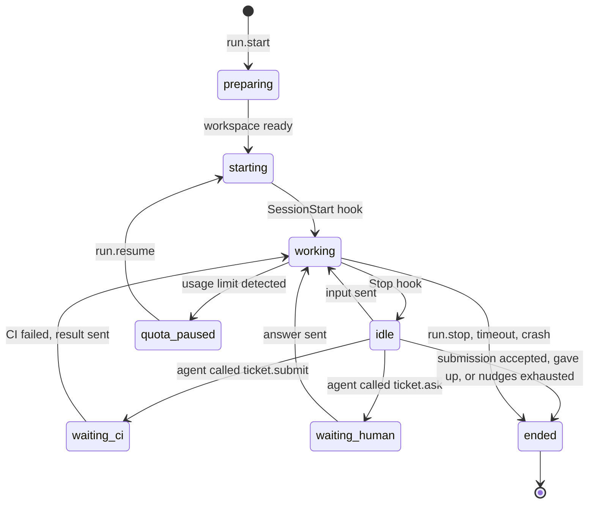

# 05 — Daemon

> Status: Draft v0.1
> Related: [01 — Domain Model](01-domain-model.md), [04 — Ticket Lifecycle](04-ticket-lifecycle.md), [06 — MCP](06-mcp.md), [07 — Scheduler](07-scheduler.md)

The daemon is the execution plane. It runs on every machine that executes agents, starts Claude Code sessions for runs, and reports what happens back to the web application. It holds no business rules about tickets: it executes what the server asks and reports facts.

## 1. Responsibilities

- Keep a single authenticated outbound connection to the web application.
- Report the machine's identity, versions and capabilities.
- Prepare a Git workspace for each run.
- Start, drive, resume and stop Claude Code sessions in **interactive mode** inside tmux.
- Enforce the agent profile's tool allowlist through Claude Code hooks.
- Collect state from hooks and session transcripts, and stream it to the server.
- Serve the MCP tools to Claude Code and relay the calls to the server.
- Push branches to GitHub on behalf of agents. Agents never hold GitHub credentials.
- Detect when the Claude account reaches its usage limit.

Non-responsibilities: deciding what runs next (scheduler), validating ticket transitions (server), storing business data (server).

## 2. Platform and packaging

| Item | Decision |
|---|---|
| Supported OS | Linux, and Windows through WSL 2 (Linux distribution). No native Windows. |
| Runtime | Node.js LTS, TypeScript. Node is already required by Claude Code. |
| Distribution | npm package exposing an `orchestrator-daemon` command. |
| Service | systemd user service, installed by `orchestrator-daemon install-service`. On WSL, systemd must be enabled; the user documentation explains how, and how to keep WSL running. |
| Dependencies checked at start | `git`, `tmux`, `claude` (version within the supported range). Missing or unsupported dependencies are reported to the server and the machine is marked unusable. |
| Recommended setup | A dedicated Linux user for the daemon, so agents cannot read the owner's personal files. |

The daemon runs as a normal process on the host, **not in Docker**, because it needs the machine's Claude Code login, tmux and toolchains (for example the Android SDK).

## 3. Enrollment and connection

### 3.1 Enrollment

1. In the UI, the owner creates a machine and selects the Claude account it uses. The server shows a one-time enrollment command containing the server URL and an enrollment code valid for 15 minutes.
2. On the machine, the owner runs `orchestrator-daemon enroll <server-url> <code>`.
3. The daemon exchanges the code for a long-lived **machine token**, stored in `~/.orchestrator/config.json` with permissions `600`.
4. The machine appears online in the UI. The owner can revoke the token at any time, which disconnects the daemon.

### 3.2 Connection

- A single WebSocket from the daemon to the server (`wss://` when the server is remote, `ws://` accepted for `localhost` only).
- The daemon authenticates with the machine token on connection.
- Heartbeat every 15 seconds. The server marks the machine `offline` after 60 seconds without one.
- Reconnection with exponential backoff (1 s to 60 s).
- When the server is not on the same network (VPS), the recommended setup is a private network such as a VPN; the web application is not exposed publicly in v1.

### 3.3 Messages

All messages are JSON: `{ "type": "...", "id": "...", "payload": { ... } }`. Messages that need an answer are acknowledged with the same `id`.

| Direction | Type | Purpose |
|---|---|---|
| D → S | `hello` | Daemon version, Claude Code version, OS, capabilities, runs currently alive on the machine. |
| D → S | `heartbeat` | Liveness and resource summary. |
| S → D | `run.start` | Start a run (payload in section 4.1). |
| S → D | `run.input` | Send text to a live session (owner answer, CI result, nudge). |
| S → D | `run.resume` | Resume a session that was closed (after a quota pause or a long wait). |
| S → D | `run.stop` | Stop a run (cancel, timeout). |
| D → S | `run.state` | Run state change (`starting`, `running`, `idle`, `ended`, …) with details. |
| D → S | `run.events` | Batch of transcript events for live logs. |
| D → S | `run.quota_limited` | The account reached its usage limit, with reset time when known. |
| D → S | `mcp.call` | An MCP tool call from an agent, with the run token. |
| S → D | `mcp.result` | Result or error of the call. |
| D → S | `git.push_request` | Ask for credentials to push a branch. |
| S → D | `git.push_credentials` | Short-lived use of the push credential for one repository. |

## 4. Run execution

### 4.1 `run.start` payload

- run id, purpose, and ticket id or request id;
- repository (owner/name), base branch, ticket branch;
- agent profile snapshot: instructions, model, tool allowlist, profile version;
- run token for MCP calls (scoped to this run);
- initial prompt, built by the server from the ticket, its comments and the purpose;
- limits: maximum run duration, idle timeout, maximum nudges;
- optional Claude session id to resume.

### 4.2 Workspace

Everything the daemon manages lives under `~/.orchestrator/`:

```
~/.orchestrator/
  config.json              machine token, server URL
  repos/<owner>/<name>.git bare clone, one per repository, reused across runs
  worktrees/<run-id>/      Git worktree for a run
  runs/<run-id>/           run files (never inside the worktree)
    system-prompt.md       agent instructions and run context
    settings.json          hooks and permissions for this run
    mcp.json               MCP server declaration for this run
    daemon.sock            local socket used by hooks and the MCP server
```

Preparation steps:

1. Fetch the bare clone (clone it first if missing).
2. Create the worktree: on the ticket branch if it exists on the remote, otherwise a new branch from the base branch.
3. For `review` runs, the worktree is checked out on the ticket branch, read-only by convention and by allowlist (no write tools).
4. For planning runs on a new project (no repository yet), the worktree is an empty scratch directory.

Run files are written outside the worktree so they never end up in a commit.

### 4.3 Starting Claude Code

The daemon creates a detached tmux session named `orch-<run-id>`, with the worktree as working directory, and starts Claude Code in interactive mode with:

- the model from the profile;
- the agent instructions appended to the default system prompt (`system-prompt.md`), keeping Claude Code's own tool guidance;
- the run's `settings.json` (hooks and permissions);
- the run's `mcp.json`;
- the initial prompt as the first message;
- the session id to resume, for `run.resume`.

The exact flags are pinned in the daemon code per supported Claude Code version range and covered by the spike in section 9.

### 4.4 Sending input

Later messages (owner answers, CI results, nudges) are sent to the session by loading the text into a tmux buffer and pasting it, then pressing Enter. This avoids problems with special characters and multi-line text. Input is only sent when the session is idle (last hook received is `Stop`); otherwise it is queued.

### 4.5 Observing the session

The daemon never reads the terminal display. It uses three sources.

| Source | What it gives | Use |
|---|---|---|
| **Hooks** | Session start (session id, transcript path), each tool use before and after, notifications, end of each turn (`Stop`), session end. | Run state machine, permission enforcement, idle detection. |
| **Transcript file** | The session's JSONL transcript written by Claude Code. | Live logs in the UI, activity summary, quota-limit detection. |
| **MCP calls** | Explicit declarations by the agent: progress, question, submission, giving up. | Ticket state, run outcome. |

Hooks are small commands declared in the run's `settings.json`. Each hook sends its input to the daemon through `daemon.sock` and returns the daemon's answer to Claude Code.

### 4.6 Permission enforcement

Interactive permission prompts would block unattended runs. They are avoided as follows:

- The profile's allowlist is applied in the run's settings, so allowed tools run without prompts.
- A `PreToolUse` hook checks every tool call against the profile. Calls outside the allowlist are **denied with a reason** that the agent can read, instead of prompting.
- Bash commands are matched against allow patterns (for example `npm test`, `./gradlew *`, `git add/commit/status/diff/log`). `git push` and anything reaching GitHub is always denied: pushing is done by the daemon.
- `--dangerously-skip-permissions` is never used.
- If a permission prompt still appears (detected through a notification hook), the daemon denies it through the same path when possible, otherwise records the event and stops the run with reason `crash`, so the problem is visible and fixable in the profile.

### 4.7 Run state machine on the daemon



### 4.8 End of turn without a decision

When a turn ends (`Stop` hook) and the agent has not called `ticket.submit`, `ticket.ask` or `ticket.give_up` during it, the daemon sends a **nudge**: a short message reminding the agent that it must continue working or use one of these three tools. After the maximum number of nudges (default 3, configurable), the run ends with reason `agent_gave_up`.

### 4.9 Submission and pushing

When the agent calls `ticket.submit` (see 06):

1. The daemon checks that the worktree has no uncommitted changes. If it has, the call is rejected and the agent is asked to commit.
2. The daemon requests push credentials, pushes the branch, and discards the credentials.
3. The server opens or updates the pull request and starts its checks (see 04, section 3.1).
4. The run moves to `waiting_ci`. The Claude session is idle and consumes no quota.
5. If a check fails, the server sends the result with the relevant CI log excerpt through `run.input`, and the agent continues. If all checks pass, the ticket moves to `in_review` and the run ends.

### 4.10 Quota limit detection

When the Claude account reaches its usage limit, Claude Code reports it in the session. The daemon detects it from the transcript (and from hooks when available), then:

1. sends `run.quota_limited` with the reset time when it can be read;
2. closes the tmux session but keeps the worktree and the Claude session id;
3. waits for `run.resume` from the scheduler (see 07).

The exact detection signal is covered by the spike in section 9.

### 4.11 Ending and cleanup

- The tmux session is closed when the run ends.
- The worktree is removed when the run ends, except for runs that are `waiting_human` or `quota_paused`.
- Unpushed commits are pushed before removal when the run ends with a failure, so work is not lost (the branch keeps the history; the next attempt starts from it).
- Bare clones are kept and pruned periodically.

## 5. Timeouts

| Setting | Default | Effect |
|---|---|---|
| Maximum run duration | 90 minutes of working time | Run stopped with reason `timeout`. Time spent waiting for CI, the owner or the quota does not count. |
| Idle timeout | 10 minutes | A session that is neither working nor waiting for something receives a nudge, then is stopped. |
| Waiting run lifetime | 30 minutes | See 04, section 6. |
| Maximum nudges per run | 3 | See section 4.8. |

All are configurable, following the rules in 04, section 8.

## 6. Disconnection and reconciliation

- If the connection drops, live sessions keep running. Events are buffered on disk and sent when the connection returns. MCP calls fail with a retryable error while disconnected.
- On reconnection, `hello` lists the runs still alive. The server reconciles: the **daemon is the source of truth for processes**, the **server is the source of truth for tickets**.
- A run unknown to the server is stopped. A run the server thinks is active but the daemon does not report is marked failed with reason `machine_offline`.
- If a machine stays offline for more than 10 minutes with an active run, the server marks the run failed and the ticket follows the retry policy.

## 7. Security

| Asset | Protection |
|---|---|
| Claude login | Stays on the machine. Never read or sent by the daemon. |
| Machine token | File with permissions `600`, revocable from the UI. |
| GitHub credential | Held by the server. Sent to the daemon only for a push, used in memory through a Git credential helper, never written to disk and never visible to the agent. |
| Run token | Scoped to one run: one project, one ticket or request, the profile's MCP permissions. Expires when the run ends. |
| Machine files | Dedicated user recommended; tool allowlist; no network tools beyond what the profile allows. |
| Transcripts | Scanned for secret patterns before being streamed; matches are masked. |

In v1 the GitHub credential is the owner's fine-grained personal token. A GitHub App with per-installation short-lived tokens is planned later.

## 8. Commands

| Command | Purpose |
|---|---|
| `orchestrator-daemon enroll <url> <code>` | Register the machine. |
| `orchestrator-daemon start` | Run in the foreground. |
| `orchestrator-daemon install-service` | Install and enable the systemd user service. |
| `orchestrator-daemon status` | Connection state, versions, capabilities, live runs. |
| `orchestrator-daemon attach <run-id>` | Attach to a run's tmux session to watch it live (read-only by default). |
| `orchestrator-daemon doctor` | Check dependencies, Claude Code login, WSL configuration. |
| `orchestrator-daemon mcp --run <id>` | MCP server started by Claude Code for a run (internal). |

## 9. Spike before implementation

The following points depend on Claude Code's behaviour and must be verified on the supported version before the daemon is built. The results are recorded as an ADR.

1. Exact flags to start an interactive session with appended instructions, run settings, MCP config, model, initial prompt and session resume.
2. Hook payloads: session id and transcript path at start, `Stop` timing, `PreToolUse` deny with a reason, notification on permission prompts.
3. Pasting multi-line input through tmux into an idle session, reliably.
4. The signal written when the usage limit is reached, and whether the reset time can be read.
5. Transcript format stability for the fields the daemon reads.
6. Behaviour of an idle interactive session left open for 30 minutes.
7. Whether recent Claude Code features for background sessions could replace part of the tmux layer without changing how usage is billed.
8. The folder trust dialog shown when Claude Code starts in a new directory: whether it appears for each new worktree, whether hooks run before it, and how to pre-approve worktree folders.
