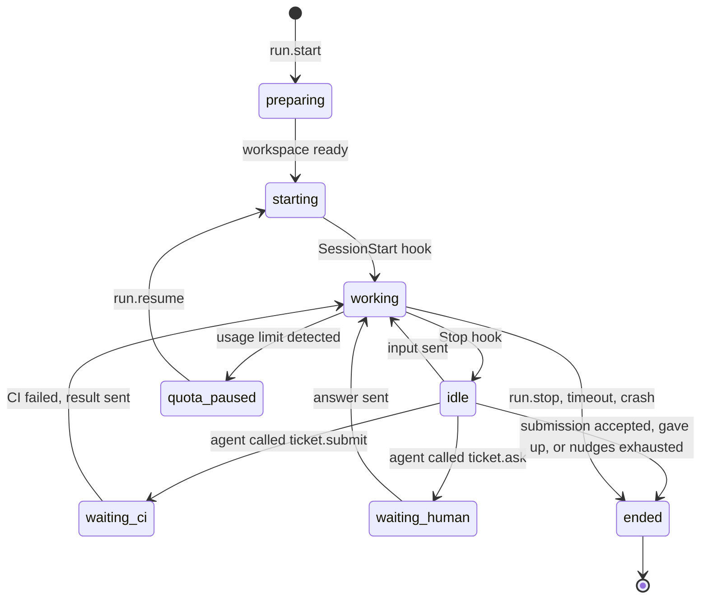

# 05 — Daemon

> Status: Draft v0.1
> Related: [01 — Domain Model](01-domain-model.md), [04 — Ticket Lifecycle](04-ticket-lifecycle.md), [06 — MCP](06-mcp.md), [07 — Scheduler](07-scheduler.md)

The daemon is the execution plane. It runs on every machine that executes agents, starts Claude Code sessions for runs, and reports what happens back to the web application. It holds no business rules about tickets: it executes what the server asks and reports facts.

## 1. Responsibilities

- Keep a single authenticated outbound connection to the web application.
- Report the machine's identity, versions and capabilities.
- Prepare a Git workspace for each run.
- Start, drive, resume and stop Claude Code sessions in **interactive mode** inside tmux.
- Enforce the agent profile's tool allowlist through Claude Code hooks.
- Collect state from hooks and session transcripts, and stream it to the server.
- Serve the MCP tools to Claude Code and relay the calls to the server.
- Fetch repositories and, from lot 3, push branches to GitHub on behalf of agents. Agents never hold GitHub credentials.
- Detect when the Claude account reaches its usage limit.

Non-responsibilities: deciding what runs next (scheduler), validating ticket transitions (server), storing business data (server).

## 2. Platform and packaging

| Item | Decision |
|---|---|
| Supported OS | Linux, and Windows through WSL 2 (Linux distribution). No native Windows. |
| Runtime | Node.js 24 LTS, TypeScript. Claude Code's native installer does not need Node.js, so Node.js is a prerequisite of the daemon itself. |
| Distribution | npm package exposing an `orchestrator-daemon` command, bundled into a single file and served by the server of the same version at `/downloads/orchestrator-daemon-<version>.tgz`. The owner installs it with `npm install -g <server URL>/downloads/orchestrator-daemon-<version>.tgz`; nothing is published to the npm registry (owner's decision, lot 2 step A). |
| Service | systemd user service named `orchestrator-daemon`, installed by `orchestrator-daemon install-service`, with lingering enabled (`loginctl enable-linger`) so it runs without an open login. The unit starts the daemon with the absolute paths of the `node` executable and of the daemon's script found at install time, so it never depends on a login shell's `PATH` (nvm). The unit also sets `PATH` to the `PATH` of the terminal where `install-service` is typed, so the service finds the same tools as the owner (`claude` in `~/.local/bin`, `node` and `npm` from nvm) and agents' commands find them too; `install-service` drops empty and relative entries (including `.`) and, on WSL, every entry under `/mnt/` (Windows folders added by WSL interop), and prints the `PATH` it wrote. After installing a tool or changing the Node.js version, the owner installs the daemon again if needed and runs `install-service` again (owner's decision, lot 2 step E). The checks of section 3.2 run at each `hello`: after updating the daemon or Claude Code, or fixing a `doctor` error, the owner restarts the daemon with `systemctl --user restart orchestrator-daemon` (or stops and starts `orchestrator-daemon start` when it runs in the foreground) (owner's decision, lot 2 step D). On WSL, systemd must be enabled (`[boot] systemd=true` in `/etc/wsl.conf`), and systemd services do not keep WSL running: the user documentation explains how to keep it running (`instanceIdleTimeout=-1` in the `[general]` section of `%UserProfile%\.wslconfig`, or an open WSL window). The daemon cannot read the Windows `.wslconfig`: the Add machine help page explains the setting, and `doctor` prints it as "check this yourself" with the documentation link (owner's decision, lot 2 step A). |
| Dependencies checked at start | `git` (2.40 or later), `tmux` (3.2 or later, for `paste-buffer -p`), `claude` (2.1.280 or later). Missing dependencies or versions below these are reported to the server and the machine is marked unusable. A Claude Code version above the highest one validated with the spike scripts is accepted with a warning in `doctor` and on the machine page, because Claude Code updates itself often; the session start timeout (section 4.2.1) catches a real incompatibility (owner's decision, lot 2 step A). |
| Recommended setup | A dedicated Linux user for the daemon, so agents cannot read the owner's personal files. In lot 2 the daemon runs under the owner's own user, and the user documentation says plainly that an agent is then less isolated and that the path checks on Bash commands are best effort (section 4.6); the guide for a dedicated user comes with lot 7 (owner's decision, lot 2 step A). |
| Claude configuration | Agents run with a **dedicated Claude Code configuration folder** (`CLAUDE_CONFIG_DIR=~/.orchestrator/claude-config`), separate from the owner's personal one. It holds its own login (same subscription), trust entries and transcripts. See ADR 0002. |

The daemon runs as a normal process on the host, **not in Docker**, because it needs the machine's Claude Code login, tmux and toolchains (for example the Android SDK).

## 3. Enrollment and connection

### 3.1 Enrollment

1. In the UI, the owner creates a machine and selects the Claude account it uses. The server shows a one-time enrollment command containing the server URL and an enrollment code valid for the enrollment code lifetime (a setting, 15 minutes by default, 04 section 8).
2. On the machine, the owner runs `orchestrator-daemon enroll <server-url> <code>`.
3. The owner runs `orchestrator-daemon login`, which opens Claude Code once with the dedicated configuration folder so they can log in to their Claude account. This is the only interactive step, done once per machine.
4. The daemon exchanges the code for a long-lived **machine token**, stored in `~/.orchestrator/config.json` with permissions `600`.
5. The machine appears online in the UI. The owner can revoke the token at any time, which disconnects the daemon.

The exchange (owner's decision, lot 2 step C):

- The daemon sends `POST /daemon/enroll` with `{ code }`, without authentication; the answer is `{ machineId, machineName, machineToken }`. Both are Zod schemas in `packages/protocol`.
- The **code** is 24 characters from Crockford's Base32 alphabet (`0-9`, `A-Z` without `I`, `L`, `O`, `U`; 120 random bits), so guessing one within its lifetime is impractical. The daemon accepts it in any case and ignores `-` and spaces. It is stored hashed, with its expiry.
- The code is **single use**: it is marked used in the same transaction that sets the machine's token, so two requests with the same code cannot both succeed.
- A refused code says why: unknown, already used, or expired (stating the current "Enrollment code lifetime"). Failed attempts are throttled per client address with the login throttling of ADR 0015 and its settings, under their own key so they never delay the owner's login; the address is resolved as for a login. A throttled attempt is refused with the time to wait.
- The **machine token** is `omt_` followed by 43 characters (256 random bits, Base64 URL). It is returned once, stored as a hash, and never logged; the request body is never logged either. The event log masks it like other credentials.
- Enrolling again (after **New enrollment code**, 01 section 3.8) issues a new token; earlier tokens are never valid again.

### 3.2 Connection

- A single WebSocket from the daemon to the server (`wss://` when the server is remote, `ws://` accepted for `localhost` only). The rule is checked by `enroll` and at every connection (owner's decision, lot 2 step E):
  - an `http://` server address is accepted only when its host is `localhost`, an address in `127.0.0.0/8` or `::1`; any other is refused, and the refusal says why: the machine token and, for Git commands, the GitHub token travel on this connection. A server on another computer is reached through `https://` (a reverse proxy, 09 section 7.2);
  - `enroll` accepts `--ca-file <path>`, a PEM certificate authority for a reverse proxy with an internal or self-signed certificate. Its content is stored in `config.json` and used for the enrollment request and the WebSocket. Certificate checks are never disabled, and there is no "insecure" option;
  - `doctor` reports the server address scheme and, for `https://`, whether the certificate is valid, with a warning when it expires within 14 days.
- The daemon authenticates with the machine token on connection (`Authorization: Bearer <token>` on the WebSocket request to `/daemon`). An unknown token is refused before the WebSocket opens (HTTP 401). A revoked token gets a `welcome` refused with `token_revoked`, then the connection is closed.
- The first message is `hello`. The server accepts the current protocol version and the previous one (09, section 6); any other version gets a `welcome` refused with `protocol_incompatible` and the update instruction, the connection is closed, and the machine shows "daemon incompatible" in "Needs you" until a compatible `hello`. A connection that sends no `hello` within the "machine offline after" delay is closed.
- A machine whose Claude Code is missing or below the minimum (section 2), or whose `doctor` reports an error, is still accepted: it shows online, is marked **unusable** with the reasons, and receives no runs. Warnings never block it. The next `hello` whose checks pass clears it (01 section 3.8, 02 section 4; owner's decision, lot 2 step C).
- Heartbeat at the heartbeat interval (15 seconds by default). The server marks the machine `offline` after the "machine offline after" delay without a message of any kind (60 seconds by default, at least twice the interval), and closes the connection. Both are settings (04, section 8); the server sends the interval to the daemon in its answer to `hello`. Each connection keeps the interval it was given, and its silence limit is never below twice that interval, so changing the settings never marks a connected daemon offline by mistake (owner's decision, lot 2 step C).
- The machine is also `offline` as soon as its connection closes. When the server starts, machines still recorded `online` become `offline`, each with its event.
- If a machine opens a new connection while an older one is still open, the newer one replaces it: the server closes the older one without marking the machine offline in between.
- Going offline only changes the machine's status and writes an event. In lot 2 it never ends or fails a run by itself: tmux sessions keep running on the host, and the daemon resends its unacknowledged reports when it reconnects. Only the owner's **Stop run** fails a run with `machine_offline`; lot 4 adds the automatic failure of section 6 (owner's decision, lot 2 step C).
- Revoking a machine closes its connection at once.
- Every connection the server closes has a WebSocket close code from `packages/protocol`, so the daemon can tell the reason (revoked, incompatible, replaced, silent).
- Reconnection with exponential backoff (1 s to 60 s). These two values are constants of the daemon, not settings: the daemon needs them before it is connected and can read any setting (owner's decision, lot 2 step A). The daemon also sends a WebSocket ping with each heartbeat; a connection with no answer for two heartbeat intervals is abandoned and a new one opened, so a connection lost without a close (a sleeping computer, a network change) is noticed.
- **Refusals that retrying cannot fix stop the daemon** (owner's decision, lot 2 step E): an unknown token (HTTP 401), a revoked token (`token_revoked` or the `revoked` close code), an incompatible protocol (`protocol_incompatible` or the `incompatible` close code), and the `replaced` close code (another daemon connected with this machine's token). The daemon writes a message naming the cause and the fix (for example "This machine was revoked in the Orchestrator: enroll it again with a new enrollment code, then restart the daemon"), records it as the **last stop reason** in `~/.orchestrator/last-stop.json`, which `doctor` and `status` show, and exits with code 78; the systemd unit does not restart it for that code (`RestartPreventExitStatus=78`). The daemon acts on a close only when it arrives on its current connection: a `replaced` close on a connection it has already abandoned for a newer one is ignored. Every other close (network error, server restart, `silent`, `shutdown`) reconnects with the backoff. Stopping the daemon (`systemctl --user stop`, Ctrl+C) is recorded as the last stop reason too; an accepted `welcome` clears it.
- When the server is not on the same network (VPS), the recommended setup is a private network such as a VPN; the web application is not exposed publicly in v1.

### 3.3 Messages

All messages are JSON: `{ "type": "...", "id": "...", "payload": { ... } }`, defined once as Zod schemas in `packages/protocol` (`src/daemon/`). Messages that need an answer are acknowledged with the same `id` (owner's decision, lot 2 step B):

- three pairs answer each other: `hello` and `welcome`, `mcp.call` and `mcp.result`, `git.credential_request` and `git.credential`;
- the server's commands (`run.start`, `run.input`, `run.resume`, `run.stop`) and the daemon's reports (`run.state`, `run.events`, `run.quota_limited`) are each answered by an `ack` (`ok`, or not with the reason); `run.events` are acknowledged per batch, not per line; heartbeats get no answer;
- the daemon keeps every unacknowledged report in its run files, so it survives a daemon restart, and resends them in order after reconnection;
- the server handles every report and command idempotently by message id: a duplicate is acknowledged again and changes nothing.

Sizes (owner's decision, lot 2 step B): every text of a message has a ceiling derived in code from the settings' declared ranges in `packages/protocol`, never copied as a number. A text tied to a setting is capped at the highest value that setting allows (a ticket title at the top of "Longest ticket title"'s range); any other text at the largest such ceiling. The server still checks the setting's current value. The same rule applies to MCP tool inputs (06, section 3).

| Direction | Type | Purpose |
|---|---|---|
| D → S | `hello` | Protocol version, daemon version, Claude Code version, OS, detected capabilities, `doctor` results, runs currently alive on the machine. |
| S → D | `welcome` | Answer to `hello`: accepted or refused (incompatible protocol, revoked token), and the heartbeat interval. The run timeouts come with each `run.start`. |
| D → S | `heartbeat` | Liveness. In lot 2 it carries nothing else; lot 4 adds the resource summary as an optional field, so protocol version 1 stays compatible (owner's decision, lot 2 step B). |
| both | `ack` | Acknowledges a command or a report (above). |
| S → D | `run.start` | Start a run (payload in section 4.1). |
| S → D | `run.input` | Send text to a live session (owner answer, CI result). Nudges are not sent this way: the daemon sends the nudge it received in `run.start` (section 4.8). The server builds the text from a run message template in `agents/` (03, section 3.2), such as the wrapping of the owner's answer. |
| S → D | `run.resume` | Resume a session that was closed (after a quota pause or a long wait), with the first message to send: the owner's answer, or the "please continue" message after a usage-limit pause, detected or suspected. Both come from run message templates in `agents/` (03, section 3.2), filled in by the server. |
| S → D | `run.stop` | Stop a run (cancel, timeout). |
| D → S | `run.state` | Run state change (section 4.7) with the Claude session id and whether the tmux session is alive (false once a waiting or paused run's session is closed); at the end of a run, the reason as a fact (`submitted`, `gave_up`, `nudges_exhausted`, `stopped`, `max_duration`, `idle_timeout`, `session_start_timeout`, `crashed`), from which the server derives the run's status and failure reason, and the ticket branch's head and the commits ahead of the base branch. |
| D → S | `run.events` | Batch of transcript events for live logs. |
| D → S | `run.quota_limited` | The account reached its usage limit (`detected`, with the reset time when known) or may have (`suspected`), with the evidence (section 4.10). |
| D → S | `mcp.call` | An MCP tool call from an agent, with the run token; for `ticket_submit`, also the worktree facts of section 4.9. |
| S → D | `mcp.result` | Result or error of the call. |
| D → S | `git.credential_request` | Ask for the credential for one Git command on one repository of an active run: `fetch`, or from lot 3 `push`. |
| S → D | `git.credential` | The credential for that one command (section 7). |

## 4. Run execution

### 4.1 `run.start` payload

- run id, purpose, and ticket id or request id;
- repository (owner/name), its clone URL (built by the server from a base URL that tests point to a local `file://` remote), base branch, ticket branch;
- commit author name and address (04, section 4);
- agent profile snapshot: instructions, model, tool allowlist, profile version;
- run token for MCP calls (scoped to this run);
- initial prompt, built by the server from the ticket, its comments and the purpose;
- nudge message, filled in by the server from its run message template (03, section 3.2; section 4.8);
- limits: maximum run duration, idle timeout, maximum nudges, waiting run lifetime, session start timeout, MCP call timeout, Claude Code MCP tool timeout (values resolved by the server when the run starts, 04 section 8);
- optional Claude session id to resume.

### 4.2 Workspace

Everything the daemon manages lives under `~/.orchestrator/`:

```
~/.orchestrator/
  config.json              machine token, server URL, optional certificate authority (mode 600)
  daemon.sock              control socket of the running daemon, read-only (section 8)
  last-stop.json           why the daemon last stopped (section 3.2)
  claude-config/           dedicated CLAUDE_CONFIG_DIR: login, trust entries, transcripts
  repos/<owner>/<name>.git bare clone, one per repository, reused across runs
  worktrees/<run-id>/      Git worktree for a run
  runs/<run-id>/           run files (never inside the worktree)
    system-prompt.md       agent instructions and run context
    settings.json          hooks, status line command and permissions for this run
    mcp.json               MCP server declaration for this run, with its tool timeout
    state.json             the run's daemon state, so a restarted daemon finds its sessions again
    daemon.sock            local socket used by hooks and the MCP server
```

Preparation steps:

1. Fetch the bare clone. If it is missing, clone it and **register workspace trust** for the bare clone's path in the dedicated configuration (section 4.2.1). The credential is used as described in section 7: it never ends up in the bare clone's configuration.
2. Create the worktree: on the ticket branch if it exists on the remote or in the bare clone (lot 2 keeps it there, section 4.11), otherwise a new branch from the base branch. Set the commit author for that worktree.
3. For `review` runs, the worktree is checked out on the ticket branch, read-only by convention and by allowlist (no write tools).
4. For planning runs on a new project (no repository yet), the worktree is an empty scratch directory.

Run files are written outside the worktree so they never end up in a commit.

#### 4.2.1 Workspace trust

Claude Code asks the user to trust a folder the first time it starts there, and does not load hooks or project settings before that. The spike (ADR 0002) showed that:

- trust is recorded per exact path, never inherited from a parent folder;
- for a Git worktree, trust is recorded on the **main repository** path, which here is the bare clone;
- a trust entry written in advance in the configuration file is honoured: the session starts with no dialog.

So the daemon registers trust **once per repository**, when it first clones it, by writing `projects["<bare clone path>"].hasTrustDialogAccepted = true` in the dedicated configuration file. The write is atomic (temporary file then rename) and done while no session of the dedicated configuration is starting. Every worktree of that repository then starts without a dialog. The owner's personal configuration is never modified.

If a session does not report `SessionStart` within the session start timeout (a setting, 30 seconds by default, 04 section 8), the run fails with reason `crash` and the event says "workspace trust or startup dialog suspected", so a change in Claude Code's behaviour is visible immediately.

### 4.3 Starting Claude Code

The daemon creates a detached tmux session named `orch-<run-id>` on its own tmux server (`tmux -L orchestrator`), separate from the owner's tmux sessions, with the worktree as working directory and `CLAUDE_CONFIG_DIR` set to the dedicated configuration, and starts Claude Code in interactive mode. `TMUX` and `TMUX_PANE` are unset in each session's environment, so nothing in a session finds the tmux server through them (owner's decision, lot 2 step E). The command is built as an argument list, never as a shell string, in this order:

| Argument | Purpose |
|---|---|
| `--mcp-config <run mcp.json>` | MCP relay for the run. First, because this option accepts several values. |
| `--strict-mcp-config` | Use only the MCP relay: MCP servers declared by the repository (`.mcp.json`) or elsewhere are ignored. |
| `--setting-sources user` | Load only the dedicated configuration's user settings (written by the daemon), never the repository's `.claude/settings.json` or `settings.local.json`: Claude Code merges `permissions.allow` lists and hooks across sources, so a repository could otherwise widen the allowlist or add hooks. This also stops Claude Code from loading the repository's `CLAUDE.md` on its own; the common rules tell the agent to read it (03, section 3). |
| `--settings <run settings.json>` | Hooks, status line command, allowlist, deny rules and `autoContinueAtUsageLimit: false` for the run. |
| `--permission-mode dontAsk` | Refuse anything not allowed instead of prompting (section 4.6). |
| `--model <profile model>` | Model from the agent profile. |
| `--append-system-prompt <text>` | Common rules and role instructions, added to Claude Code's own system prompt. The text is passed directly: the spike found no file variant, and although the documentation now lists `--append-system-prompt-file`, the validated text form is kept (owner's decision, lot 2 step A). |
| `--resume <session id>` | Only for `run.resume`. The session keeps its id. |
| `--` then the first message | Always after `--`, so the message can never be read as an option value. |

With `--setting-sources user`, the only settings file Claude Code reads besides `--settings` is the **user** settings file of the configuration folder in `CLAUDE_CONFIG_DIR`: `~/.orchestrator/claude-config/settings.json`, written and owned only by the daemon (Claude Code's documentation: user settings are `$CLAUDE_CONFIG_DIR/settings.json` when the variable is set). The owner's own `~/.claude/` settings never reach a run, and the agent cannot change the daemon's file: it is inside the Claude configuration folders covered by the deny rules (section 4.6). Managed settings (`/etc/claude-code/`, and on WSL possibly the Windows policy) always apply, as they do for any Claude Code session; the owner's machine normally has none, and `doctor` reports any it finds (owner's decision, lot 2 step A).

These arguments were validated on Claude Code 2.1.280 (ADR 0002), except `--strict-mcp-config` and `--setting-sources`, taken from the documentation check of lot 2 step A and checked by the owner with a probe script right after the permission step of lot 2 (plan step H), before any run code depends on them. The daemon declares its supported minimum version and refuses older ones (section 2). Claude Code updates itself while the daemon runs, so the version reported at `hello` can go stale: at each run start the daemon reports the version of the `claude` it launches, and the server checks it again as at `hello`, marking the machine unusable (and failing that start) when it is missing or below the minimum (owner's decision, lot 2 step D; implemented in plan steps F and J). Environment: `CLAUDE_CONFIG_DIR` as above; the automatic updater of Claude Code is left on.

### 4.4 Sending input

Later messages (owner answers, CI results, nudges) are sent to the session by loading the text into a tmux buffer and pasting it, then pressing Enter. This avoids problems with special characters and multi-line text. Input is only sent when the session is idle (last hook received is `Stop`); otherwise it is queued.

### 4.5 Observing the session

The daemon never reads the terminal display. It uses three sources.

| Source | What it gives | Use |
|---|---|---|
| **Hooks** | `SessionStart` (session id, transcript path, `source`: `startup` or `resume`), `PreToolUse` and `PostToolUse`, `Notification` (`notification_type`, including `idle_prompt` when idle), `Stop` at the end of **each turn** with the agent's last message (`last_assistant_message`), `StopFailure` **instead of** `Stop` when a turn ends on an API error (`error`: `rate_limit`, `overloaded`, `server_error`, `authentication_failed`, … and the error text in `last_assistant_message`), `SessionEnd`. | Run state machine, permission enforcement, idle detection, turn outcome and usage-limit detection without reading the transcript. |
| **Status line command** | A command declared in the run's `settings.json` (`statusLine`), run by Claude Code with a JSON input that includes `cost.total_cost_usd` and, for Pro and Max accounts, `rate_limits.five_hour` and `rate_limits.seven_day` (`used_percentage`, `resets_at` in Unix seconds). It forwards the input to the daemon and prints nothing useful. It is a documented input, like hooks, not the terminal display. Claude Code runs it only when its interface refreshes, so it is a supplementary source (section 4.10). | Usage estimate per run (07), reset time of a usage limit. |
| **Transcript file** | The session's JSONL transcript, under the dedicated configuration folder. Claude Code documents its format as internal and changing between versions, so the daemon reads it tolerantly (unknown entries are skipped) and uses it only for display. It includes `cost-state` entries, used for the usage estimate only if the status line gives none. | Live logs in the UI. |
| **MCP calls** | Explicit declarations by the agent: progress, question, submission, giving up. | Ticket state, run outcome. |

Hooks and the status line are small commands declared in the run's `settings.json` (`orchestrator-daemon hook <event>`, `orchestrator-daemon status-line`). Each sends its input to the daemon through `daemon.sock` and returns the daemon's answer to Claude Code.

### 4.6 Permission enforcement

Interactive permission prompts would block unattended runs. They are avoided as follows:

Two layers, validated by the spike (ADR 0002):

1. **`dontAsk` permission mode with the profile's allowlist.** Allowed tools run without prompts. Anything else is refused automatically with a message telling the agent to stop and explain; the common rules tell the agent to use `ticket.ask` in that case (06, section 6). File reads outside the working directory need an approval, so `dontAsk` refuses them too. The run's `settings.json` also has **deny rules** (`Read(//<path>/**)`, `Edit(//<path>/**)`) for the daemon's folder `~/.orchestrator/` (which holds the machine token) and for the Claude configuration folders (`~/.orchestrator/claude-config/`, `~/.claude/`, `~/.claude.json`); Claude Code applies deny rules to its file tools, to the file commands it recognises in Bash (`cat`, `head`, `sed`, `tee`, …) and to redirections, and whatever a hook answers.
2. **`PreToolUse` hook for rules an allowlist cannot express.** It denies, with a reason the agent reads:
   - `git push` and any command reaching GitHub (pushing is done by the daemon);
   - any change to the repository's `.claude/` folder: runs ignore the repository's settings (section 4.3), but the owner's own Claude Code would load them;
   - any access to the daemon's folder `~/.orchestrator/` (including `config.json` and its machine token) and to the Claude configuration folders, whether through a file tool or a Bash command (owner's decision, lot 2 step A);
   - any Bash command invoking `tmux`, so an agent cannot reach its own or another run's session (owner's decision, lot 2 step E; tested with the other rules in plan step G);
   - any other access outside the worktree and the run folder.

   Paths of file tools are checked exactly, after resolving `..` and symbolic links. For Bash commands the check is **best effort**: the hook denies absolute paths outside the allowed folders, `..` leaving the worktree, `~`, `$HOME` and the folders above, but a program can still open files in ways no command text shows (Claude Code's documentation says the same of its own Bash rules). The user documentation says so (section 2, recommended setup). Each deny rule has its own test.

Allowlist rules are strict: a prefix rule such as `Bash(echo:*)` does not cover the same command with a redirection. Every default profile's allowlist is therefore checked by a smoke test (03, section 6). The `ToolSearch` tool must always be allowed, because Claude Code uses it to load MCP tools.

`--dangerously-skip-permissions` and the `bypassPermissions` mode are never used.

### 4.7 Run state machine on the daemon



The server's run status (01, section 3.7) follows the daemon's state: `preparing` and `starting` give `starting`; `working`, `idle` and `waiting_ci` give `running`; `waiting_human` gives `waiting_human` (also after the waiting run lifetime closed the session); `quota_paused` gives `paused_quota`; `ended` gives `succeeded`, `failed` or `cancelled` according to the reason. Before the daemon acknowledges `run.start` the run is `queued` then `dispatched`.

### 4.8 End of turn without a decision

When a turn ends (`Stop` hook) and the agent has not called `ticket.submit`, `ticket.ask` or `ticket.give_up` during it, the daemon sends a **nudge** (never after a `StopFailure`, section 4.10): a short message reminding the agent that it must continue working or use one of these three tools. The daemon decides when to nudge, but the text is the nudge message of `run.start`, filled in by the server from a run message template (03, section 3.2): the daemon holds no agent-facing text (owner's decision, lot 2 step B). After the maximum number of nudges (default 2, configurable), the run ends with reason `agent_gave_up`.

Nudges are expensive: every turn reloads the whole session context (about 70,000 tokens from cache in the spike, even for a one-line answer). The instructions are designed so that agents rarely need one.

### 4.9 Submission and pushing

When the agent calls `ticket.submit` (see 06):

**Lot 2.** Only step 1 applies, plus a check that the ticket branch has commits ahead of the base branch; the server then applies the reduced checks of 04, section 3.1 and the run ends. Nothing is pushed. Lot 3 adds the steps below.

The daemon reports facts and the server decides (owner's decision, lot 2 step B): when it forwards the call, the daemon collects whether the worktree is clean, the branch head and the commits ahead of the base branch at that moment, never from a cached state, and sends them with the call (`mcp.call`, section 3.3). The server runs every check on them and refuses with `DOD_FAILED`, listing each failed check.

1. The worktree must have no uncommitted changes. If it has, the server rejects the call and the agent is asked to commit.
2. The daemon requests push credentials, pushes the branch, and discards the credentials.
3. The server opens or updates the pull request and starts its checks (see 04, section 3.1).
4. The run moves to `waiting_ci`. The Claude session is idle and consumes no quota.
5. If a check fails, the server sends the result with the relevant CI log excerpt through `run.input`, and the agent continues. If all checks pass, the ticket moves to `in_review` and the run ends.

### 4.10 Quota limit detection

Detection lives in **one module** of the daemon, which takes hook payloads, status line inputs and transcript entries and answers `detected` (with the reset time when known), `suspected`, or nothing. The signals it recognises are a table of patterns with fixtures captured from the real Claude Code, so adjusting detection changes data, not logic (owner's decision, lot 2 step A).

Claude Code's documentation (lot 2 step A) gives these signals; they are not yet observed on a real limit (section 9):

- a `StopFailure` hook with `error: "rate_limit"`, whose `last_assistant_message` holds the message shown, documented as `You've hit your session limit · resets 3:45pm` (also `weekly`, `Opus` and `Sonnet` limits);
- the status line input, whose `rate_limits` windows give `used_percentage` and `resets_at` (Unix seconds).

The status line is a **supplementary** source: Claude Code runs the command only when its interface refreshes, so its data can be late or missing. It can confirm a limit and give the reset time and the usage estimate, but detection never depends on it alone, and its absence never prevents detection (owner's decision, lot 2 step A).

**Detected**: a known usage-limit message at the end of a turn (in a `StopFailure` of any type, or as the API error text of a turn), or a `StopFailure` with `error: "rate_limit"` while the latest status line input shows a window at 100 %. The reset time is `resets_at` of the full window, or else the time read from the message; without either, the fallback delay (`quotaFallbackDelayMinutes`) applies (07, section 5.2). The daemon sends no nudge, and:

1. sends `run.quota_limited` (`detected`, reset time when known, evidence);
2. closes the tmux session but keeps the worktree and the Claude session id;
3. waits for `run.resume` (the owner's **Resume** in lot 2, the scheduler from lot 4, 07).

The server moves the run to `paused_quota` with reason `usage_limit` and the account to `limited` until the reset time or now plus the fallback delay (`quotaFallbackDelayMinutes`); **Resume** is refused until then.

**Suspected**: a turn that ends on an API error that is not a detected limit (a `StopFailure` with `rate_limit` alone, `overloaded`, `server_error` or any other or unknown type, or an API error text with no tool use in the turn), or an idle timeout right after such a turn. The daemon sends no nudge, sends `run.quota_limited` (`suspected`, evidence), and closes the session as above. The server moves the run to `paused_quota` with reason `suspected_usage_limit`, but **does not change the account**, and **Resume** is allowed at once: an overload or a network error must never lock the account (owner's decision, lot 2 step A).

In **both cases** no nudge is sent and no failed attempt is counted (04, section 5).

Claude Code can itself wait in an open session and continue after the reset (`autoContinueAtUsageLimit`, on by default). The run's settings (`--settings`) set `autoContinueAtUsageLimit: false`, so it is **off for every run** and only the Orchestrator decides when a paused run continues.

The fake `claude` used in tests (09, section 8) can emit each signal: the documented message with and without a reset time, a `StopFailure` of each type, a status line at 100 %, an API error turn with no tool use, and nothing at all (a session that hangs until the idle timeout).

### 4.11 Ending and cleanup

- The tmux session is closed when the run ends.
- The worktree is removed when the run ends, except for runs that are `waiting_human` or `quota_paused`.
- Unpushed commits are pushed before removal when the run ends with a failure, so work is not lost (the branch keeps the history; the next attempt starts from it). In lot 2 nothing is pushed: the branch stays in the bare clone (a worktree's branch lives in its main repository), and the next run on that machine starts from it.
- Bare clones are kept and pruned periodically.

## 5. Timeouts

| Setting | Default | Allowed range | Effect |
|---|---|---|---|
| Maximum run duration | 90 minutes of working time | 1 to 1,440 minutes | Run stopped with reason `timeout`. Time spent waiting for CI, the owner or the quota does not count. |
| Idle timeout | 10 minutes | 1 to 120 minutes | A session that is neither working nor waiting for something receives a nudge, then is stopped. |
| Maximum nudges per run | 2 | 0 to 10 | See section 4.8. |

All are configurable, following the rules in 04, section 8. The waiting run lifetime, the session start timeout, the MCP call timeout and the Claude Code MCP tool timeout are also daemon timeouts; they are defined once, in 04, section 8. The server resolves every value when the run starts and sends it in `run.start`.

## 6. Disconnection and reconciliation

- **Lot 2 subset** (owner's decision, lot 2 step A): the daemon keeps each run's state in `runs/<id>/state.json` and finds its tmux sessions again after a restart; on reconnection, a run the server no longer considers active is stopped; while a machine is offline its active runs show "machine offline", and the owner's **Stop run** marks such a run failed with `machine_offline` (never counted as an attempt). The rest of this section comes with lot 4.
- If the connection drops, live sessions keep running. Events are buffered on disk and sent when the connection returns. MCP calls fail with a retryable error while disconnected.
- On reconnection, `hello` lists the runs still alive. The server reconciles: the **daemon is the source of truth for processes**, the **server is the source of truth for tickets**.
- A run unknown to the server is stopped. A run the server thinks is active but the daemon does not report is marked failed with reason `machine_offline`.
- If a machine stays offline for more than 10 minutes with an active run, the server marks the run failed and the ticket follows the retry policy.

## 7. Security

| Asset | Protection |
|---|---|
| Claude login | Stays on the machine, in the dedicated configuration folder. Never read or sent by the daemon. Separate from the owner's personal Claude Code login. |
| Machine token | File with permissions `600`, revocable from the UI. |
| GitHub credential | Held by the server. Sent to the daemon for one Git command (`fetch`, and `push` from lot 3) of an active run, kept in the daemon's memory only for that command, and given to Git through a credential helper passed on that command's line (`git -c credential.helper=… fetch`), which reads it from the daemon. It is never written to disk or to any Git configuration (bare clone or worktree), remote URLs never contain it, and it is never visible to the agent. A test proves that a `git fetch` run in the worktree outside the daemon has no credentials (owner's decision, lot 2 step A). |
| Run token | Scoped to one run: one project, one ticket or request, the profile's MCP permissions. Expires when the run ends. |
| Machine files | Dedicated user recommended; tool allowlist; no network tools beyond what the profile allows. |
| Transcripts | Scanned for secret patterns before being streamed; matches are masked. |

In v1 the GitHub credential is the owner's fine-grained personal token. A GitHub App with per-installation short-lived tokens is planned later.

## 8. Commands

| Command | Purpose |
|---|---|
| `orchestrator-daemon enroll <url> <code> [--ca-file <path>]` | Register the machine (section 3.1); `--ca-file` for a certificate authority (section 3.2). Enrolling again replaces the stored token. |
| `orchestrator-daemon login` | Open Claude Code once with the dedicated configuration folder to log in. |
| `orchestrator-daemon start` | Run in the foreground. Refused when another daemon of this user answers on the control socket. |
| `orchestrator-daemon install-service` | Install and enable the systemd user service, with lingering (section 2). Refused while a daemon runs in a terminal. |
| `orchestrator-daemon status` | Whether a daemon runs, as the service or in a terminal; connection state, versions, capabilities, live runs; the last stop reason when none runs. |
| `orchestrator-daemon attach <run-id> [--write]` | Attach to a run's tmux session to watch it live. Read-only by default; `--write` asks for confirmation and warns that typing in the session interferes with the agent. |
| `orchestrator-daemon doctor` | Check the machine (grading below) and show the last stop reason. What it cannot read, such as `instanceIdleTimeout` in the Windows `.wslconfig`, it prints as "check this yourself" with the link to the documentation. |
| `orchestrator-daemon mcp --run <id>` | MCP server started by Claude Code for a run (internal). |
| `orchestrator-daemon hook <event>`, `orchestrator-daemon status-line` | Commands Claude Code runs for hooks and the status line (internal, section 4.5). |

**Control socket** (owner's decision, lot 2 step E). The running daemon listens on `~/.orchestrator/daemon.sock` (mode `600`). `status` asks it for the daemon's state; `start` and `install-service` use it to find a daemon already running. A socket file left by a crash, where nothing answers, is removed and the command continues. The socket is **read-only**: no request changes any state, and no answer contains a token or another secret, because agents run under the same user and the deny rules on `~/.orchestrator/` are best effort for programs that open files indirectly (section 4.6).

**`doctor` grading** (owner's decisions, lot 2 steps D and E). An error makes the machine unusable (section 3.2); a warning is shown on the machine page only. The daemon runs the checks at each `hello`; the `doctor` command runs the same ones in the terminal. The tools are looked up in the `PATH` the daemon runs with: the unit's `PATH` when the service is installed and `doctor` is typed in a terminal, the process's own otherwise.

| Check | Grade | Message |
|---|---|---|
| Enrollment | error when `config.json` is missing or invalid | "Not enrolled: run the enroll command shown by the Orchestrator." |
| Server address | ok | The address, "encrypted (https)" or "this computer only (http)". |
| Server certificate (`https://` only) | ok with its expiry date; warning when it expires within 14 days or the server cannot be reached; error when it is not trusted | "Not trusted: <reason>. Enroll again with `--ca-file` if the Orchestrator uses its own certificate authority." |
| Git | error when missing or below 2.40; ok with the version | "Git not found in the daemon's PATH" / "Git 2.39.0 is older than 2.40". |
| tmux | error when missing or below 3.2; ok with the version | As for Git. |
| Claude Code | error when missing or below the minimum; warning above the highest validated version; ok with the version | As for Git; the warning says runs are still allowed. |
| Claude Code login | error when `.credentials.json` is missing from the dedicated configuration folder (its presence only is checked; the file is never read) | "Not logged in: run `orchestrator-daemon login`." |
| Node.js, npm | warning when missing | "Not found in the daemon's PATH: agents cannot run npm commands. Run install-service again from a terminal where `node --version` works." |
| systemd | warning when `systemctl --user is-system-running` does not answer `running` | The answer, and the Help link to turn on systemd. |
| Lingering | warning when off | "The service stops when you log out: type `loginctl enable-linger`." |
| Service | warning when the unit is not installed; error when the `node` path written in the unit no longer exists or differs from the `node` running the daemon; ok otherwise | "Run `orchestrator-daemon install-service` again." |
| Managed Claude Code settings | error when found: `/etc/claude-code/managed-settings.json`, `managed-settings.d/`, `managed-mcp.json`, and on WSL the same files under `C:\Program Files\ClaudeCode\`; ok when none | The files found: "they apply to every run and can change its permissions". |
| WSL | ok, on WSL only | "WSL detected". |
| WSL idle timeout | check yourself, on WSL only | "`instanceIdleTimeout=-1` in `%UserProfile%\.wslconfig`", with the link `<server URL>/help/machines#keep-wsl-running`. |

## 9. Spike results

The Claude Code behaviour this document relies on was verified on version 2.1.280 by the scripts in `tools/spike/`. Results and decisions are recorded in [ADR 0002](../adr/0002-claude-code-interactive-runner.md).

| Point | Status |
|---|---|
| Launch arguments, appended instructions, settings, MCP config, resume | Validated |
| Hook payloads, `Stop` per turn, `PreToolUse` deny with reason | Validated |
| Multi-line input through tmux | Validated |
| Usage-limit signal | **Open**: documented (section 4.10) but not observed. To capture with `claude-code-spike.sh --scan-limit` and `--probe-limit` the next time the limit is reached; if it is not captured before the lot 2 check, the capture moves to lot 4 |
| Transcript structure | Recorded; to compare when upgrading Claude Code. Documented as internal and changing between versions: used for display only |
| Idle session for 30 minutes | Validated |
| Remote Control | Not suitable to replace the daemon; possible later for taking over a session from a phone |
| Workspace trust | Solved by a dedicated configuration folder and trust registered per repository |
| `dontAsk` permission mode | Validated |
| `--append-system-prompt-file` | ADR 0002 found no such option; the documentation checked in lot 2 step A lists it and says it works in interactive mode. The daemon keeps `--append-system-prompt <text>` (validated); the owner's smoke test in the lot 2 check tells whether the file variant can replace it |
| `--strict-mcp-config`, `--setting-sources`, deny rules on Bash `cat`, status line input, `autoContinueAtUsageLimit` | From the documentation (lot 2 step A); checked by the owner with `tools/smoke/claude-code-probe.sh` in lot 2 plan step H |
| `StopFailure` hook and usage-limit data | From the documentation; cannot be triggered on demand, so checked with the usage-limit capture (`--probe-limit`) |

The spike scripts are kept as a compatibility check: they are run again before raising the supported Claude Code version.
