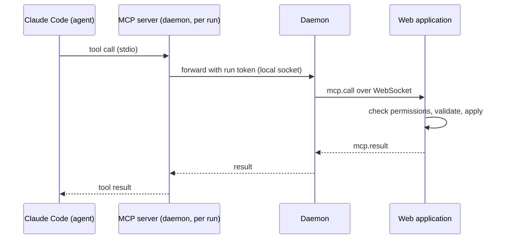

# 06 — MCP Tools

> Status: Draft v0.1
> Related: [01 — Domain Model](01-domain-model.md), [04 — Ticket Lifecycle](04-ticket-lifecycle.md), [05 — Daemon](05-daemon.md)

Agents interact with the Orchestrator only through the MCP tools described here. The tools are the agents' entire view of the system: tickets, plans, reviews and questions to the owner. Everything else (Git, the code, the tests) happens in the worktree with Claude Code's normal tools.

## 1. Architecture



- The MCP server is started by Claude Code for each run (`orchestrator-daemon mcp --run <id>`), using the run's `mcp.json`.
- It is a thin relay. **All validation happens on the server**: permissions, state transitions, Definition of Done, limits.
- Some calls also trigger daemon actions (for example `ticket.submit` makes the daemon push the branch first, see 05, section 4.9).
- Nothing is exposed on the network by the daemon; the server is reached through the daemon's existing connection.
- The daemon waits for the server's answer at most the MCP call timeout, then answers `UNAVAILABLE`. It writes Claude Code's own tool timeout for this server into `mcp.json` (the Claude Code MCP tool timeout), which is always longer (04, section 8).

## 2. Identity and scope

Every call carries the run token. From it the server knows, without trusting anything the agent says:

- the run, its agent profile and profile version;
- the project;
- the ticket (implementation and review runs) or the request (planning runs);
- the permission set of the profile.

An agent can read anything in its own project. It can only change **its own ticket**, unless its permissions say otherwise. It cannot see or change other projects.

## 3. Conventions

- Tool names use `<object>.<verb>` in the specifications and screens. On the wire the MCP server names them `<object>_<verb>` (`ticket_create`), because Claude Code and the Claude API accept only letters, digits, `_` and `-` in tool names; the agent sees them as `mcp__orchestrator__ticket_create`, and allowlists use that name (owner's decision, lot 2 step A).
- Inputs and outputs are JSON objects with documented schemas, defined once in `packages/protocol` (`src/mcp/`), with snake_case field names as in the examples below. Inputs are strict: an unknown field is refused with `VALIDATION_FAILED`. Texts are Markdown.
- Text sizes follow the rule of 05, section 3.3: a text tied to a setting (a title, a comment) is capped at the highest value that setting allows, any other text at the largest such ceiling, and the server then checks the setting's current value (owner's decision, lot 2 step B).
- Tickets are referenced by their human number (`WEB-12`).
- Tool descriptions are written for the agent: what the tool does, when to use it, when not to, and what happens next. They are part of the harness, versioned with the application, and reviewed like code.
- Every successful write returns the new state of the object, so the agent does not need to read it again.
- Errors return a code, a message written for the agent, and details when useful. A refusal tied to a setting (`LIMIT_REACHED`, a text too long, and similar) states the setting's current value in its message, for example "limit of 3 tickets per run reached"; the tests of the step that implements each refusal check it (owner's review, lot 2 step B):

| Code | Meaning |
|---|---|
| `FORBIDDEN` | The profile does not have this permission, or the object belongs to another ticket. |
| `NOT_FOUND` | Unknown object in this project. |
| `INVALID_TRANSITION` | The ticket's state does not allow this action (see 04). |
| `VALIDATION_FAILED` | Input incomplete or inconsistent; details list the problems. |
| `DOD_FAILED` | Submission checks failed; details list each failed check. |
| `LIMIT_REACHED` | A configurable limit was hit (see 04, section 8). |
| `UNAVAILABLE` | The daemon is disconnected from the server. Retry later. |

## 4. Tools

### 4.1 Reading

| Tool | Description |
|---|---|
| `project.get` | Project information: name, kind, repository, default branch, pointers to CLAUDE.md, docs and ADR folders, and the harness elements missing from a linked repository (08, section 3.4). |
| `ticket.get` | One ticket with description, acceptance criteria, status, dependencies, DoD report and pull request link. Defaults to the run's ticket. |
| `ticket.list` | Tickets of the project, filtered by status, type, assignee or text. Returns summaries, a page at a time (`cursor` and `next_cursor`) to stay under Claude Code's MCP output limit. |
| `ticket.comments` | Comments of a ticket, oldest first, including questions and answers, a page at a time like `ticket.list`. Defaults to the run's ticket. |
| `request.get` | The request being planned, with its comments (planning runs). *(Lot 5.)* |
| `agent.list` | Available agent profiles with their role and description, so tickets can be assigned. |
| `ci.status` | CI status of the run's pull request, with the log excerpt of failed jobs. Read from GitHub Actions workflow runs, jobs and job logs, and from commit statuses: fine-grained tokens cannot use the Checks API (02, section 3.1). *(Lot 3.)* |

### 4.2 Working on the run's ticket

| Tool | Description |
|---|---|
| `ticket.progress` | Short status line shown live in the UI ("Writing tests for the contact form"). Does not create a comment. Never refused for frequency: the server accepts every call, keeps the latest line and publishes it at most once per progress update interval (a setting, one minute by default, 04 section 8). The description tells the agent that calling more often is harmless but useless (owner's review, lot 2 step B). |
| `ticket.comment` | Adds a `note` comment: findings, decisions, anything the owner or the next agent should know. |
| `ticket.ask` | Asks the owner a question. The ticket moves to `waiting_human`. The agent should end its turn after calling it; the answer arrives as the next message. |
| `ticket.submit` | Submits the work with the DoD report (see 04, section 3.1). In lot 2 it only runs the reduced checks of 04, section 3.1 and, when they pass, ends the run: nothing is pushed and the agent receives no CI result. The daemon pushes the branch, the server opens or updates the pull request and runs the checks. Returns either the list of failed checks, or `pending_ci`, in which case the agent ends its turn and receives the CI result as the next message. |
| `ticket.give_up` | Declares that the ticket cannot be completed, with the reason (`reason`) and what was tried (`tried`). The run ends as failed and the retry policy applies (04, section 5). |

`ticket.submit` input:

```json
{
  "criteria": [
    { "index": 0, "status": "met", "justification": "Form validates email on submit, see ContactForm.test.ts" }
  ],
  "tests": { "paths": ["src/contact/ContactForm.test.ts"], "justification": null },
  "docs": { "paths": ["docs/user/contact-form.md"], "justification": null },
  "adrs": [],
  "summary": "Adds a contact form with client-side validation and a server endpoint."
}
```

### 4.3 Creating and editing tickets

| Tool | Description |
|---|---|
| `ticket.create` | Creates a ticket in `proposed`, outside any plan, that the owner accepts or rejects (04, section 2). Used when an agent finds work that is out of its ticket's scope (a bug, missing documentation). Input: type, title, description, acceptance criteria, priority, optional `blocked_by` (tickets of the same project) and optional assignee (a key from `agent.list`); the same length and count limits as the owner's form. Limited per run (04, section 8, `LIMIT_REACHED` beyond it), flagged "created by agent" with the profile and the run. Refused with `INVALID_TRANSITION` when the project is archived or not `ready`. |
| `ticket.update` | Changes title, description, acceptance criteria, type, priority, assignee or dependencies of a ticket that is `proposed` or `todo`. |

### 4.4 Planning

| Tool | Description |
|---|---|
| `request.ask` | Asks the owner a clarifying question about the request before planning. The request stays open until answered. |
| `plan.propose` | Submits a plan: summary, optional new project, and tickets. Tickets reference each other through local keys for dependencies. The server validates the plan (limits, assignees exist, no dependency cycle, each ticket has acceptance criteria) and shows it to the owner. |

`plan.propose` input (abridged):

```json
{
  "summary": "Build a one-page website with a contact form...",
  "new_project": { "name": "Bakery website", "kind": "website" },
  "tickets": [
    { "key": "setup", "type": "chore", "title": "Bootstrap project harness", "assignee": "architect",
      "acceptance_criteria": ["CI runs lint and tests on pull requests", "..."], "blocked_by": [] },
    { "key": "contact", "type": "feature", "title": "Contact form", "assignee": "web_dev",
      "acceptance_criteria": ["..."], "blocked_by": ["setup"] }
  ]
}
```

### 4.5 Reviewing

| Tool | Description |
|---|---|
| `review.approve` | Approves the ticket under review with a summary comment. The ticket moves to `awaiting_merge`. |
| `review.request_changes` | Requests changes with a list of actionable points (optionally with file and line). The ticket returns to `todo` for a `fix_review` run. The points are also posted as a review on the GitHub pull request. |

The server rejects both tools when the reviewing profile is the one that implemented the ticket.

## 5. Permissions by role

| Tool | Planner (PM) | Builder (Architect, Web Dev, Android Dev) | Reviewer (Quality) | Writer (Technical Writer) |
|---|---|---|---|---|
| All reading tools | ✓ | ✓ | ✓ | ✓ |
| `ticket.progress`, `ticket.comment`, `ticket.ask`, `ticket.give_up` | ✓ | ✓ | ✓ | ✓ |
| `ticket.submit` | — | ✓ | — | ✓ |
| `ticket.create` | ✓ | ✓ | ✓ | ✓ |
| `ticket.update` | ✓ (any ticket in the project) | — | — | — |
| `request.ask`, `plan.propose` | ✓ | — | — | — |
| `review.approve`, `review.request_changes` | — | — | ✓ | — |

Custom agents take the permissions of the role chosen at creation. The owner can remove permissions from a profile but cannot grant a permission its role does not have; this keeps the review and planning boundaries intact.

## 6. What the initial prompt tells the agent

The server builds the first message of each run. It always states:

- who the agent is working for, and the ticket or request to handle;
- that the MCP tools are the only way to communicate with the owner and the system;
- that a run must end with exactly one of `ticket.submit`, `ticket.ask` (then wait), or `ticket.give_up` (or `plan.propose` / review tools for planning and review runs);
- that pushing to GitHub is done by the system, and the agent only commits;
- where to find the project conventions (CLAUDE.md, docs, ADRs), and that the agent reads `CLAUDE.md` first: Claude Code does not load it on its own in a run (05, section 4.3);
- that when a tool or command is refused, the agent must not look for a workaround: it uses `ticket.ask` to explain what it needs and why, or `ticket.give_up` if the ticket cannot be done without it.

The template for each purpose is versioned with the application and documented in [03 — Agents](03-agents.md).

## 7. Audit

Every call is recorded as an event (01, section 3.10) with the run, the tool, a summary of the input, and the result code. The UI shows them in the run history.
