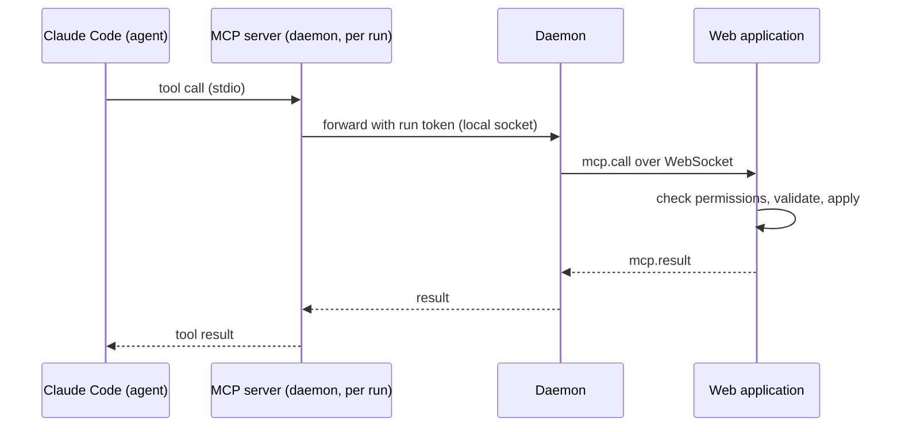

# 06 — MCP Tools

> Status: Draft v0.1
> Related: [01 — Domain Model](01-domain-model.md), [04 — Ticket Lifecycle](04-ticket-lifecycle.md), [05 — Daemon](05-daemon.md)

Agents interact with the Orchestrator only through the MCP tools described here. The tools are the agents' entire view of the system: tickets, plans, reviews and questions to the owner. Everything else (Git, the code, the tests) happens in the worktree with Claude Code's normal tools.

## 1. Architecture



- The MCP server is started by Claude Code for each run (`orchestrator-daemon mcp --run <id>`), using the run's `mcp.json`.
- It is a thin relay. **All validation happens on the server**: permissions, state transitions, Definition of Done, limits.
- Some calls also trigger daemon actions (for example `ticket.submit` makes the daemon push the branch first, see 05, section 4.9).
- Nothing is exposed on the network by the daemon; the server is reached through the daemon's existing connection.
- The daemon waits for the server's answer at most the MCP call timeout, then answers `UNAVAILABLE`. It writes Claude Code's own tool timeout for this server into `mcp.json` (the Claude Code MCP tool timeout, never the MCP call timeout), which is always longer (04, section 8), so the agent always gets the daemon's answer first (owner's decision, lot 2 step G).
- A call made while the daemon is disconnected from the server, or still waiting when the connection drops, gets `UNAVAILABLE` at once; an answer arriving after the timeout is ignored (owner's decision, lot 2 step G).
- The relay is built on the official MCP SDK (ADR 0028) with its low-level server: it lists the tools with their descriptions and input schemas from `packages/protocol` as JSON Schema, and passes the arguments to the server as they are, without checking them itself. A result reaches Claude Code as JSON text; a refusal is a result marked as an error (`isError`) whose text is the JSON `{ code, message, details }` of section 3 (owner's decision, lot 2 step G).
- The relay never holds the run token: it reaches the daemon through the run's socket (05, section 4.5), and the daemon adds the token to `mcp.call`.

## 2. Identity and scope

Every call carries the run token. From it the server knows, without trusting anything the agent says:

- the run, its agent profile and profile version;
- the project;
- the ticket (implementation and review runs) or the request (planning runs);
- the permission set of the profile.

A run's token is revoked when the run ends, and at once when the owner stops it (04, section 2): a call with a revoked or unknown token is refused with `FORBIDDEN`, telling the agent its run has ended (owner's decision, lot 2 step J).

An agent can read anything in its own project. It can only change **its own ticket**, unless its permissions say otherwise. It cannot see or change other projects.

## 3. Conventions

- Tool names use `<object>.<verb>` in the specifications and screens. On the wire the MCP server names them `<object>_<verb>` (`ticket_create`), because Claude Code and the Claude API accept only letters, digits, `_` and `-` in tool names; the agent sees them as `mcp__orchestrator__ticket_create`, and allowlists use that name (owner's decision, lot 2 step A).
- Inputs and outputs are JSON objects with documented schemas, defined once in `packages/protocol` (`src/mcp/`), with snake_case field names as in the examples below. Inputs are strict: an unknown field is refused with `VALIDATION_FAILED`. Texts are Markdown.
- Text sizes follow the rule of 05, section 3.3: a text tied to a setting (a title, a comment) is capped at the highest value that setting allows, any other text at the largest such ceiling, and the server then checks the setting's current value (owner's decision, lot 2 step B).
- Tickets are referenced by their human number (`WEB-12`).
- Tool descriptions are written for the agent: what the tool does, when to use it, when not to, and what happens next. They are part of the harness, versioned with the application, and reviewed like code.
- Every successful write returns the new state of the object, so the agent does not need to read it again.
- Errors return a code, a message written for the agent, and details when useful. A refusal tied to a setting (`LIMIT_REACHED`, a text too long, and similar) states the setting's current value in its message, for example "limit of 3 tickets per run reached"; the tests of the step that implements each refusal check it (owner's review, lot 2 step B):

| Code | Meaning |
|---|---|
| `FORBIDDEN` | The profile does not have this permission, or the object belongs to another ticket. |
| `NOT_FOUND` | Unknown object in this project. |
| `INVALID_TRANSITION` | The ticket's state does not allow this action (see 04). |
| `VALIDATION_FAILED` | Input incomplete or inconsistent; details list the problems. |
| `DOD_FAILED` | Submission checks failed; details list each failed check. |
| `LIMIT_REACHED` | A configurable limit was hit (see 04, section 8). |
| `UNAVAILABLE` | The daemon is disconnected from the server. Retry later. |

## 4. Tools

### 4.1 Reading

| Tool | Description |
|---|---|
| `project.get` | Project information: name, kind, repository, default branch, pointers to CLAUDE.md, docs and ADR folders, and the harness elements missing from a linked repository (08, section 3.4). |
| `ticket.get` | One ticket with description, acceptance criteria, status, dependencies, DoD report and pull request link. Defaults to the run's ticket. |
| `ticket.list` | Tickets of the project, filtered by status, type, assignee or text. Returns summaries, a page at a time (`cursor` and `next_cursor`) to stay under Claude Code's MCP output limit. |
| `ticket.comments` | Comments of a ticket, oldest first, including questions and answers, a page at a time like `ticket.list`. Defaults to the run's ticket. |
| `request.get` | The request being planned, with its comments (planning runs). *(Lot 5.)* |
| `agent.list` | Available agent profiles with their role and description, so tickets can be assigned. |
| `ci.status` | CI status of the run's pull request, with the log excerpt of each failed step. Read from GitHub Actions workflow runs, jobs and job logs, and from commit statuses: fine-grained tokens cannot use the Checks API (02, section 3.1). *(Lot 3.)* The result follows 04, section 3.1 (every workflow run of the head commit and its statuses; "No CI found"); each failed job lists its failed steps, each with its own part of the job's log as 04 section 3.1 cuts it (or the end of the job's log, said as such), cut to **Longest CI log excerpt**, and the whole output stays within `MCP_OUTPUT_MAX_CHARACTERS`, the excerpts of all failed steps cut further, the longest first, with a marker. Without a pull request it says so. All roles (owner's decision, lot 3 step A). **Which commit** (owner's answers, lot 3 step G1b): only an accepted submission's commit of the run's ticket, named in the answer: this run's; before this run hands in, the ticket's latest accepted one, said to be an earlier run's (with its attempt) and not to hold the work done since; none when no work was accepted. Never the branch, the pull request's head (said when it is another commit) or a refused submission's commit; it never decides a result. After a CI round sent back to the run and before the agent hands in again, it answers for that round: its commit, the result and excerpts the round sent, kept on the round and said to be that round's, never "read again at most every" (owner's addition, lot 3 step G2b); only what the round could not read (failed jobs not listed, a log GitHub could not give for a passing reason) is read again, at most once per **GitHub check interval**, never while the request limit holds, and kept on the round; a complete round asks GitHub nothing (owner's review, lot 3 step G2b). A run that ended after a confirmed round, before handing in again, still answers for the next runs with that round, as the ticket's latest run holding a wait or a confirmed round (owner's review, lot 3 step G2b). **Work accepted by Check CI again** (owner's review of lot 3 step H1): when the owner's **Check CI again** accepted the work after its run ended (04, section 3.1), every later answer about that commit, a review run's and a later run's included, gives what Check CI again found (CI passed, or "No CI found" with "Nothing on GitHub tested this work.") and when, asks GitHub nothing, and never says CI failed or did not finish; a failed result read before is said only as what it was before the re-reading ("Before that re-reading, the result read on GitHub was: CI failed (…). It no longer applies."). Its checks are not listed: Check CI again keeps only what it found. **Cost**: during the wait it gives the wait's stored result, asking GitHub nothing; otherwise a commit is read at most once per **GitHub check interval** (2 requests, plus 1 per failed workflow run and 1 per failed job's log), never while GitHub's request limit holds the wait back (a limit GitHub gives no time for holds for the longer of one minute, what GitHub's documentation asks, and **GitHub check interval**, and the answer says until when; a read that failed is not tried again before one **GitHub check interval**, its problem said meanwhile: owner's addition, lot 3 step G2b); a finished result is kept and never read again, logs are read once per failed job, and every answer says when its result was read and that a finished result is not read again. Logs are read job by job while each excerpt can get at least 500 characters; the answer counts and names the failed jobs whose log was left unread, with their failed steps. A log that cannot be read gives the step a sentence instead of an excerpt (expired or deleted; GitHub unreachable or limited, read again later; a refusal in GitHub's masked words). The sentences come from the template `ci-status` (03, section 3.2). |

**Output size** (owner's decision, lot 2 step K). Claude Code refuses an MCP output above 25,000 tokens (`MAX_MCP_OUTPUT_TOKENS`), and a description or a comment can be up to 100,000 characters within the settings' ranges. A reading tool's output is therefore at most `MCP_OUTPUT_MAX_CHARACTERS`, 40,000 characters of JSON (about 10,000 tokens of English, with room for denser text), a constant in `packages/protocol` (04, section 8). A page holds whole items while they fit, always at least one; `ticket.list` returns at most 50 tickets per page. A single text above the budget (a description, a comment) is cut at a line boundary and followed by a marker saying how many characters were left out. With the default settings nothing is ever cut: the largest `ticket.get` (a 20,000-character description and 20 criteria of 500 characters) is about 32,000 characters.

### 4.2 Working on the run's ticket

| Tool | Description |
|---|---|
| `ticket.progress` | Short status line shown live in the UI ("Writing tests for the contact form"). Does not create a comment. Never refused for frequency: the server accepts every call, keeps the latest line and publishes it at most once per progress update interval (a setting, one minute by default, 04 section 8). The description tells the agent that calling more often is harmless but useless (owner's review, lot 2 step B). |
| `ticket.comment` | Adds a `note` comment: findings, decisions, anything the owner or the next agent should know. |
| `ticket.ask` | Asks the owner a question. The ticket moves to `waiting_human`. The agent should end its turn after calling it; the answer arrives as the next message. |
| `ticket.submit` | Submits the work with the DoD report (see 04, section 3.1). In lot 2 it only runs the reduced checks of 04, section 3.1 and, when they pass, ends the run: nothing is pushed and the agent receives no CI result. From lot 3, the daemon pushes the branch, the server runs the checks of 04 section 3.1 and, when they pass, opens or updates the pull request. Returns either the list of failed checks (`DOD_FAILED`; nothing opened or updated), or `pending_ci`, in which case the agent ends its turn and receives the CI result as the next message only if CI fails; when CI passes, the run ends. Each submission after a CI failure is checked again from the start (owner's decisions, lot 3 step A). From lot 3 step F, a failed push is refused with a `push` check telling the agent it cannot fix it and to end its turn; the run then ends with `push_failed`; listed paths must be files the branch changed (folders are not accepted); the pull request is opened after the answer, never inside the call (04, section 3.1). |
| `ticket.give_up` | Declares that the ticket cannot be completed, with the reason (`reason`) and what was tried (`tried`). Both are posted as the agent's `note` on the ticket, so the owner and the next attempt read them, and the reason is kept as the run's outcome; when the turn ends, the run ends as failed, its `system` comment follows and the retry policy applies (04, section 5) (owner's decision, lot 2 step K). |

Decisions in one run (lot 2 step K): `ticket.ask`, `ticket.submit` and `ticket.give_up` need the ticket `in_progress`. A second question while the first waits, and any of the three after an accepted `ticket.submit` or `ticket.give_up`, are refused with `INVALID_TRANSITION`, telling the agent to end its turn. An accepted `ticket.submit` stores the report at once; the run ends `succeeded` and the ticket moves to `in_review` when the turn ends (05, section 4.8).

`ticket.submit` input:

```json
{
  "criteria": [
    { "index": 0, "status": "met", "justification": "Form validates email on submit, see ContactForm.test.ts" }
  ],
  "tests": { "paths": ["src/contact/ContactForm.test.ts"], "justification": null },
  "docs": { "paths": ["docs/user/contact-form.md"], "justification": null },
  "adrs": [],
  "summary": "Adds a contact form with client-side validation and a server endpoint."
}
```

### 4.3 Creating and editing tickets

| Tool | Description |
|---|---|
| `ticket.create` | Creates a ticket in `proposed`, outside any plan, that the owner accepts or rejects (04, section 2). Used when an agent finds work that is out of its ticket's scope (a bug, missing documentation). Input: type, title, description, acceptance criteria, priority, optional `blocked_by` (tickets of the same project) and optional assignee (a key from `agent.list`); the same length and count limits as the owner's form. Limited per run (04, section 8, `LIMIT_REACHED` beyond it), flagged "created by agent" with the profile and the run. Refused with `INVALID_TRANSITION` when the project is archived or not `ready`. |
| `ticket.update` | Changes title, description, acceptance criteria, type, priority, assignee or dependencies of a ticket that is `proposed` or `todo`. |

### 4.4 Planning

| Tool | Description |
|---|---|
| `request.ask` | Asks the owner a clarifying question about the request before planning. The request stays open until answered. |
| `plan.propose` | Submits a plan: summary, optional new project, and tickets. Tickets reference each other through local keys for dependencies. The server validates the plan (limits, assignees exist, no dependency cycle, each ticket has acceptance criteria) and shows it to the owner. |

`plan.propose` input (abridged):

```json
{
  "summary": "Build a one-page website with a contact form...",
  "new_project": { "name": "Bakery website", "kind": "website" },
  "tickets": [
    { "key": "setup", "type": "chore", "title": "Bootstrap project harness", "assignee": "architect",
      "acceptance_criteria": ["CI runs lint and tests on pull requests", "..."], "blocked_by": [] },
    { "key": "contact", "type": "feature", "title": "Contact form", "assignee": "web_dev",
      "acceptance_criteria": ["..."], "blocked_by": ["setup"] }
  ]
}
```

### 4.5 Reviewing

| Tool | Description |
|---|---|
| `review.approve` | Approves the ticket under review with a summary comment. Recorded at the call, applied at the run's end (below): the ticket moves to `awaiting_merge`, the summary becomes a `review` comment and is also posted on the pull request. |
| `review.request_changes` | Requests changes with a list of actionable points (optionally with file and line). Recorded at the call, applied at the run's end (below): each point becomes a `review` comment (`src/contact.ts:42 — <point>`) and the ticket returns to `todo` for a `fix_review` run (or stops after **Most review rounds per ticket**, 04 section 5). The points are also posted on the GitHub pull request. |

The server rejects both tools when the reviewing profile is the one that implemented the ticket, and when the run is not a `review` run of a ticket in `in_review`. On GitHub each is posted as **one review of the "comment" kind**, the points in its body with `file:line` when given: GitHub refuses an approval or a request for changes on your own pull request (every pull request is the owner's), and refuses inline comments on lines outside the diff. When GitHub refuses the post, the decision stands, with an event and a note on the ticket page (owner's decisions, lot 3 step A).

**One decision per review, about one commit** (owner's answers 2 and 3, lot 3 step H). A review run reviews one commit, fixed when **Start review** starts it (04, section 3.2). Within either tool's call, the server reads the pull request's head on GitHub:

- unchanged: the decision (the summary, or the points) is stored on the run and the call answered; the agent ends its turn;
- read and found moved: the call is refused with `INVALID_TRANSITION` ("The pull request changed on GitHub during your review, now def5678: your review no longer applies. End your turn.") and the server stops the run, which fails with `review_branch_moved`, not counted;
- not read (GitHub unreachable, its request limit, an answer that cannot be read, the token refused): the call is never refused for it; the decision is stored and answered as when the head is unchanged, marked "head not checked on GitHub at the decision", which the ticket page and the run page then show. A GitHub problem never costs the review.

The decision is applied only when the run ends `submitted` with no head moved on the machine (05, section 4.9): the ticket's status, the `review` comments and the events in one transaction, then the comment review on GitHub, posted at most once, on the reviewed commit (`commit_id`). A decision thrown away (the head moved on the machine, **Stop run** or the machine lost before the end) is kept on the run, which says which decision it was and why it was not applied. A second decision, or `ticket.ask` or `ticket.give_up` after one, is refused with `INVALID_TRANSITION` ("You already approved this ticket in this run: end your turn.", or "You already asked for changes on this ticket in this run: end your turn."); a decision after the run's end gets the "run ended" refusal. **What the call answers** (lot 3 step H2): the decision, the commit, whether the head was checked, and a note: "Your approval of commit abc1234 is recorded. It is applied when your turn ends: end your turn now, without another tool call.", with, when GitHub could not be read, "GitHub could not be read to check the pull request's head (<why>): the owner is told to check it before merging." **The reviewer never an implementer** (owner's answer 6g): both tools are refused with `FORBIDDEN` ("<profile> implemented this ticket in an earlier run, so it cannot review it: end your turn without a decision.") when the run's profile ran an `implement` or `fix_review` run of the ticket. **The ticket's comment** when a review run ends without its decision applied, a `system` note (no status change, or `waiting_human` → `in_review` with the answer's question open): "The review run on machine laptop ended without a decision: <reason>. It does not count as a failed attempt.", or "… ended before Quality's approval of commit abc1234 was applied: <why>. The approval is not applied, and the ticket stays in review. …"; after **Stop run**, "Review run stopped by the owner. It does not count as a failed attempt.", or "Review run stopped by the owner before Quality's request for changes (2 points) on commit abc1234 was applied: it is not applied. …".

**The comment review's text** (template `review-comment`, 03 section 3.2): "**Quality review: approved** · commit abc1234", the summary, then "— Posted by the Orchestrator for BAK-12 (<ticket link>). The owner merges this pull request."; or "**Quality review: changes requested** · commit abc1234 · 3 points", the numbered points ("1. `src/contact.ts:42`: <point>"), then "— Posted by the Orchestrator for BAK-12 (<ticket link>). The agent that implemented it addresses these points in its next run." The agent's text is masked for secrets, then made harmless as the pull request's description (04, section 3.1: a zero-width space after `@`, `#`, `GH-` and in `/issues/`; `<`, `>` and `&` escaped); paths sit in code spans with a fence they cannot close. The body stays within 65,536 characters: the points are kept whole, in order, then "… and N more points: see the ticket page"; a summary too long is cut at a line boundary with "[cut: the full text is on the ticket page]". The texts that leave for GitHub also have their local paths made harmless (04, section 3.1): a path in the run's worktree becomes relative, the daemon's folder `~/.orchestrator/`; any other path, such as a page address `/home/dashboard` or a hardcoded `/home/alice/data/file.csv` the review reports, is quoted as written (owner's answer 4b, narrowed on 2026-10-10). A point too long to fit alone is cut like the summary, with the same marker (owner's answer 4c, lot 3 step H3: **Longest comment** goes up to 100,000 characters).

**Posting it, at most once** (owner's answers 1 to 4, lot 3 step H3). No retry, no **Post again**, no "Needs you" item; whatever happens, the decision stands in the Orchestrator.

- **Wanted.** The transaction that applies the decision marks the post wanted on the run, with the ticket's pull request number, as a pull request is marked wanted at a submission (04, section 3.1). The post is made after that transaction, one at a time per run, and at each server start for every run still marked, so a decision applied just before the server stopped is posted too.
- **Started.** Before the request, the run records "post started" in a transaction of its own. The body ends with a mark GitHub does not show, `<!-- orchestrator-review run=<run id> -->`; the agent cannot write one, since its `<` is escaped.
- **Answered.** Accepted: "Posted on GitHub" with the review's link, event `ticket.review_posted`. Refused by GitHub, or never sent (GitHub not reached at all, no token, the token unreadable): the note "Not posted on GitHub: <reason>. The decision stands in the Orchestrator.", with the reasons of a pull request not opened (Pull requests (Read and write) missing with the token list link, GitHub unreachable, the token refused, the request limit, including GitHub's 422 for posting too fast, an unreadable answer, other refusals in GitHub's masked words), and event `ticket.review_not_posted`.
- **A refusal (422) is explained** by one read of the pull request: its head moved, "Not posted on GitHub: pull request #12's head is now def5678, and GitHub refused a review of commit abc1234 ("<GitHub's words>"). The decision stands in the Orchestrator."; closed or merged, "Not posted on GitHub: pull request #12 was closed (merged) and GitHub refused the review ("<GitHub's words>"). The decision stands in the Orchestrator."; otherwise GitHub's words. A review of a commit no longer in the pull request, or on a closed one, that GitHub accepts is posted (assumptions A30 and A31). The owner's run of the smoke script on the real GitHub (2026-10-10) found that GitHub accepts both: a comment review whose `commit_id` is an older commit of the pull request or a commit not in it (state `COMMENTED`, `commit_id` as sent), and one on a pull request closed without merging. The notes for a moved head and for a closed or merged pull request therefore remain only for a 422 GitHub gives for another reason.
- **A lost answer** (a timeout, the connection cut after the request left, a server error) and a server start finding a post started without its result: the server reads the pull request's reviews, following every page until it finds the mark or reaches the end. Found: posted. Not found at a server start: posted now (its first attempt). Not found after a lost answer, never a flat "Not posted", since GitHub may still finish it: "GitHub did not answer the post, and the review was not on pull request #12 when checked at 15:10. The decision stands in the Orchestrator." The reading itself fails: "GitHub did not answer the post, and pull request #12 could not be checked (<reason>). The decision stands in the Orchestrator. If "Quality review" appears on the pull request, it was posted." (after a server start: "The Orchestrator stopped while posting the review, and pull request #12 could not be checked afterwards (<reason>). …"). Both write `ticket.review_not_posted`, saying which case it was.
- **"Head not checked"** (owner's answer 3): the post is attempted as for any decision; `commit_id` ties it to the reviewed commit. A failed post gives its own note under the "head could not be checked" sentence; a post done does not remove that sentence.

## 5. Permissions by role

| Tool | Planner (PM) | Builder (Architect, Web Dev, Android Dev) | Reviewer (Quality) | Writer (Technical Writer) |
|---|---|---|---|---|
| All reading tools | ✓ | ✓ | ✓ | ✓ |
| `ticket.progress`, `ticket.comment`, `ticket.ask`, `ticket.give_up` | ✓ | ✓ | ✓ | ✓ |
| `ticket.submit` | — | ✓ | — | ✓ |
| `ticket.create` | ✓ | ✓ | ✓ | ✓ |
| `ticket.update` | ✓ (any ticket in the project) | — | — | — |
| `request.ask`, `plan.propose` | ✓ | — | — | — |
| `review.approve`, `review.request_changes` | — | — | ✓ | — |

**The tools a run sees** (owner's answer 1, lot 3 step H). `run.start` carries the tools the run may call: the profile's permissions without those its purpose cannot use (`ticket.submit` in a `review` run; `review.approve` and `review.request_changes` in any other run). The daemon keeps the list with the run and the relay lists only those tools to Claude Code, so an agent never sees a tool it cannot use; the server still refuses each call by role and purpose. An agent that calls a tool its run does not list gets Claude Code's own answer, never the server's: "<tool_use_error>Error: No such tool available: mcp__orchestrator__ticket_submit</tool_use_error>" (Claude Code 2.1.296, `haiku`, the owner's `quality` smoke run of 2026-10-10, lot 3 step H2; the smoke test records it as an INFO line, never a verdict).

Custom agents take the permissions of the role chosen at creation. The owner can remove permissions from a profile but cannot grant a permission its role does not have; this keeps the review and planning boundaries intact.

## 6. What the initial prompt tells the agent

The server builds the first message of each run. It always states:

- who the agent is working for, and the ticket or request to handle;
- that the MCP tools are the only way to communicate with the owner and the system;
- that a run must end with exactly one of `ticket.submit`, `ticket.ask` (then wait), or `ticket.give_up` (or `plan.propose` for planning runs; `review.approve` or `review.request_changes` instead of `ticket.submit` for review runs, with one decision per review);
- that pushing to GitHub is done by the system, and the agent only commits; a review run commits nothing and changes no file itself, and runs no Git command that moves HEAD or changes tracked files (what installing, building and testing create is expected);
- where to find the project conventions (CLAUDE.md, docs, ADRs), and that the agent reads `CLAUDE.md` first: Claude Code does not load it on its own in a run (05, section 4.3);
- that when a tool or command is refused, the agent must not look for a workaround and never asks the owner to allow it: if the ticket cannot be done without it, it says so in plain words with `ticket.ask` (something the owner can decide) or `ticket.give_up` (03, section 3; owner's decisions, lot 2 step N and lot 3 step A);
- that tips Claude Code shows about its own commands (such as `/ultrareview`) are not for the agent and are ignored (owner's decision, lot 3 step A).

Most of these are said by the rules appended to the system prompt, picked by the run's purpose (03, section 3; lot 3 step H5), the rest by the first message. The template for each purpose is versioned with the application and documented in [03 — Agents](03-agents.md).

## 7. Audit

The event log is for changes, and agents call the reading tools dozens of times per run, so not every call is an event (owner's decision, lot 2 step K):

- a call that changes something writes the events of that change, in its transaction, with the actor `agent` and the profile and run in the payload: `ticket.comment` (`ticket.commented`), `ticket.ask` (`ticket.commented` and `ticket.status_changed`), `ticket.create` (`ticket.created`), `ticket.submit` when accepted (`ticket.submitted`), `ticket.give_up` (`ticket.commented`), `review.approve` and `review.request_changes` (`run.review_decided` at the call; at the run's end, `ticket.commented` for each `review` comment and `ticket.status_changed` with the agent as actor, or `run.review_discarded` when the decision is thrown away; lot 3 step H2), and `ticket.progress` when a new line is shown (`run.progress`); `ci.status` is a reading call;
- a reading call (`project.get`, `ticket.get`, `ticket.list`, `ticket.comments`, `agent.list`) and a refused call write no event: they appear in the run's log, which shows every tool call and its result from the transcript (02, section 7);
- the server logs every call (run, ticket, machine, tool, result code) in its own log.
