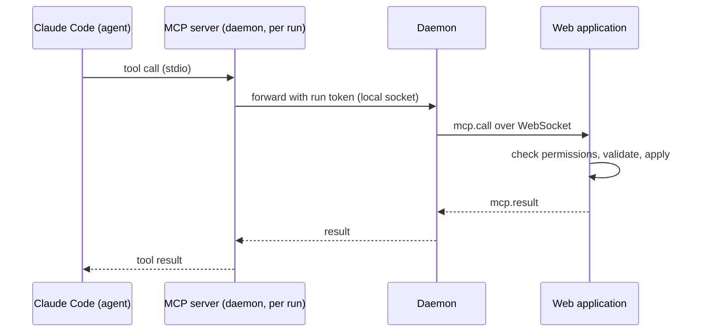

# 06 — MCP Tools

> Status: Draft v0.1
> Related: [01 — Domain Model](01-domain-model.md), [04 — Ticket Lifecycle](04-ticket-lifecycle.md), [05 — Daemon](05-daemon.md)

Agents interact with the Orchestrator only through the MCP tools described here. The tools are the agents' entire view of the system: tickets, plans, reviews and questions to the owner. Everything else (Git, the code, the tests) happens in the worktree with Claude Code's normal tools.

## 1. Architecture



- The MCP server is started by Claude Code for each run (`orchestrator-daemon mcp --run <id>`), using the run's `mcp.json`.
- It is a thin relay. **All validation happens on the server**: permissions, state transitions, Definition of Done, limits.
- Some calls also trigger daemon actions (for example `ticket.submit` makes the daemon push the branch first, see 05, section 4.9).
- Nothing is exposed on the network by the daemon; the server is reached through the daemon's existing connection.
- The daemon waits for the server's answer at most the MCP call timeout, then answers `UNAVAILABLE`. It writes Claude Code's own tool timeout for this server into `mcp.json` (the Claude Code MCP tool timeout, never the MCP call timeout), which is always longer (04, section 8), so the agent always gets the daemon's answer first (owner's decision, lot 2 step G).
- A call made while the daemon is disconnected from the server, or still waiting when the connection drops, gets `UNAVAILABLE` at once; an answer arriving after the timeout is ignored (owner's decision, lot 2 step G).
- The relay is built on the official MCP SDK (ADR 0028) with its low-level server: it lists the tools with their descriptions and input schemas from `packages/protocol` as JSON Schema, and passes the arguments to the server as they are, without checking them itself. A result reaches Claude Code as JSON text; a refusal is a result marked as an error (`isError`) whose text is the JSON `{ code, message, details }` of section 3 (owner's decision, lot 2 step G).
- The relay never holds the run token: it reaches the daemon through the run's socket (05, section 4.5), and the daemon adds the token to `mcp.call`.

## 2. Identity and scope

Every call carries the run token. From it the server knows, without trusting anything the agent says:

- the run, its agent profile and profile version;
- the project;
- the ticket (implementation and review runs) or the request (planning runs);
- the permission set of the profile.

A run's token is revoked when the run ends, and at once when the owner stops it (04, section 2): a call with a revoked or unknown token is refused with `FORBIDDEN`, telling the agent its run has ended (owner's decision, lot 2 step J).

An agent can read anything in its own project. It can only change **its own ticket**, unless its permissions say otherwise. It cannot see or change other projects.

## 3. Conventions

- Tool names use `<object>.<verb>` in the specifications and screens. On the wire the MCP server names them `<object>_<verb>` (`ticket_create`), because Claude Code and the Claude API accept only letters, digits, `_` and `-` in tool names; the agent sees them as `mcp__orchestrator__ticket_create`, and allowlists use that name (owner's decision, lot 2 step A).
- Inputs and outputs are JSON objects with documented schemas, defined once in `packages/protocol` (`src/mcp/`), with snake_case field names as in the examples below. Inputs are strict: an unknown field is refused with `VALIDATION_FAILED`. Texts are Markdown.
- Text sizes follow the rule of 05, section 3.3: a text tied to a setting (a title, a comment) is capped at the highest value that setting allows, any other text at the largest such ceiling, and the server then checks the setting's current value (owner's decision, lot 2 step B).
- Tickets are referenced by their human number (`WEB-12`).
- Tool descriptions are written for the agent: what the tool does, when to use it, when not to, and what happens next. They are part of the harness, versioned with the application, and reviewed like code.
- Every successful write returns the new state of the object, so the agent does not need to read it again.
- Errors return a code, a message written for the agent, and details when useful. A refusal tied to a setting (`LIMIT_REACHED`, a text too long, and similar) states the setting's current value in its message, for example "limit of 3 tickets per run reached"; the tests of the step that implements each refusal check it (owner's review, lot 2 step B):

| Code | Meaning |
|---|---|
| `FORBIDDEN` | The profile does not have this permission, or the object belongs to another ticket. |
| `NOT_FOUND` | Unknown object in this project. |
| `INVALID_TRANSITION` | The ticket's state does not allow this action (see 04). |
| `VALIDATION_FAILED` | Input incomplete or inconsistent; details list the problems. |
| `DOD_FAILED` | Submission checks failed; details list each failed check. |
| `LIMIT_REACHED` | A configurable limit was hit (see 04, section 8). |
| `UNAVAILABLE` | The daemon is disconnected from the server. Retry later. |

## 4. Tools

### 4.1 Reading

| Tool | Description |
|---|---|
| `project.get` | Project information: name, kind, repository, default branch, pointers to CLAUDE.md, docs and ADR folders, and the harness elements missing from a linked repository (08, section 3.4). |
| `ticket.get` | One ticket with description, acceptance criteria, status, dependencies, DoD report and pull request link. Defaults to the run's ticket. |
| `ticket.list` | Tickets of the project, filtered by status, type, assignee or text. Returns summaries, a page at a time (`cursor` and `next_cursor`) to stay under Claude Code's MCP output limit. |
| `ticket.comments` | Comments of a ticket, oldest first, including questions and answers, a page at a time like `ticket.list`. Defaults to the run's ticket. |
| `request.get` | The request being planned, with its comments (planning runs). *(Lot 5.)* |
| `agent.list` | Available agent profiles with their role and description, so tickets can be assigned. |
| `ci.status` | CI status of the run's pull request, with the log excerpt of each failed step. Read from GitHub Actions workflow runs, jobs and job logs, and from commit statuses: fine-grained tokens cannot use the Checks API (02, section 3.1). *(Lot 3.)* The result follows 04, section 3.1 (every workflow run of the head commit and its statuses; "No CI found"); each failed job lists its failed steps, each with its own part of the job's log as 04 section 3.1 cuts it (or the end of the job's log, said as such), cut to **Longest CI log excerpt**, and the whole output stays within `MCP_OUTPUT_MAX_CHARACTERS`, the excerpts of all failed steps cut further, the longest first, with a marker. Without a pull request it says so. All roles (owner's decision, lot 3 step A). **Which commit** (owner's answers, lot 3 step G1b): only an accepted submission's commit of the run's ticket, named in the answer: this run's; before this run hands in, the ticket's latest accepted one, said to be an earlier run's (with its attempt) and not to hold the work done since; none when no work was accepted. Never the branch, the pull request's head (said when it is another commit) or a refused submission's commit; it never decides a result. After a CI round sent back to the run and before the agent hands in again, it answers for that round: its commit, the result and excerpts the round sent, kept on the round and said to be that round's, never "read again at most every" (owner's addition, lot 3 step G2b); only what the round could not read (failed jobs not listed, a log GitHub could not give for a passing reason) is read again, at most once per **GitHub check interval**, never while the request limit holds, and kept on the round; a complete round asks GitHub nothing (owner's review, lot 3 step G2b). A run that ended after a confirmed round, before handing in again, still answers for the next runs with that round, as the ticket's latest run holding a wait or a confirmed round (owner's review, lot 3 step G2b). **Cost**: during the wait it gives the wait's stored result, asking GitHub nothing; otherwise a commit is read at most once per **GitHub check interval** (2 requests, plus 1 per failed workflow run and 1 per failed job's log), never while GitHub's request limit holds the wait back (a limit GitHub gives no time for holds for the longer of one minute, what GitHub's documentation asks, and **GitHub check interval**, and the answer says until when; a read that failed is not tried again before one **GitHub check interval**, its problem said meanwhile: owner's addition, lot 3 step G2b); a finished result is kept and never read again, logs are read once per failed job, and every answer says when its result was read and that a finished result is not read again. Logs are read job by job while each excerpt can get at least 500 characters; the answer counts and names the failed jobs whose log was left unread, with their failed steps. A log that cannot be read gives the step a sentence instead of an excerpt (expired or deleted; GitHub unreachable or limited, read again later; a refusal in GitHub's masked words). The sentences come from the template `ci-status` (03, section 3.2). |

**Output size** (owner's decision, lot 2 step K). Claude Code refuses an MCP output above 25,000 tokens (`MAX_MCP_OUTPUT_TOKENS`), and a description or a comment can be up to 100,000 characters within the settings' ranges. A reading tool's output is therefore at most `MCP_OUTPUT_MAX_CHARACTERS`, 40,000 characters of JSON (about 10,000 tokens of English, with room for denser text), a constant in `packages/protocol` (04, section 8). A page holds whole items while they fit, always at least one; `ticket.list` returns at most 50 tickets per page. A single text above the budget (a description, a comment) is cut at a line boundary and followed by a marker saying how many characters were left out. With the default settings nothing is ever cut: the largest `ticket.get` (a 20,000-character description and 20 criteria of 500 characters) is about 32,000 characters.

### 4.2 Working on the run's ticket

| Tool | Description |
|---|---|
| `ticket.progress` | Short status line shown live in the UI ("Writing tests for the contact form"). Does not create a comment. Never refused for frequency: the server accepts every call, keeps the latest line and publishes it at most once per progress update interval (a setting, one minute by default, 04 section 8). The description tells the agent that calling more often is harmless but useless (owner's review, lot 2 step B). |
| `ticket.comment` | Adds a `note` comment: findings, decisions, anything the owner or the next agent should know. |
| `ticket.ask` | Asks the owner a question. The ticket moves to `waiting_human`. The agent should end its turn after calling it; the answer arrives as the next message. |
| `ticket.submit` | Submits the work with the DoD report (see 04, section 3.1). In lot 2 it only runs the reduced checks of 04, section 3.1 and, when they pass, ends the run: nothing is pushed and the agent receives no CI result. From lot 3, the daemon pushes the branch, the server runs the checks of 04 section 3.1 and, when they pass, opens or updates the pull request. Returns either the list of failed checks (`DOD_FAILED`; nothing opened or updated), or `pending_ci`, in which case the agent ends its turn and receives the CI result as the next message only if CI fails; when CI passes, the run ends. Each submission after a CI failure is checked again from the start (owner's decisions, lot 3 step A). From lot 3 step F, a failed push is refused with a `push` check telling the agent it cannot fix it and to end its turn; the run then ends with `push_failed`; listed paths must be files the branch changed (folders are not accepted); the pull request is opened after the answer, never inside the call (04, section 3.1). |
| `ticket.give_up` | Declares that the ticket cannot be completed, with the reason (`reason`) and what was tried (`tried`). Both are posted as the agent's `note` on the ticket, so the owner and the next attempt read them, and the reason is kept as the run's outcome; when the turn ends, the run ends as failed, its `system` comment follows and the retry policy applies (04, section 5) (owner's decision, lot 2 step K). |

Decisions in one run (lot 2 step K): `ticket.ask`, `ticket.submit` and `ticket.give_up` need the ticket `in_progress`. A second question while the first waits, and any of the three after an accepted `ticket.submit` or `ticket.give_up`, are refused with `INVALID_TRANSITION`, telling the agent to end its turn. An accepted `ticket.submit` stores the report at once; the run ends `succeeded` and the ticket moves to `in_review` when the turn ends (05, section 4.8).

`ticket.submit` input:

```json
{
  "criteria": [
    { "index": 0, "status": "met", "justification": "Form validates email on submit, see ContactForm.test.ts" }
  ],
  "tests": { "paths": ["src/contact/ContactForm.test.ts"], "justification": null },
  "docs": { "paths": ["docs/user/contact-form.md"], "justification": null },
  "adrs": [],
  "summary": "Adds a contact form with client-side validation and a server endpoint."
}
```

### 4.3 Creating and editing tickets

| Tool | Description |
|---|---|
| `ticket.create` | Creates a ticket in `proposed`, outside any plan, that the owner accepts or rejects (04, section 2). Used when an agent finds work that is out of its ticket's scope (a bug, missing documentation). Input: type, title, description, acceptance criteria, priority, optional `blocked_by` (tickets of the same project) and optional assignee (a key from `agent.list`); the same length and count limits as the owner's form. Limited per run (04, section 8, `LIMIT_REACHED` beyond it), flagged "created by agent" with the profile and the run. Refused with `INVALID_TRANSITION` when the project is archived or not `ready`. |
| `ticket.update` | Changes title, description, acceptance criteria, type, priority, assignee or dependencies of a ticket that is `proposed` or `todo`. |

### 4.4 Planning

| Tool | Description |
|---|---|
| `request.ask` | Asks the owner a clarifying question about the request before planning. The request stays open until answered. |
| `plan.propose` | Submits a plan: summary, optional new project, and tickets. Tickets reference each other through local keys for dependencies. The server validates the plan (limits, assignees exist, no dependency cycle, each ticket has acceptance criteria) and shows it to the owner. |

`plan.propose` input (abridged):

```json
{
  "summary": "Build a one-page website with a contact form...",
  "new_project": { "name": "Bakery website", "kind": "website" },
  "tickets": [
    { "key": "setup", "type": "chore", "title": "Bootstrap project harness", "assignee": "architect",
      "acceptance_criteria": ["CI runs lint and tests on pull requests", "..."], "blocked_by": [] },
    { "key": "contact", "type": "feature", "title": "Contact form", "assignee": "web_dev",
      "acceptance_criteria": ["..."], "blocked_by": ["setup"] }
  ]
}
```

### 4.5 Reviewing

| Tool | Description |
|---|---|
| `review.approve` | Approves the ticket under review with a summary comment. The ticket moves to `awaiting_merge`. The summary is also posted on the pull request. |
| `review.request_changes` | Requests changes with a list of actionable points (optionally with file and line). Each point is posted as a `review` comment and the ticket returns to `todo` for a `fix_review` run (or stops after **Most review rounds per ticket**, 04 section 5). The points are also posted on the GitHub pull request. |

The server rejects both tools when the reviewing profile is the one that implemented the ticket, and when the run is not a `review` run of a ticket in `in_review`. On GitHub each is posted as **one review of the "comment" kind**, the points in its body with `file:line` when given: GitHub refuses an approval or a request for changes on your own pull request (every pull request is the owner's), and refuses inline comments on lines outside the diff. When GitHub refuses the post, the decision stands, with an event and a note on the ticket page (owner's decisions, lot 3 step A).

## 5. Permissions by role

| Tool | Planner (PM) | Builder (Architect, Web Dev, Android Dev) | Reviewer (Quality) | Writer (Technical Writer) |
|---|---|---|---|---|
| All reading tools | ✓ | ✓ | ✓ | ✓ |
| `ticket.progress`, `ticket.comment`, `ticket.ask`, `ticket.give_up` | ✓ | ✓ | ✓ | ✓ |
| `ticket.submit` | — | ✓ | — | ✓ |
| `ticket.create` | ✓ | ✓ | ✓ | ✓ |
| `ticket.update` | ✓ (any ticket in the project) | — | — | — |
| `request.ask`, `plan.propose` | ✓ | — | — | — |
| `review.approve`, `review.request_changes` | — | — | ✓ | — |

Custom agents take the permissions of the role chosen at creation. The owner can remove permissions from a profile but cannot grant a permission its role does not have; this keeps the review and planning boundaries intact.

## 6. What the initial prompt tells the agent

The server builds the first message of each run. It always states:

- who the agent is working for, and the ticket or request to handle;
- that the MCP tools are the only way to communicate with the owner and the system;
- that a run must end with exactly one of `ticket.submit`, `ticket.ask` (then wait), or `ticket.give_up` (or `plan.propose` / review tools for planning and review runs);
- that pushing to GitHub is done by the system, and the agent only commits;
- where to find the project conventions (CLAUDE.md, docs, ADRs), and that the agent reads `CLAUDE.md` first: Claude Code does not load it on its own in a run (05, section 4.3);
- that when a tool or command is refused, the agent must not look for a workaround and never asks the owner to allow it: if the ticket cannot be done without it, it says so in plain words with `ticket.ask` (something the owner can decide) or `ticket.give_up` (03, section 3; owner's decisions, lot 2 step N and lot 3 step A);
- that tips Claude Code shows about its own commands (such as `/ultrareview`) are not for the agent and are ignored (owner's decision, lot 3 step A).

The template for each purpose is versioned with the application and documented in [03 — Agents](03-agents.md).

## 7. Audit

The event log is for changes, and agents call the reading tools dozens of times per run, so not every call is an event (owner's decision, lot 2 step K):

- a call that changes something writes the events of that change, in its transaction, with the actor `agent` and the profile and run in the payload: `ticket.comment` (`ticket.commented`), `ticket.ask` (`ticket.commented` and `ticket.status_changed`), `ticket.create` (`ticket.created`), `ticket.submit` when accepted (`ticket.submitted`), `ticket.give_up` (`ticket.commented`), `review.approve` and `review.request_changes` (`ticket.commented` and `ticket.status_changed`), and `ticket.progress` when a new line is shown (`run.progress`); `ci.status` is a reading call;
- a reading call (`project.get`, `ticket.get`, `ticket.list`, `ticket.comments`, `agent.list`) and a refused call write no event: they appear in the run's log, which shows every tool call and its result from the transcript (02, section 7);
- the server logs every call (run, ticket, machine, tool, result code) in its own log.
