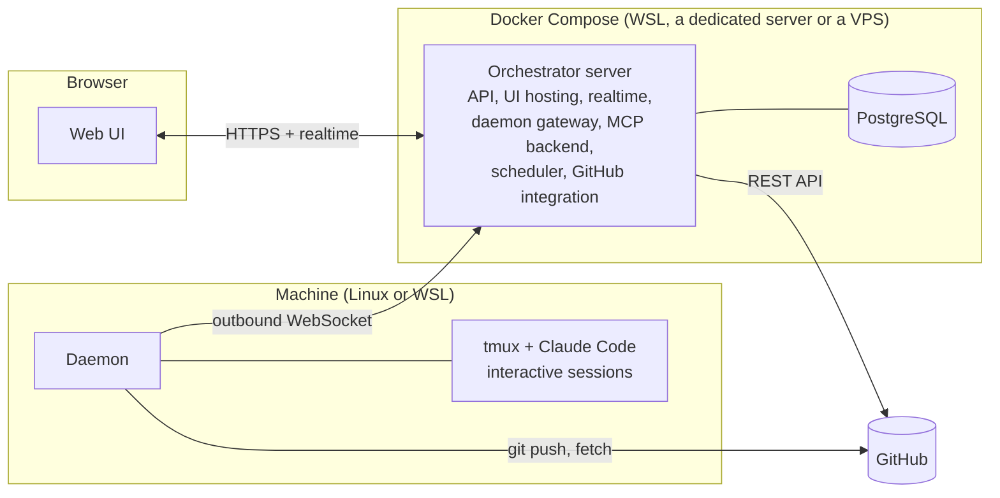

# 09 — Technical Architecture and Deployment

> Status: Draft v0.1
> Related: [00 — Vision and Scope](00-vision-and-scope.md), [05 — Daemon](05-daemon.md), [07 — Scheduler](07-scheduler.md), [08 — Harness](08-harness.md)

This document describes how the Orchestrator itself is built and deployed. Each technology choice listed here becomes an ADR in `docs/adr/` during the bootstrap of the Orchestrator's repository.

## 1. Overview



## 2. Repository structure

A single monorepo with pnpm workspaces.

```
apps/
  server/      Fastify server: API, realtime, daemon gateway, MCP backend, scheduler, GitHub integration
  web/         React UI (built and served by the server)
  daemon/      Daemon and its MCP relay (an npm package served by the server, 05 section 2)
packages/
  protocol/    Shared schemas: daemon messages, MCP tool inputs and outputs, API types
  db/          Database schema and migrations
agents/        Default agent instructions and run message templates (03)
docs/          specs/, user/, dev/, adr/ (08)
docker/        Dockerfile and compose files
```

`packages/protocol` is the contract between the three applications. Every message and tool input is defined once, as a schema that validates at runtime and produces TypeScript types.

## 3. Technology choices

| Area | Choice | Reason |
|---|---|---|
| Language | TypeScript everywhere | One language for server, UI and daemon; shared types. |
| Runtime | Node.js LTS | Required by Claude Code anyway; one runtime on machines. |
| Package manager | pnpm workspaces | Fast, strict, good monorepo support. |
| Server framework | Fastify | Lightweight, schema-based validation, WebSocket plugin. |
| Database | PostgreSQL | Chosen earlier; reliable, advisory locks for the scheduler. |
| Database access | Drizzle ORM with SQL migrations | Typed queries, readable migrations kept in the repository. |
| Validation | Zod | Runtime validation and types from the same schema. |
| UI | React + Vite + TanStack Query + Tailwind CSS | Common, well known by agents, fast builds. |
| Realtime to UI | Server-Sent Events | One direction is enough (server to browser); simpler than WebSocket. |
| Daemon connection | WebSocket | Two directions needed; outbound from the machine. |
| Tests | Vitest (unit, integration), Playwright (end-to-end) | Same tools as generated web projects (08, section 3.3). |
| Logs | Pino, JSON | Structured logs readable with `docker logs`. |

## 4. Server components

| Component | Responsibility |
|---|---|
| **API** | REST endpoints used by the UI. All inputs validated by schema. |
| **Realtime** | SSE stream pushing ticket changes, run logs, questions and quota state to the UI: one stream per logged-in browser, carrying "changed" messages (kind of entity, id, project) and notices of new run log entries (the run and its last entry number); the UI reloads what changed and fetches the log entries after the last one it holds (02, section 1; owner's decision, lot 2 step L). Changes reach the stream from the events they write, through PostgreSQL `LISTEN`/`NOTIFY`, so only saved changes are sent ([ADR 0029](../adr/0029-realtime-stream.md)). |
| **Downloads** | Serves the daemon package of the server's own version (`/downloads/orchestrator-daemon-<version>.tgz`, 05 section 2). |
| **Daemon gateway** | WebSocket endpoint for daemons: authentication, heartbeats, message routing, reconciliation (05, section 6). |
| **MCP backend** | Executes MCP tool calls relayed by daemons: permission checks, transitions, DoD checks (06). |
| **Scheduler** | Section 07. |
| **GitHub integration** | Repository creation and skeleton commit, pull requests, review comments, CI status, merge detection, and from 0.6.0 the automatic merge of projects with **Merge automatically** on (04, section 4). Polling at the **GitHub check interval** (60 seconds by default, 04 section 8) for tickets that wait on GitHub: CI of a pending submission, open pull requests; no webhooks (00, section 6). |
| **Event log** | Append-only events (01, section 3.10), feeding the activity views. |
| **Settings** | Global and per-project settings with defaults (04, section 8). |
| **Help** | Renders `docs/user/` inside the application. |

The server is a single process. Components are modules inside it, not separate services. This is enough for one user and keeps deployment to one container.

## 5. Security

| Topic | Decision |
|---|---|
| Owner authentication | One local account created by the setup wizard. Password hashed with Argon2, session cookie (HTTP-only, SameSite strict, `Secure` only when `PUBLIC_URL` is HTTPS). Failed logins are throttled per username and per client address: after a number of failures, an increasing delay (thresholds are settings; ADR 0015). |
| GitHub token | Entered in the UI, stored encrypted in the database with a key from the `ORCHESTRATOR_SECRET_KEY` environment variable. Never sent to the browser after being saved. If the key is lost or changed, the server still starts and "Needs you" asks to enter the token again (ADR 0016). |
| Machine tokens | Stored as hashes; revocable (05, section 3.1). |
| Run tokens | Random, scoped to one run, expire at run end (06, section 2). |
| Untrusted content | Markdown written by the owner or agents (descriptions, comments, requests, plans) is rendered in the UI without raw HTML, with links limited to `http`, `https` and `mailto`; it can never run a script (01, section 3.5). Images in it are shown as links, so viewing content never contacts another site. |
| Writes to the default branch | The daemon pushes only ticket branches and agents never push nor merge (05, section 4.6). From 0.6.0 (lot 5 step 5bis B) the server may write to a project's default branch in one way only: merging, with GitHub's merge endpoint, a ticket's open pull request from the project's own repository into the default branch, whose head is the commit Quality approved (passed as `sha`, so GitHub refuses any other head) and on which CI passed when read again just before, on a project where the owner turned on **Merge automatically** (off by default). It uses the token's existing Contents (Read and write); no new permission. The risk the owner accepts by turning it on: no human reads the change before it reaches the default branch; Quality's review and CI are the only checks, and an agent's work, or text it read, could mislead Quality. CI tested the pull request's head merged with the default branch as it was at the last push: another pull request merged since (automatically or by the owner) can put two changes on the default branch that were never tested together, with no Git conflict to stop it, so the default branch can break although each pull request passed CI; dependent tickets are not affected (they start after the merge), independent tickets waiting at the same time are. Help > Projects says so. |
| Network exposure | Local network or VPN only in v1. HTTPS through a reverse proxy recommended outside `localhost`. |
| Dependencies | Lock file committed; `pnpm audit` in CI, failing on critical vulnerabilities. |

## 6. Versioning and compatibility

- The server, UI and daemon share one version number, released together.
- The daemon protocol has its own version, sent in `hello`; lot 2 introduces version 1, also returned by `/version`. The server accepts the current and the previous protocol version and marks older daemons incompatible, with an update instruction in the UI.
- From the 0.3.0 release on, any change a released daemon cannot understand raises `PROTOCOL_VERSION` (`packages/protocol`), in the same change: the version number of a release alone never tells the server what a daemon understands (owner's decision, lot 2 step N).
- Lot 5 introduces protocol version 3 (owner's answer 1, lot 5 step A; 05, sections 4.1 and 4.2): planning runs without a ticket branch (a scratch folder for a new project), acceptance criteria numbered from 1 in `ticket_submit`, and the browser tests' folder and capability. A protocol 2 daemon stays connected but is unusable: it takes no run at all, and the queue and the machine page say "Update the daemon to 0.6.0" (owner's simplification, approval of lot 5 step A). `ticket_submit` therefore counts from 1 everywhere.
- Lot 3 introduces protocol version 2 (05, section 3.3). A daemon of the previous protocol is accepted but marked **unusable** when it cannot do what the server's runs need ("Daemon 0.3.0 is older than this Orchestrator (0.4.0): update it", with the update commands). Each daemon package also carries a build identifier, sent in `hello` and compared with the bundle the server serves: a different build of the same protocol is a warning, not a block (05, section 2; owner's decisions, lot 3 step A).
- Supported Claude Code versions (the minimum and the highest validated one) are declared once in `packages/protocol` and used by the daemon and the server (05, section 2). Unsupported versions make the machine unusable with a clear message; the connection stays open (05, section 3.2).

## 7. Deployment

### 7.1 Containers

| Container | Content |
|---|---|
| `orchestrator` | The server, with the built UI as static files. Runs database migrations at start. |
| `postgres` | PostgreSQL with a named volume. |

One compose file, `docker/compose.yml`, for all targets, configured by environment variables. `docker/compose.dev.yml` runs only PostgreSQL for development and integration tests.

Environment variables:

| Variable | Purpose |
|---|---|
| `DATABASE_URL` | PostgreSQL connection. |
| `ORCHESTRATOR_SECRET_KEY` | Encryption key for stored secrets. Must be backed up. |
| `PUBLIC_URL` | URL used in enrollment commands and links. Optional: defaults to `http://localhost:<PORT>`; set it for access from another host, through a reverse proxy or over HTTPS. |
| `PORT` | HTTP port (default 8080). |
| `LOG_LEVEL` | Log verbosity. |

Health endpoint `/health` for Docker health checks; `/version` returns server and protocol versions, and the build of the daemon package the server serves (null when it was not built; lot 3 step B).

### 7.2 Targets

| Target | Notes |
|---|---|
| **WSL (first)** | Docker Engine inside WSL or Docker Desktop. Daemon on the same WSL instance connects to `http://localhost:8080`. |
| **Dedicated server** (the future host; owner's decision, lot 5 step A) | A Linux server running Docker Compose. Daemons on other computers connect to its address through **HTTPS** (a reverse proxy): the daemon accepts plain `http://` for `localhost` only, because the machine token and the GitHub token for Git commands travel on its connection (05, section 3.2). The Help section [Orchestrator on another computer](../user/machines.md#orchestrator-on-another-computer) explains it. |
| **VPS** | Behind a VPN (for example Tailscale); reverse proxy with HTTPS, required by daemons as for a dedicated server. Daemons connect through the VPN. |

The daemon is never containerised (05, section 2).

### 7.3 Backups

- The only state to back up is the PostgreSQL database and the `ORCHESTRATOR_SECRET_KEY`. Code lives on GitHub.
- A `backup` command in the container produces a `pg_dump` file; the user documentation explains how to schedule it on each target and how to restore.

### 7.4 Owner password reset

The owner account has no email address (01, section 3.11). A forgotten password is reset from the host with a command run inside the server container:

```
docker compose -f docker/compose.yml exec orchestrator orchestrator reset-password
```

It asks for the new password interactively (never as an argument, so it does not stay in the shell history), applies the minimum length, revokes all sessions and writes an event. The user documentation explains it.

## 8. Observability

- Structured logs with the run id, ticket number and machine in every related line.
- The UI shows the event log per ticket, per run and per machine.
- Daemon logs are local (journald through systemd) and summarised in heartbeats; `orchestrator-daemon status` and `doctor` help diagnose a machine.
