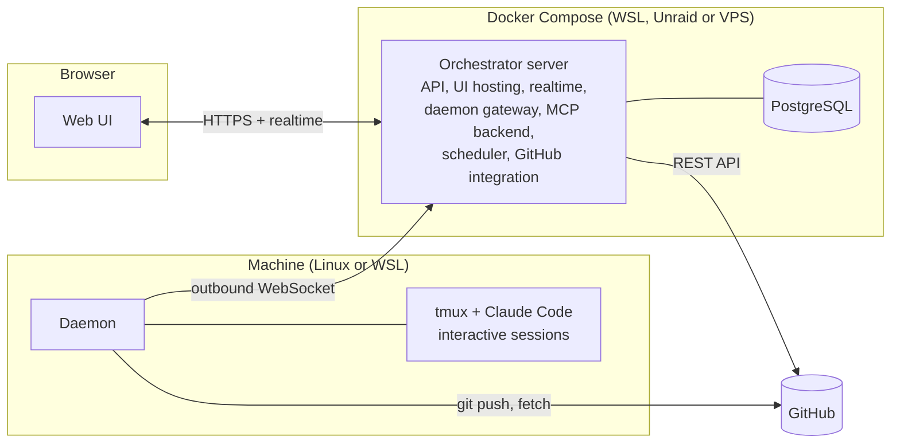

# 09 — Technical Architecture and Deployment

> Status: Draft v0.1
> Related: [00 — Vision and Scope](00-vision-and-scope.md), [05 — Daemon](05-daemon.md), [07 — Scheduler](07-scheduler.md), [08 — Harness](08-harness.md)

This document describes how the Orchestrator itself is built and deployed. Each technology choice listed here becomes an ADR in `docs/adr/` during the bootstrap of the Orchestrator's repository.

## 1. Overview



## 2. Repository structure

A single monorepo with pnpm workspaces.

```
apps/
  server/      Fastify server: API, realtime, daemon gateway, MCP backend, scheduler, GitHub integration
  web/         React UI (built and served by the server)
  daemon/      Daemon and its MCP relay (published as an npm package)
packages/
  protocol/    Shared schemas: daemon messages, MCP tool inputs and outputs, API types
  db/          Database schema and migrations
agents/        Default agent instructions and run message templates (03)
docs/          specs/, user/, dev/, adr/ (08)
docker/        Dockerfile and compose files
```

`packages/protocol` is the contract between the three applications. Every message and tool input is defined once, as a schema that validates at runtime and produces TypeScript types.

## 3. Technology choices

| Area | Choice | Reason |
|---|---|---|
| Language | TypeScript everywhere | One language for server, UI and daemon; shared types. |
| Runtime | Node.js LTS | Required by Claude Code anyway; one runtime on machines. |
| Package manager | pnpm workspaces | Fast, strict, good monorepo support. |
| Server framework | Fastify | Lightweight, schema-based validation, WebSocket plugin. |
| Database | PostgreSQL | Chosen earlier; reliable, advisory locks for the scheduler. |
| Database access | Drizzle ORM with SQL migrations | Typed queries, readable migrations kept in the repository. |
| Validation | Zod | Runtime validation and types from the same schema. |
| UI | React + Vite + TanStack Query + Tailwind CSS | Common, well known by agents, fast builds. |
| Realtime to UI | Server-Sent Events | One direction is enough (server to browser); simpler than WebSocket. |
| Daemon connection | WebSocket | Two directions needed; outbound from the machine. |
| Tests | Vitest (unit, integration), Playwright (end-to-end) | Same tools as generated web projects (08, section 3.3). |
| Logs | Pino, JSON | Structured logs readable with `docker logs`. |

## 4. Server components

| Component | Responsibility |
|---|---|
| **API** | REST endpoints used by the UI. All inputs validated by schema. |
| **Realtime** | SSE stream pushing ticket changes, run logs, questions and quota state to the UI. |
| **Daemon gateway** | WebSocket endpoint for daemons: authentication, heartbeats, message routing, reconciliation (05, section 6). |
| **MCP backend** | Executes MCP tool calls relayed by daemons: permission checks, transitions, DoD checks (06). |
| **Scheduler** | Section 07. |
| **GitHub integration** | Repository creation and skeleton commit, pull requests, review comments, CI status, merge detection. Polling every 60 seconds for tickets that wait on GitHub; no webhooks (00, section 6). |
| **Event log** | Append-only events (01, section 3.10), feeding the activity views. |
| **Settings** | Global and per-project settings with defaults (04, section 8). |
| **Help** | Renders `docs/user/` inside the application. |

The server is a single process. Components are modules inside it, not separate services. This is enough for one user and keeps deployment to one container.

## 5. Security

| Topic | Decision |
|---|---|
| Owner authentication | One local account created by the setup wizard. Password hashed with Argon2, session cookie (HTTP-only, SameSite strict). |
| GitHub token | Entered in the UI, stored encrypted in the database with a key from the `ORCHESTRATOR_SECRET_KEY` environment variable. Never sent to the browser after being saved. |
| Machine tokens | Stored as hashes; revocable (05, section 3.1). |
| Run tokens | Random, scoped to one run, expire at run end (06, section 2). |
| Network exposure | Local network or VPN only in v1. HTTPS through a reverse proxy recommended outside `localhost`. |
| Dependencies | Lock file committed; `pnpm audit` in CI, failing on critical vulnerabilities. |

## 6. Versioning and compatibility

- The server, UI and daemon share one version number, released together.
- The daemon protocol has its own version, sent in `hello`. The server accepts the current and the previous protocol version and marks older daemons incompatible, with an update instruction in the UI.
- Supported Claude Code versions are declared by the daemon (05, section 2). Unsupported versions make the machine unusable with a clear message.

## 7. Deployment

### 7.1 Containers

| Container | Content |
|---|---|
| `orchestrator` | The server, with the built UI as static files. Runs database migrations at start. |
| `postgres` | PostgreSQL with a named volume. |

One compose file, `docker/compose.yml`, for all targets, configured by environment variables. `docker/compose.dev.yml` runs only PostgreSQL for development and integration tests.

Environment variables:

| Variable | Purpose |
|---|---|
| `DATABASE_URL` | PostgreSQL connection. |
| `ORCHESTRATOR_SECRET_KEY` | Encryption key for stored secrets. Must be backed up. |
| `PUBLIC_URL` | URL used in enrollment commands and links. |
| `PORT` | HTTP port (default 8080). |
| `LOG_LEVEL` | Log verbosity. |

Health endpoint `/health` for Docker health checks; `/version` returns server and protocol versions.

### 7.2 Targets

| Target | Notes |
|---|---|
| **WSL (first)** | Docker Engine inside WSL or Docker Desktop. Daemon on the same WSL instance connects to `http://localhost:8080`. |
| **Unraid** | Compose stack (Compose Manager plugin) or two containers. Daemons on the local network connect to the Unraid address. |
| **VPS** | Behind a VPN (for example Tailscale); reverse proxy with HTTPS. Daemons connect through the VPN. |

The daemon is never containerised (05, section 2).

### 7.3 Backups

- The only state to back up is the PostgreSQL database and the `ORCHESTRATOR_SECRET_KEY`. Code lives on GitHub.
- A `backup` command in the container produces a `pg_dump` file; the user documentation explains how to schedule it on each target and how to restore.

### 7.4 Owner password reset

The owner account has no email address (01, section 3.11). A forgotten password is reset from the host with a command run inside the server container:

```
docker compose -f docker/compose.yml exec orchestrator orchestrator reset-password
```

It asks for the new password interactively (never as an argument, so it does not stay in the shell history), applies the minimum length, revokes all sessions and writes an event. The user documentation explains it.

## 8. Observability

- Structured logs with the run id, ticket number and machine in every related line.
- The UI shows the event log per ticket, per run and per machine.
- Daemon logs are local (journald through systemd) and summarised in heartbeats; `orchestrator-daemon status` and `doctor` help diagnose a machine.
